# 远程会诊平台 —— 从需求调研到可运行原型

用 **Vue 3 + TypeScript + 契约包先行** 的方式，把《医疗软件设计进阶四部曲》的图纸落成一套能点、能流转、能拦截的会诊工作台。状态机、脱敏、合规校验、错误码分段全部有唯一真相源，页面不许自己发明第二套。

> **边界**：本项目是**演示切片**，不是生产系统。数据来自内存 mock，刷新即重置；登录与菜单为 dev 直通；只有「会诊工单」一个业务域走通闭环，病历、记录、审计三个域仅占位。医疗合规相关的规则以 `shared/` 里的契约为准，不以本 README 的表述为准。

---

## 演示

三段录屏，都带鼠标轨迹：

| 片段 | 时长 | 内容 |
|---|---|---|
| [demo.mp4](https://cdn.jsdelivr.net/gh/ZhenSiRong/remote-consultation-platform@master/docs/demo.mp4) | 58 秒 | 工单闭环：列表 → 详情 → 受理 → 排期 → 开始 → 非法流转被拦 |
| [demo-room.mp4](https://cdn.jsdelivr.net/gh/ZhenSiRong/remote-consultation-platform@master/docs/demo-room.mp4) | 1 分 43 秒 | 视频会诊室完整流程（测试信号源）：设备检测 → 入会 → 录制提示 → 消息 → 资料 → 结束会诊 |
| [demo-room-live.mp4](https://cdn.jsdelivr.net/gh/ZhenSiRong/remote-consultation-platform@master/docs/demo-room-live.mp4) | 25 秒 | 真实摄像头接入：本地小窗是物理设备画面，人脸区域已做箱式模糊 |

> 为什么真实采集单独录一段：同一台机器上两个 Chrome 实例会抢同一个摄像头（Windows 下多数 USB 摄像头是独占设备），第二个实例 `getUserMedia` 直接失败。所以完整流程用测试信号源（`--use-fake-device-for-media-stream`）录，保证可复现；真实摄像头能力单独录 25 秒佐证。打码是后期对小窗区域做箱式模糊——`<video>` 加 CSS `filter` 的方案在有头模式下没生效（注入时机在页面重挂载前），所以改用 ffmpeg 裁剪+模糊+叠回，坐标按 1440×810 视口固定。

录屏里红色圆环是注入的光标指示器，点击时落点炸开红色涟漪——不是后期加的特效，是 `补充物/tools/record.mjs` 在 CDP 层注入的 DOM，配合缓动插值的鼠标轨迹，让「点了哪里、点了什么」在无声视频里也能看清。

工单闭环的演示路径：

```
工单列表（5 页签 / 12 条）
  → 切「待受理」（4 条）
  → 搜索「李」（3 条）
  → 点行进详情
  → 受理（状态转「已受理」，色点变主色）
  → 排期（转「排期待开始」，回填排期时间）
  → 开始会诊（转「进行中」，色点改呼吸动画）
  → 点「演示：跳过受理直接归档」→ 后端返回 20005，顶部红条，状态不回滚
```

| 列表 | 详情 | 非法流转被拦 |
|---|---|---|
| 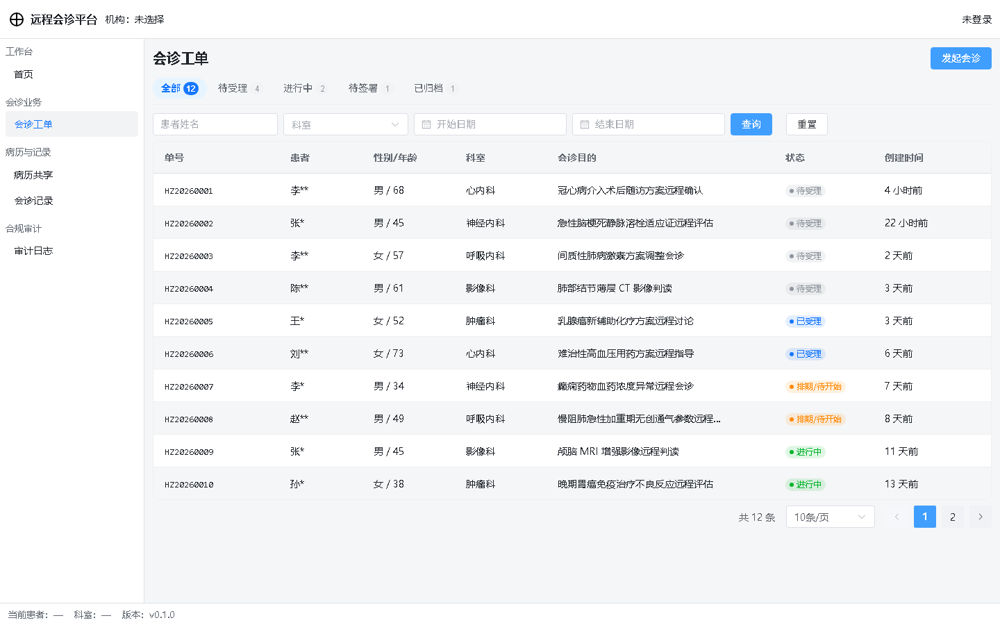 | 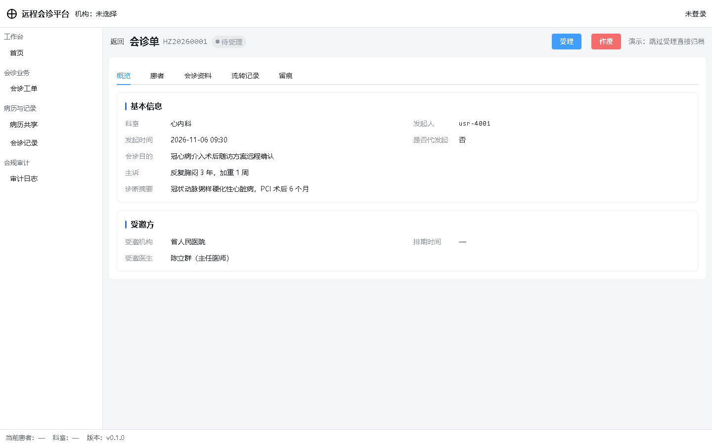 | 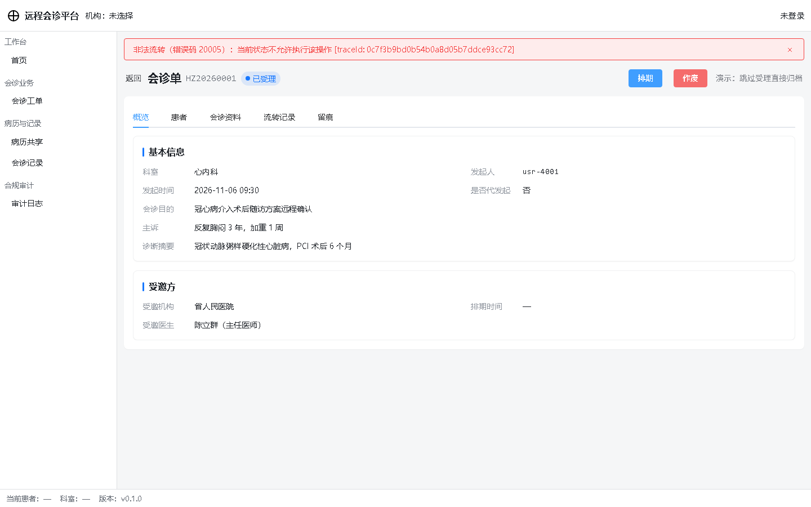 |

---

## 1. 这是什么

三条线并行，但**只有第三条能跑**：

| 线 | 内容 | 状态 |
|---|---|---|
| **课程图纸** | 四部曲：需求调研 → 布局调查与设计 → 软件升级七步法 → 方法论迁移 | 文档级完成，见第 10 节 |
| **契约包** | `shared/`：71 个 Zod schema、54 个类型、12 个权限点、66 格角色矩阵、23 个错误码、5 组字典、3 个外部能力 port | 完成，两端共用 |
| **可运行原型** | 会诊工单域完整闭环 + 视频会诊室（真实 WebRTC P2P）：列表 → 详情 → 状态流转 → 发起 → 合规拦截 → 会前检测 → 会中协作 → 结束小结 | 本仓库主体 |

为什么要先有契约包：前后端如果各写一份类型，接口一改就是两处改、两处漏。`shared/` 是同一份 Zod schema，前端 `import type` 拿类型、运行时 `parse()` 做校验，后端将来直接拿同一个包做 DTO 校验。**mock 也必须过 schema**——数据字段对不上要在模块加载时当场炸，而不是等页面显示 `undefined` 才发现。

## 2. 快速开始

```bash
npm install                 # 一次装齐前端 + shared + server
npm run build:shared        # shared 是 CJS 构建产物，server 端要它
npm run dev                 # 终端 1：前端 http://localhost:5173
npm run dev:server          # 终端 2：后端 http://localhost:3000（视频会诊室需要）
```

前三条就能跑完整个工单闭环——mock 是 axios adapter，挂在请求实例上，不需要后端。**只有视频会诊室要连真后端**（信令走 SSE/POST，绕开 axios，mock 拦不到），所以第 4 条只在需要看真实视频时启动。

不需要数据库、不需要配置。`VITE_USE_MOCK=false` 一行即可把工单接口切到真后端。

自检：

```bash
npm run typecheck              # shared + 前端 vue-tsc
node 补充物/tools/verify.mjs      # 18 项工单闭环断言（需 dev 已启动）
node 补充物/tools/verify-rtc.mjs  # 7 项 WebRTC 断言（需 dev + server 都启动）
```

## 3. 功能演示

### 3.1 工单列表：5 个页签 + 四条件搜索


- 页签：全部 12 / 待受理 4 / 进行中 2 / 待签署 1 / 已归档 1。徽标数字由 `/consultations/counts` 实时算，`0` 也照常渲染，不留空白
- 搜索：患者姓名（模糊）、科室（下拉）、开始/结束日期。回车即查，`page` 自动回 1
- 患者列直接渲染 `patient.nameMasked`（如 `李**`）。**脱敏发生在后端**，前端不解掩码、也不负责脱敏——这是 R8 的责任边界，不是省事
- 状态列是色点 + 中文，色值只来自 `CONSULT_STATUS_META` 的 token，页面里没有一处十六进制
- 时间列用相对时间（`4 小时前`），超 30 天回落绝对日期

### 3.2 详情页与状态流转


5 个 tab：概览 / 患者 / 会诊资料 / 流转记录 / 留痕。

**动作条是本项目唯一不可 mock 的业务逻辑**。它只做一件事：问状态机「当前状态允许哪些动作」，然后把返回的动作渲染成按钮。

- 待受理 → 只有 `{受理, 作废}`
- 已受理 → 只有 `{排期, 作废}`
- 进行中 → 只有 `{结束会诊, 作废}`
- 已归档 / 已作废 → 无动作，显示灰字

作废必须填原因，原因为空时确认按钮 `disabled`。归档要二次确认「请确认各方已签署」。

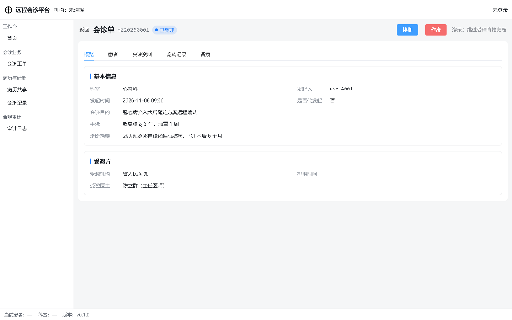

### 3.3 发起会诊与合规前置

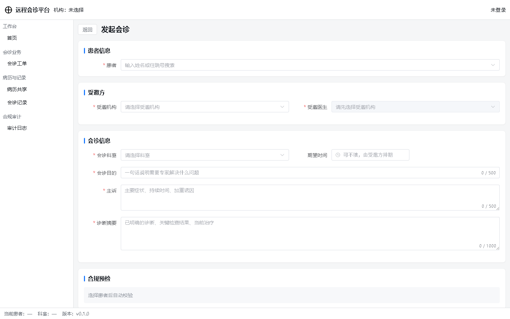

4 个分组：患者 / 受邀方 / 会诊信息 / 合规预检。

合规预检不是装饰。选中患者后自动调 `/consultations/precheck`，返回 4 项固定结论：

| 项 | 规则 | 不通过的后果 |
|---|---|---|
| 患者知情同意 | R4 | 阻断，错误码 `20003` |
| 受邀机构协议已签署 | R1 | 阻断，错误码 `20001` |
| 医师执业范围匹配 | R5 | 阻断，错误码 `20004` |
| 电子签名证书有效 | R6 | 阻断，错误码 `40003` |

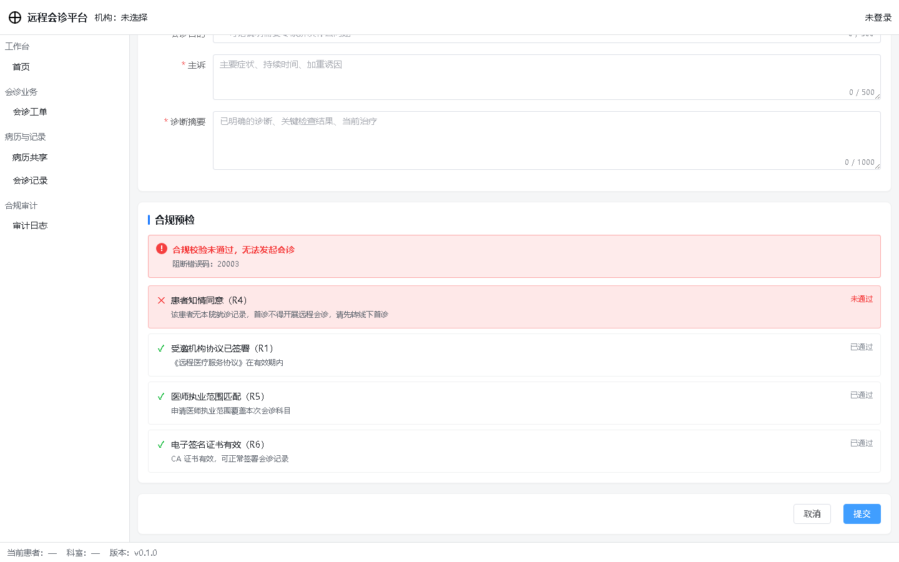

首诊患者在下拉里直接置灰——能在选择阶段拦住的，不留到提交后才报错。但如果绕过下拉（比如深链 `?patientId=pat-1005`），点提交仍会被拦：

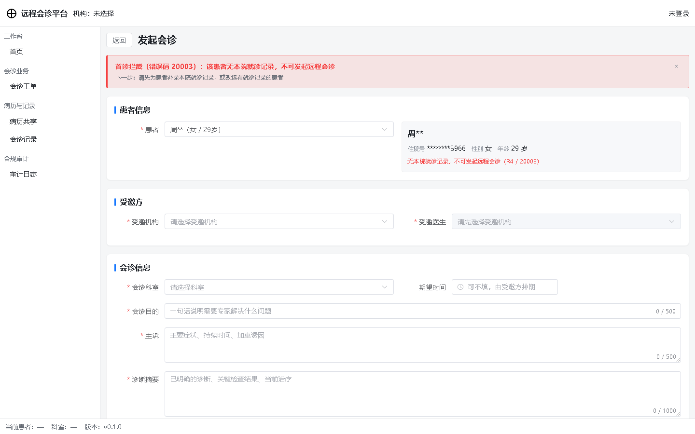

这里有个刻意的设计：**预检阻断时提交按钮不置灰**。按钮灰着点不动，观众只看到「不能点」，学不到「首诊不得发起远程会诊」这条规则。所以改成可点，点击后本地判定 `blocked` 并渲染红条，不发请求；若真发了请求后端仍返回 `20003`（预检过期等竞态），走同一个渲染函数，不写两套文案。

### 3.4 视频会诊室

形态参考 BOSS 直聘的「面试间」：会前检测 → 入会 → 主画面 + 本地小窗 → 底部控制条 → 右侧栏。但医疗场景多三样东西：**患者信息常驻**、**录制合规提示**、**主持人控场权**。

| 会前设备检测 | 会诊室 | 结束会诊 |
|---|---|---|
| 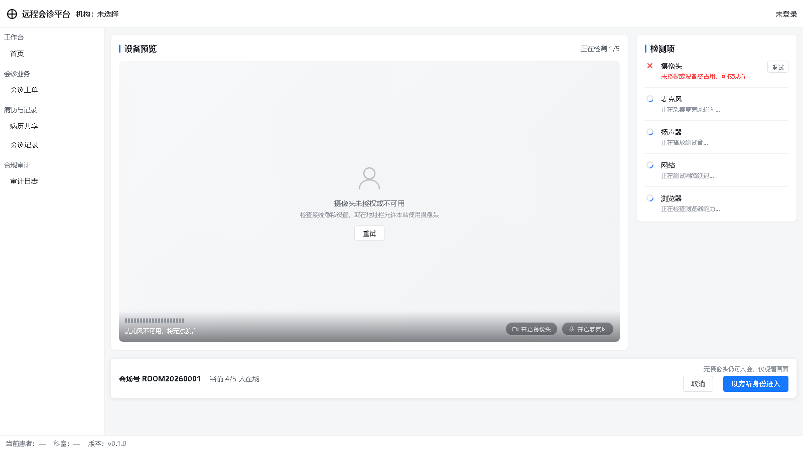 | 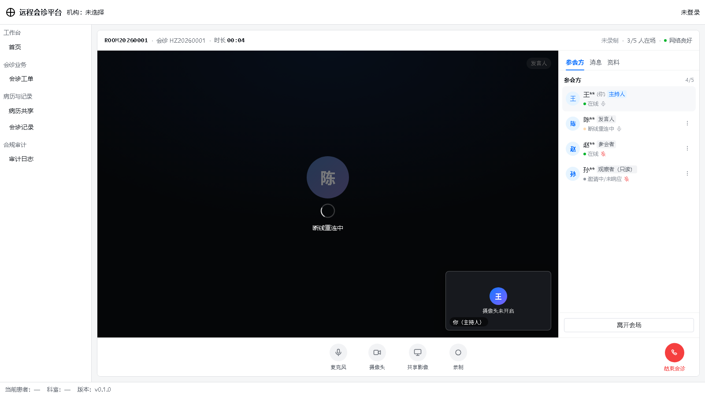 | 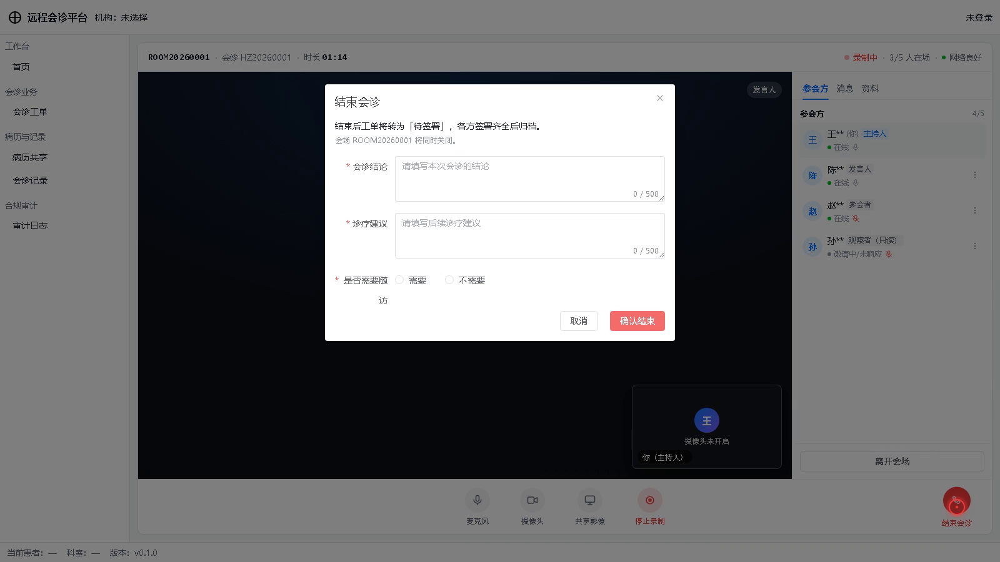 |

**会前检测**（`/consult/:id/room/precheck`）：摄像头预览、麦克风实时音量条、5 项检测（摄像头 / 麦克风 / 扬声器 / 网络 / 浏览器）。检测项逐项点亮，约 1.5 秒出结果。

摄像头不可用时**不阻断入会**——按钮文案改为「以旁听身份进入」，并在上方说明「无摄像头仍可入会，仅观看画面」。这条降级路径在无摄像头的 CI 环境里是默认路径，所以它必须能用，不能只是兜底。

**会诊室**（`/consult/:id/room`）：

| 区域 | 内容 |
|---|---|
| 顶部 | 会场号 · 会诊单号 · 时长计时（每秒刷新）· 录制红点 · 在线人数 · 网络状态 |
| 主画面 | 远端专家，占位为深色底 + 首字头像 + 姓名 + 在线态；断线时叠加遮罩 |
| 本地小窗 | 右下角 240×135，点一下可切换主次画面 |
| 底部控制条 | 麦克风 / 摄像头 / 共享影像 / 录制 / 结束会诊 |
| 右侧栏 | 参会方 / 消息 / 资料 三个 tab |

**三个值得说的实现**：

1. **参会方在线态用 5 态字典**（`ONLINE` / `BUSY` / `INVITING` / `RECONNECTING` / `LEFT`），色值和动画全部来自 `ROOM_PRESENCE_META`，页面不挑颜色。`RECONNECTING` 带呼吸动画，`INVITING` 表示「邀请了但还没进会场」——这也是为什么会场 4 人却只有 3 个在线。
2. **断线是演练出来的，不是真断网**：mock 按轮询次数制造变化，第 3 次拉取让专家转 `RECONNECTING`，第 5 次转回 `ONLINE`。这样演示时能看到黄色呼吸态和主画面遮罩，而不用真拔网线。
3. **控场权只认字典**：`ROOM_ROLE_META[role].canControl` 为 `true` 才会渲染「⋮」菜单，不写 `role === 'HOST'`。将来加「联席主持人」，改 `shared/` 即可，页面自动跟上。

**录制合规**（R13）：首次进入且会场处于录制中时，弹一次提示「本次会诊将被录制，用于病历留痕与质量复核」，确认后本次会话不再弹。这不是弹窗礼仪，是合规要求——录制必须被告知。

**结束会诊**：填会诊结论、诊疗建议、是否需要随访（三项必填），确认后工单转「待签署」，会场同时关闭。小结内容本切片不落库（记录域接口在 W7），只走状态流转。

### 3.5 真实音视频：A 档 P2P

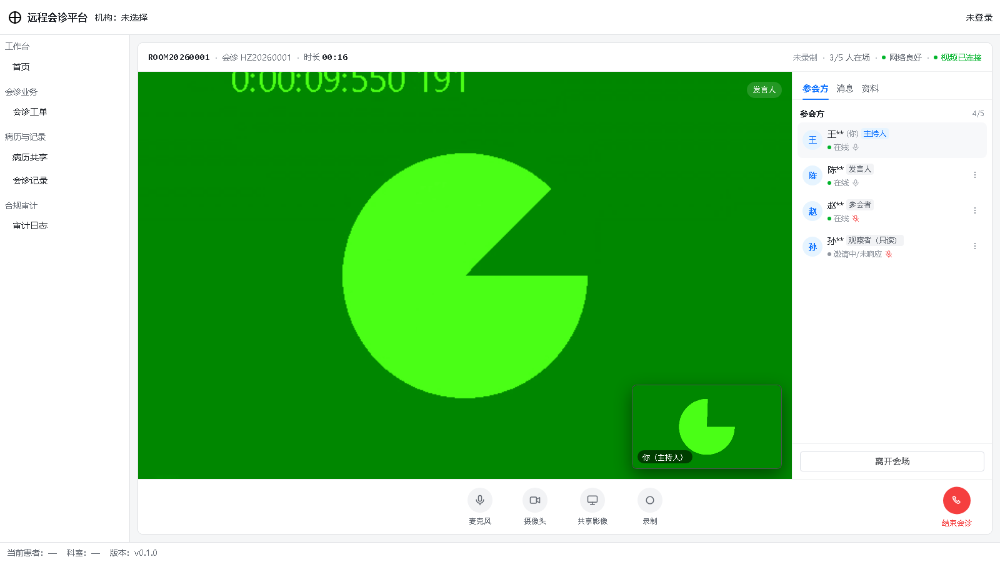

上图是真的视频画面——绿色是 Chrome 的 fake camera（测试设备），不是模拟图。两端各自 `state === 'connected'`，远端流里 `audio + video` 两条轨都在，`videoWidth` 非零说明帧真的解码出来了。

**信令为什么不用 WebSocket**：`server/` 原本没有任何 `ws` / `socket.io` 依赖，为了不引入新包，信令走 **SSE（收）+ POST（发）** 纯 HTTP：`GET /rtc/signal/stream` 保持长连接接收，`POST /rtc/signal` 发送 SDP/ICE。信令本身是低频的（一次会诊几十条），SSE 完全够用，而且浏览器原生 `EventSource` 自带断线重连。

**一个必须分开的东西：业务身份 ≠ 信令身份**。

| 用途 | 取值 | 为什么 |
|---|---|---|
| 业务身份 | `host-local`（固定） | 参会方列表标「(你)」、HOST 权限判断 |
| 信令身份 | `host-local-${6位随机}`（每次加载一个） | 服务端房间表是 `Map<participantId, conn>`，两个标签同 id 会互相顶掉 |

这个坑很阴：被顶掉的那条连接**不报错也不关闭**，只是再也收不到帧。现场表现是「两个人都显示在线，对面永远是黑的」。

**验证方法**（不是看页面有没有报错）：

```bash
node 补充物/tools/verify-rtc.mjs
```

脚本开两个独立浏览器实例（带 `--use-fake-device-for-media-stream`），各自加载会诊室，然后从 WebRTC 层面判定：信令房间有 2 个唯一连接、两端都有远端 `<video>`、`videoWidth > 0`（真的解码出帧，而不只是挂了个空流）、断开后房间回收。当前 **7/7 通过**。

> **演示前先清场**：服务端不区分「脚本连接」和「真人连接」，同一个 roomId 下的所有连接都会互相看见。如果 verify 脚本或别的标签还在 `ord-0001` 房间里，演示时的 offer 可能发给那一路沉默的连接，页面就会卡在「正在建立视频连接」。跑演示或验证前先确认房间是空的：
>
> ```bash
> curl -s http://localhost:3000/rtc/signal/rooms
> ```
>
> 非空就重启 server（房间表在内存），或换一个没被碰过的会诊单号。

**能力边界**：只支持 2 方、无 TURN（对称 NAT 连不上）、无服务端录制、无 Simulcast。什么时候必须升级到云 SDK 或自建 SFU，见 [`补充物/RTC接入指南.md`](补充物/RTC接入指南.md)——里面有升级判据、接入点、成本表和迁移时哪些文件一行不用改。

## 4. 状态机：唯一的业务真相

7 个主态，`shared/src/dict/consult-status.ts` 是唯一来源：

| 状态 | 中文 | 装饰 | 终态 |
|---|---|---|---|
| `PENDING_ACCEPT` | 待受理 | 实心点（灰） | 否 |
| `ACCEPTED` | 已受理 | 实心点（蓝） | 否 |
| `SCHEDULED` | 排期/待开始 | 实心点（橙） | 否 |
| `IN_PROGRESS` | 进行中 | **呼吸点**（绿） | 否 |
| `PENDING_SIGN` | 待签署 | 实心点（紫） | 否 |
| `ARCHIVED` | 已归档 | **对勾 + 文字降透明度** | 是 |
| `VOIDED` | 已作废 | 实心点（红） | 是 |

「进行中」与「已归档」**同色**是故意的：不新增颜色，用形状（呼吸点 vs 对勾）和字重区分。改色必须先改字典，页面不许自己挑颜色。

流转表在 `src/domain/consult/stateMachine.ts`，页面和 mock **都调它**：

```
PENDING_ACCEPT --ACCEPT--> ACCEPTED
ACCEPTED       --SCHEDULE--> SCHEDULED
SCHEDULED      --START--> IN_PROGRESS
IN_PROGRESS    --FINISH--> PENDING_SIGN
PENDING_SIGN   --ARCHIVE--> ARCHIVED
任意非终态      --VOID--> VOIDED
```

非法流转返回 `20005`，前端红条展示错误码 + traceId，并静默重拉详情——**不做乐观更新，状态不回滚**。

## 5. 契约先行：错误码分段与 traceId

错误码按域分段，前端只需看第一位数就知道该怎么处理：

| 段 | 域 | 前端行为 |
|---|---|---|
| `0` | 成功 | 正常渲染 |
| `1xxxx` | 通用/会话 | 统一提示；`10002` 跳登录，`10003` 无权限页 |
| `2xxxx` | 会诊工单 | 拦截类必须给出「原因 + 下一步」 |
| `3xxxx` | 病历/授权 | `30002` 重新申请授权，`30003` 告警并留痕 |
| `4xxxx` | 记录/签署 | `40002` 高亮未签方 |
| `5xxxx` | 音视频/协同 | 降级提示 + 重试入口 |
| `6xxxx` | 合规/审计 | `60001` fail-closed，阻断当前操作 |
| `9xxxx` | 系统 | 错误页 + 展示 traceId 供报障 |

HTTP 状态码只承载传输与会话层语义（401/403/429/5xx），**业务规则失败统一 422 + code 细分**。

每次请求前端生成 32 位 hex 的 traceId 写入 `X-Trace-Id`，后端回填到响应体，留痕与排障共用同一个 ID。所以红条里能直接给出 `[traceId: 202bc2ea...]`——用户报障时报这一串就够。

## 6. 验收：18 项端到端断言

`补充物/tools/verify.mjs` 用 CDP 真点真跑，每条断言都从**渲染后的 DOM** 取证据，不读内存变量——mock 阶段读变量太容易自欺。

```
1. 列表页     5 个页签 / 徽标全非空 / 全部=12 / 患者列匹配 /^李\*/ /
              状态色点全部实色 / 首页 10 行
2. 搜索       搜「李」→ 3 行
3. 详情       点行进入 /consult/ord-0001 / 动作集合 = {ACCEPT, VOID} /
              不出现 START、FINISH、ARCHIVE / 初始状态「待受理」
4. 流转       受理后状态「已受理」/ 色点变 rgb(22, 119, 255)
5. 非法流转   演示按钮触发 20005 红条 / 状态不回滚
6. 首诊拦截   合规阻断面板出现 / 点提交出现 20003 拦截条
7. 可追溯     traceId 为 16–32 位 hex
```

当前结果：**18 / 18 通过**。

## 7. 目录

```
远程会诊平台/
├── shared/                  # 契约包（两端共用，冻结）
│   └── src/
│       ├── schemas/         # 71 个 Zod schema，按域分文件
│       ├── types/           # 从 schema 推导的类型
│       ├── dict/            # 5 组字典：状态/标记/留痕动作/会场/签名核验
│       ├── errors/          # 23 个错误码 + 分段元数据
│       ├── authz/           # 12 个权限点 + 66 格角色矩阵
│       └── ports/           # 3 个外部能力接口（DICOM/RTC/签名），只定不实现
├── src/
│   ├── api/                 # request 层（traceId + code 分流）+ 13 个业务函数（工单 6 + 会场 7）
│   ├── mock/                # axios adapter + 12 条工单种子 + 4 人会场 + 14 个 handler
│   ├── domain/              # 状态机 / 脱敏 / 权限 / 留痕动作 / 会场在线态
│   ├── composables/         # useRtc（WebRTC P2P 与信令）/ usePermission
│   ├── components/          # 10 个基础积木 + 4 个业务组件（动作条 / 合规面板 / 侧栏 / 结束弹窗）
│   ├── views/               # 9 个页面（工单 3 页 + 会诊室 2 页 + 其余占位）
│   ├── layouts/             # 四层骨架：顶栏 / 侧栏 / 主区 / 状态栏
│   ├── router/              # 8 条路由 + 守卫 + 菜单
│   └── styles/              # tokens.css（全仓唯一允许出现十六进制的地方）
├── server/                  # NestJS：/health + 8 个域模块（空壳）+ RTC 信令（已实现）
│   └── src/modules/rtc/     # SSE + POST 信令，内存房间表
├── 交付物/                   # 课程要求的四部曲文档
├── 补充物/                   # WBS / 架构决策 / RTC 指南 / 工具链
│   ├── RTC接入指南.md        # B/C 档升级路径（给后人的交接文档）
│   └── tools/
│       ├── record.mjs       # 带鼠标轨迹的录屏引擎
│       ├── verify.mjs       # 18 项工单闭环验收
│       ├── verify-rtc.mjs   # 7 项 WebRTC 验收（双浏览器实例）
│       ├── shoot.mjs        # 截图引擎
│       └── docx2md.py       # docx → md 转换
└── docs/
    ├── demo.mp4             # 工单闭环录屏（58 秒）
    ├── demo-room.mp4        # 会诊室完整流程（测试信号源，1 分 43 秒）
    ├── demo-room-live.mp4   # 真实摄像头 25 秒（人脸已打码）
    └── screenshots/         # 13 张实证截图
```

## 8. 已知限制（务必先读）

| 限制 | 原因 | 影响 |
|---|---|---|
| ⚠️ 数据不持久 | mock 在内存里，刷新即重置 | 演示时不要刷新页面；新建的工单刷新后消失 |
| ⚠️ 登录/菜单是 dev 直通 | `guard.ts` 恒放行，`usePermission` 返回 `['*']` | 看不到权限拦截效果；路由 `meta.permission` 目前不生效 |
| ⚠️ 只有会诊域可用 | 本期只做 consult 一个闭环 | 病历/记录/审计三页是占位，点了没有内容 |
| ⚠️ 未接 VxeTable / ECharts | 表格用原生 `<table>` + el-pagination | 无虚拟滚动、无列冻结，分页上限 100 |
| ⚠️ 合规预检是固定结论 | 4 项判定写死在 mock handler 里 | 换患者只变 R4 一项，其余恒「已通过」 |
| ⚠️ 权限点只有 create/invite | `shared` 的 consult 段只有这两个 | 动作可见性由**状态机**控制，不由权限点控制 |
| ⚠️ 受邀方名称走字典接口 | 契约里只有 `invitedOrgId`，没有名称字段 | 字典拉取失败时回落显示 ID，不影响详情渲染 |
| ⚠️ 发起人 `usr-*` 显示裸 ID | 医生字典里没有这个 id | 属预期行为，不是 bug |
| ⚠️ 视频只支持 2 方 P2P | A 档实现，无 SFU | 第 3 人进入会替换第 2 人；多学科会诊需升 B/C 档 |
| ⚠️ 无 TURN | 只配了公共 STUN | 对称 NAT / 严格企业防火墙下两端连不上 |
| ⚠️ 信令无鉴权 | 知道 roomId 即可入会 | 上线前必须补 token 校验与留痕 |
| ⚠️ 信令房间表在内存 | 服务重启丢房间 | 多实例部署需 Redis pub/sub |
| ⚠️ 强杀浏览器后房间表延迟回收 | TCP 半开，服务端 socket 看起来健康，`close` 不触发 | 正常关标签 0.3–0.4 秒即回收；强杀进程要等心跳写失败（20–40 秒）。残留的是旧信令 id 的幽灵成员，因为 id 每会话唯一，不会顶掉新连接 |
| ⚠️ 摄像头需浏览器授权 | `getUserMedia` 走浏览器权限 | 拒绝授权或 headless 环境会走降级路径（旁听身份进入） |
| ⚠️ 会场消息不落库 | 消息只在前端内存 | 刷新后回到预置的 3 条 |
| ⚠️ 会诊小结不落库 | 记录域接口在 W7 | 结束会诊只走状态流转，结论/建议/随访不入库 |
| ⚠️ 会场状态与工单状态分离 | 契约如此（`3.3D`） | 会场 CLOSED ≠ 工单 ARCHIVED，两者独立生命周期 |

**演示前请重启 dev**：mock 状态在模块内存里，跑过一遍流转后种子数据就变了，重启才能回到 12 条。

## 9. 非目标

- 不做多方 SFU 与云 SDK（A 档只做 2 方 P2P；升级路径、成本、验收判据见 [`补充物/RTC接入指南.md`](补充物/RTC接入指南.md)）
- 不做 DICOM 影像解析（`ports/dicom-provider.ts` 同理）
- 不做电子签名（`ports/signature-provider.ts` 同理）
- 不做患者端（本期只做医护侧，患者端 story 已移出）
- 不做真实后端（NestJS 脚手架在 `server/`，本期不动；这是「两段式」的第一段）
- 不追求 UI 组件库全量接入（VxeTable/ECharts 已装未用）

## 10. 课程交付物

本项目同时是《医疗软件设计进阶四部曲》的落地。课程要求写在 `teach.pptx`，产出物按「PPT 是否明确要求」分成两级目录：

| 目录 | 判定口径 | 内容 |
|---|---|---|
| `交付物/` | PPT 点名要求的（课程提交用） | 四部曲各板块的正式产出 |
| `补充物/` | 超出 PPT 要求、但支撑交付物的 | WBS、架构决策、工具链 |

| 板块（PPT 出处） | 要求产出 | 落位 |
|---|---|---|
| ① 需求调研（P9） | 痛点清单 · 用户故事集 · 合规红线 · 优先级初排 | `交付物/板块一-需求调研/` |
| ② 布局调查与设计（P16） | 共性布局模式 · 页面骨架 | `交付物/板块二-布局设计/` |
| ③ 软件升级（P17–25） | 诊断三图 · 差距分析 · 优先级矩阵 · 四件套 · 三期迭代 | `交付物/板块三-软件升级/` |
| ④ 方法论迁移 | 通用方法总表（PPT 已给） | — |

板块一：22 条用户故事（含验收标准与全量优先级）、16 条合规红线（含 R1–R16 与故事的交叉核对矩阵）、7 条量化痛点、9 家竞品对比。

板块二：4 款开源医疗系统（OpenEMR / Bahmni / 云 HIS / OpenHIS）的实机调研，14 张真实 UI 截图作为布局结论的实证依据，归纳出「四层骨架 / 两形态 / 三级钻取」的共性范式——本项目的四层布局就来自这份调研。

板块三：七步法全流程，含功能地图、痛点清单、数据流图（7 个校验点）、20 项差距分析、优先级矩阵、四件套、补缺清单、三期迭代计划。

---

> 本项目的价值不在「做完了」，而在**每一处约束都能指到出处**：状态色指到 `dict/consult-status.ts`，错误码指到 `errors/codes.ts`，布局指到板块二的截图，优先级指到板块三的矩阵。图纸和代码之间不是转述关系，是引用关系。
