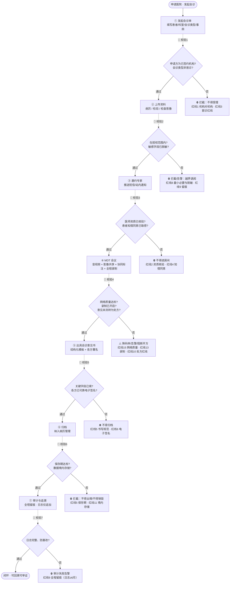

# 诊断三图 · 远程会诊平台

> 《医疗软件设计进阶四部曲》板块三「软件升级七步法」**第 1 步：诊断现状**
> 三张图 = ① 功能地图（有什么 / 该有什么）· ② 痛点清单（哪里疼）· ③ 数据流图（怎么走 / 哪里要卡）
>
> 输入来源（`../板块一-需求调研/`）：`远程会诊平台-用户故事集.docx`、`远程会诊平台-合规红线清单.docx`、
> `远程会诊平台-共同点与痛点.docx`、`远程会诊平台-竞品对比.xlsx`；`../板块二-布局设计/README.md`
>
> 编制日期：2026-10-16 ｜ 状态：**施工前（图纸级，代码未实现）**

---

## 图一 · 功能地图（按四大模块拆解）

> 每个模块拆到"可验收的功能点"，功能点右侧标注来源：`US-*` = 用户故事 ｜ `红线N` = 合规红线清单第 N 条。
> 括号内为**验收量化指标**（取自用户故事验收标准）。

### 模块一 · 音视频会诊

| 功能域 | 功能点 | 量化指标 / 约束 | 来源 |
|---|---|---|---|
| **组会与邀约** | 一键邀请多位专家、自动建房间 | 单场 ≥ 5 方；建房间 < 10 秒 | US-AV-01 |
| | 邀请状态实时可见 | 已接受 / 忙线 / 超时三态 | US-AV-01 |
| | 通知推送（短信 + 站内） | 邀请后即时推送 | US-AV-01 |
| **会前准备** | 患者关键信息卡预览（脱敏） | 姓名脱敏 + 性别/年龄/主诉/诊断摘要 | US-AV-02 |
| | 参与医师资质展示 | 姓名/科室/执业资质标识 | US-AV-05、红线2 |
| **房间与媒体** | 多方高清音视频 | 弱网丢包 20% 时音频可懂度 ≥ 90%、视频 ≥ 15fps | US-AV-03 |
| | 网络自适应 + 音频优先 | 断线 5 秒内自动重连 | US-AV-03、红线15 |
| | 屏幕共享 + DICOM 同步 | 共享画面与音视频同视图对齐，延迟 < 500ms | US-AV-04 |
| **录制与存证** | 全程录制（音视频 + 共享画面） | 录制起止与会诊生命周期一致 | US-AV-06、红线13 |
| | 加密存储 + 受控调阅 | 调阅留痕 | US-AV-06、红线7 |
| **准入控制** | 资质未过不得进房间 | 实名核验 | US-AV-05、红线2 |

### 模块二 · 病历共享

| 功能域 | 功能点 | 量化指标 / 约束 | 来源 |
|---|---|---|---|
| **授权调阅** | 调阅门诊/住院病历、检验报告、检查影像 | 按"最小必要"范围展示 | US-EMR-01、红线8 |
| | 敏感字段默认脱敏、二次授权展开 | 经二次授权方可展开 | US-EMR-01、红线8 |
| **共享清单** | 勾选时间区间 / 资料类型 | 生成快照，随会诊记录归档 | US-EMR-02 |
| | 越界调阅告警 | 实时触发 | US-EMR-02、红线9 |
| **时间轴视图** | 结构化呈现 + 时间轴浏览 | 异常指标 / 危急值高亮 | US-EMR-03 |
| | 关键词检索 + 跨资料跳转 | — | US-EMR-03 |
| **脱敏与授权** | 会话级细粒度临时授权（字段 + 时限） | 会话结束权限自动回收 | 痛点7、红线8 |
| **审计留痕** | 记录调阅人/时间/内容/用途/授权来源 | 日志仅追加、防篡改 | US-EMR-04、红线9 |
| | 按时间段/人员导出审计报表 | — | US-EMR-04、红线9 |
| **患者侧控制** | 知情同意（可撤回） | 越权访问实时告警并阻断 | US-EMR-05、红线4 |
| | 患者端查询"谁在何时调阅了什么" | — | US-EMR-05 |

### 模块三 · 会诊记录

| 功能域 | 功能点 | 量化指标 / 约束 | 来源 |
|---|---|---|---|
| **结构化模板** | 参与人 / 时间 / 讨论要点 / 结论 / 下一步计划 | 关键字段强制填写不可空 | US-REC-01、红线5 |
| **各方意见** | 分区署名、单方确认/撤回 | 他人意见不可单方面修改 | US-REC-02 |
| **电子签名** | 可靠电子签名后方可归档 | 签名与内容绑定、不可抵赖 | US-REC-04、红线6 |
| **归档与质控** | 纳入病历管理、按规范归档 | 门诊 ≥ 15 年、住院 ≥ 30 年 | US-REC-03、红线5 |
| | 导出 + 质控抽查 | 符合《病历书写基本规范》 | US-REC-03、红线5 |
| **患者端** | 查阅结论摘要 + 通俗化说明 | 调阅受授权与留痕约束 | US-REC-05 |

### 模块四 · 多方协同

| 功能域 | 功能点 | 量化指标 / 约束 | 来源 |
|---|---|---|---|
| **角色权限** | 主持人静音/解静音、指定发言人、移出会场 | 权限变更实时生效并留痕 | US-COL-01 |
| | 角色权限矩阵可配置 | — | US-COL-01 |
| **协同标注** | 共享病历上实时标注/批注 | 标注带作者 + 时间戳、实时同步 | US-COL-02 |
| | 标注层显隐与导出 | — | US-COL-02 |
| **状态监控** | 状态机可视化（待受理→已受理→进行中→待签署→已归档） | 断连/超时/越权/未签名实时告警 | US-COL-03 |
| | 下钻单场会诊全程轨迹 | — | US-COL-03 |
| **机构接入** | 机构实名互信接入 | 机构对机构 | US-COL-04、红线1 |
| | 签署《远程医疗服务协议》电子件 | 责任划分可配置、可审计 | US-COL-04、红线12 |
| | 对接机构清单可配置 | — | 红线12 |
| **质控** | 全流程状态纳入质量管理与质控 | 异常实时告警 | 红线14 |

> **功能地图结论**：四大模块的**功能点已可穷举**（覆盖 16 条用户故事 + 16 条红线），
> 但全部处于"图纸级"，无一进入编码 —— 这是"诊断"的第一条硬结论。

---

## 图二 · 痛点清单（引用现有痛点，标注来源）

> **口径说明**：本清单**不新增**痛点，全部**引用**现有输入文件；每条标注来源与数据出处。
> 痛点与合规红线的对应关系见 `docs/差距分析表.md`。
>
> ⚠️ 数据为 2024–2025 行业调研口径（来源见《共同点 痛点》），非本项目真实用户访谈 —— 属**行业级共性痛点**。

| # | 痛点 | 关键量化数据 | 来源 |
|---|---|---|---|
| **P1** | 跨机构数据孤岛：HIS/PACS 异构，病历影像互通成本高（**行业头号痛点**） | 三级医院结构化数据互通率仅 68.5%；基层标准化接口适配率仅 57.9%；跨院 DICOM 一键调阅失败率偏高 | 《共同点 痛点》痛点1（中国政府网《关于进一步推进医疗机构检查检验结果互认的指导意见》） |
| **P2** | 音视频、病历、影像三者割裂；会中多人实时结构化协同不足 | 仅 **21%** 平台支持会话内同步影像批注；单例会诊会后整理平均耗时 **18–25 分钟** | 《共同点 痛点》痛点2（CHIMA 2025 调研；团体标准 T/ZPP 多中心会诊数据交互规范 2025） |
| **P3** | MDT 专家排班、预审、邀约靠人工，专家碎片时间难利用 | 专家档期协调人工工作量占全流程 **40%** 工时；普通会诊平均响应 2.7 小时，疑难 MDT 排期 3–7 天 | 《共同点 痛点》痛点3（中山一院 2025 MDT 实践报告 / CHIMA） |
| **P4** | 医疗责任边界、全链路司法存证不足，纠纷举证难 | 日志只记操作行为，**无法**把语音片段/影像标注帧/病历修改做时序绑定存证 | 《共同点 痛点》痛点4（中国经济网 2026-04） |
| **P5** | 医保支付碎片化，跨机构结算、专家劳务分账不闭环 | 29 省份纳入医保，但跨省 MDT 直接结算覆盖率低；定价差异大（600/800/1000 元/例） | 《共同点 痛点》痛点5（国家医保局） |
| **P6** | 基层网络基础设施薄弱，弱网下音视频 + 影像同步卡顿 | 32.6% 县级医院无法稳定支撑 4K 影像协同；28.4% 基层缺专职 IT，故障修复平均 17.3 小时 | 《共同点 痛点》痛点6 |
| **P7** | 隐私脱敏粗放，缺少会话级细粒度临时授权 | 现有平台多为整份病历一次性授权，无法"会话内开放指定字段、结束自动回收"；脱敏靠人工打码 | 《共同点 痛点》痛点7 |

### 行业级共性（现状基线，来自《共同点 痛点》第一部分）

| # | 共性特征 | 对本项目的含义 |
|---|---|---|
| C1 | **机构工单驱动，不是视频会议**：统一为"申请医院发起会诊单→上传资料→邀约专家→MDT→出具意见书" | 数据流必须按工单走，不支持个人直接发起（对应红线1） |
| C2 | 音视频基础成熟，但**与病历/影像解耦**（两套独立窗口） | 一体化协同画布是差异化机会（对应 P2） |
| C3 | 病历共享以**文件上传为主**，FHIR 原生互通率低 | 互通是"能否真正用起来"的卡点（对应 P1） |
| C4 | 会诊记录为**会后静态归档**，实时协同编辑弱 | 时序绑定存证是机会点（对应 P4） |
| C5 | 角色权限模型成熟，但 **MDT 会前预审能力弱** | 会前预审工作台是机会点（对应 P3） |
| C6 | 合规底座标配（等保三级/实名/审计/脱敏），但**字段级临时授权普遍缺失** | 对应红线7/8/9 与 P7 |

### 痛点优先级（按《用户故事集》初排口径：痛 × 频 × 合规）

| 层级 | 痛点 | 理由 |
|---|---|---|
| 🔴 高 | P1 数据孤岛、P7 授权粗放 | 决定平台可用性与合规底线 |
| ★ 中高 | P2 三者割裂、P6 弱网卡顿 | 高频刚需，影响会诊体验 |
| 🟠 中 | P3 排班预审、P4 存证举证 | 效率与责任，随版本补强 |
| 💤 低 | P5 医保分账 | 商业模式，非 V1 阻塞项 |

---

## 图三 · 会诊主流程数据流图（每个节点标注校验动作）

> 主流程（来自《共同点 痛点》C1 与 README 第 4.1 节）：
> **申请医院发起会诊单 → 上传资料 → 邀约专家 → MDT 会议 → 出具会诊意见书 → 归档**
> 每个节点后紧跟"🔎 校验动作"，**校验失败即拦截/告警**（合规红线的落点）。

### 流程-红线-痛点 对照

| 节点 | 校验动作 | 对应红线 | 对应痛点 |
|---|---|---|---|
| ① 发起会诊单 | 机构对机构 + 非首诊 | 红线1、红线3 | C1 |
| ② 上传资料 | 授权范围 + 脱敏 | 红线8、红线9 | P1、P7 |
| ③ 邀约专家 | 资质核验 + 知情同意 | 红线2、红线4 | P3 |
| ④ MDT 会议 | 网络 + 录制 + 处方解耦 | 红线15、红线13、红线10 | P2、P6 |
| ⑤ 出具意见书 | 字段强制 + 电子签名 | 红线5、红线6 | P4 |
| ⑥ 归档 | 保存期 + 境内存储 | 红线5、红线11 | — |
| ⑦ 审计追溯 | 留痕防篡改 | 红线9 | P4 |

### 数据流诊断结论

1. **主流程与行业范式一致**（机构工单驱动），方向无需调整；
2. **7 个校验点全部未实现**，且**多处红线（4/6/7/13/12）建设状态仍为"待建设"** —— 合规风险集中；
3. **痛点与校验点高度重合**：P1/P7 落在节点②，P2/P6 落在节点④，P4 落在节点⑤⑦ —— 说明"合规红线"与"用户痛点"在本项目上**同源**，可统一排期。

---

## 三图小结（进入第 2 步"对标行业"的输入）

| 图 | 结论 | 交接口 |
|---|---|---|
| 功能地图 | 功能点可穷举，四大模块全覆盖，**全部处于图纸级** | → 差距分析表"功能点"列 |
| 痛点清单 | 7 条量化痛点 + 6 条行业共性，**与合规同源** | → 差距分析表"对标来源"、优先级矩阵纵轴 |
| 数据流图 | 主流程正确，**7 个校验点全空**，合规风险集中 | → 差距分析表"合规红线"列、优先级矩阵横轴 |
