# 远程会诊平台 · 同品类前端调研与布局逆向（图纸先行版）

> 本文是《医疗软件设计进阶四部曲》**板块二「布局调查与设计」**的落地产出物。
> 目标：在"信息缺乏是常态"的前提下，用**逆向学习**还原成熟系统的布局范式，产出可直接交给开发、也可直接喂给 AI 的**图纸**。
>
> **纪律（PPT 原话）：看排布，不抄内容。** 本文只提炼控件排布、字段摆放、弹窗样式、状态规范，不复制任何厂商的业务文案与素材版权。

---

## 0. 怎么用这份文档

| 角色 | 怎么用 |
|---|---|
| 开发 | 第 4、5 节是页面骨架与字段清单，照着搭页面 |
| AI 生成代码 | 把第 5 节「字段与控件清单」+ 第 6 节「提示词包」整段贴给 AI |
| 产品/评审 | 第 2 节来源清单 + 第 3 节共性范式，说明"为什么这么设计" |
| 后续调研 | 第 8 节「待补清单」，接着往下补 |

**贯穿原则（课程"三尊重"）：尊重行业范式 · 尊重用户习惯 · 尊重合规红线。**

---

## 1. 调研方法：六渠道 → 本次聚焦开源

PPT 给出的六类信息源，本次按"信息浓度"排序，**主攻开源系统**（能看界面，还能看代码级实现）：

| # | 渠道 | 本次是否采用 | 说明 |
|---|---|---|---|
| ① | 开源医疗系统 | ✅ 主攻 | 公开 Demo 可登录截图；源码可看 views/components/router |
| ② | 政府采购招标文档 | ⬜ 待补 | 功能清单+界面截图+性能指标（见第 8 节） |
| ③ | 厂商营销材料 | ⬜ 待补 | 公众号/CHIMA·CHINC 展会，截图最密集 |
| ④ | 在线 Demo / 演示视频 | ⚠️ 部分 | 多数远程会诊厂商需登录，未覆盖 |
| ⑤ | 培训 PPT / 操作手册 | ✅ 借用 | OpenHIS 官方操作教程配图 |
| ⑥ | 短视频 / B 站录屏 | ⬜ 待补 | 暂停看分区，连播看流程 |

**截图手段**：本机 Chrome 无头模式 + Chrome DevTools Protocol（脚本见 `../../补充物/tools/shoot.mjs`，执行计划见 `../../补充物/tools/plans/*.json`），可自动登录并逐页抓取；登录墙后的页面需人工补图。

---

## 2. 调研对象清单（4 款）

| 系统 | 定位 | 技术栈 | 可访问性 | 本次取证 |
|---|---|---|---|---|
| **OpenEMR** | 国际开源 EMR（美国 ONC 认证） | PHP + 原生 JS | 公开 Demo 可登录 | 5 张 |
| **Bahmni** | 国际开源 HIS 标杆（WHO/DPG） | Angular + React | 公开 Demo 可登录 | 5 张 |
| **云HIS**（clouddy/zp-test） | 国产开源院内 HIS / 医共体 | Vue3 + TS + ElementPlus + SpringCloud | 源码 + README 高清截图 | 2 张 |
| **OpenHIS**（信创版） | 国产开源 HIS（一二级医院） | Vue3 + Vite7 + ElementPlus + VxeTable + Vue Vben Admin | 源码 + 官方教程截图 | 2 张 |

> 备选参考：**若依医疗版**（RuoYi-Vue 多租户，预约挂号，Vue + Element UI）——无公开截图，仅确认"若依/Element UI"技术范式。

### 各系统目录结构（用于"看代码"）

- **OpenHIS（Vben Admin Monorepo）**
  ```
  apps/web-ele/src/
    ├── api/        接口（按业务域）
    ├── views/      页面   → basic / outpatient / inpatient / inventory / system
    ├── components/ 公共组件
    ├── router/     路由与权限
    ├── store/      业务 Store
    └── layouts/    布局
  ```
- **云HIS**：`dev-pgsql` 分支为最新；后端 SpringCloud + Nacos + PG，前端 Vue3 + TS + ElementPlus。

---

## 3. 逆向结论：医疗软件的共性布局范式

> 以下每条都有截图实证，可直接作为"行业默认答案"写进提示词。

### 3.1 页面骨架四层（铁律）

```
┌───────────────────────────────────────────────────────┐
│ ① 顶部栏：logo · 机构名 · 当前用户 · 消息 · 库房/科室切换 │
├──────────┬────────────────────────────────────────────┤
│ ② 左侧   │ ③ 主内容区                                  │
│   导航   │   （面包屑 / 标签页 / 列表 / 详情）          │
│ (业务域  │                                             │
│  分组)   │                                             │
├──────────┴────────────────────────────────────────────┤
│ ④ 底部状态栏：当前患者 · 科室 · 时间 · 版本              │
└───────────────────────────────────────────────────────┘
```

- **实证**：`screenshots/yunhis/01_img.png`（顶部栏机构/用户/时间 + 深色左导航按"系统管理/业务数据/药品维护…"分组 + 主区 + 底部）；`screenshots/openhis/01_pharmacy_manage.png`（同构）。
- **变体**：国际系统用**顶部菜单 + 可关闭标签页**替代左导航——`screenshots/openemr/02_main_calendar.png`（顶部横向菜单 + 标签页栏）；`screenshots/bahmni/03_clinical_dashboard.png`（顶部色栏 + 宫格）。

**实证 ① · 云HIS 工作台首页**——四层骨架最典型样本

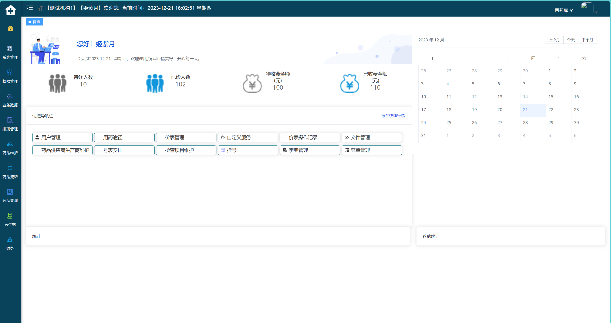

**实证 ② · OpenHIS 药房管理**——同构骨架，可交叉印证

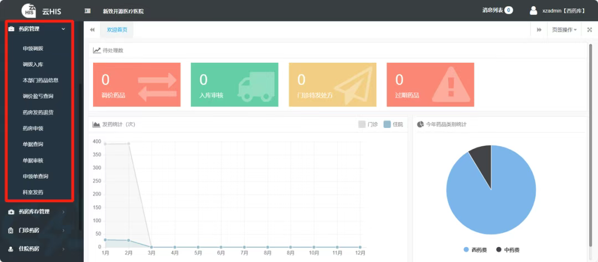

**变体 · 国际系统（顶部菜单流派）**

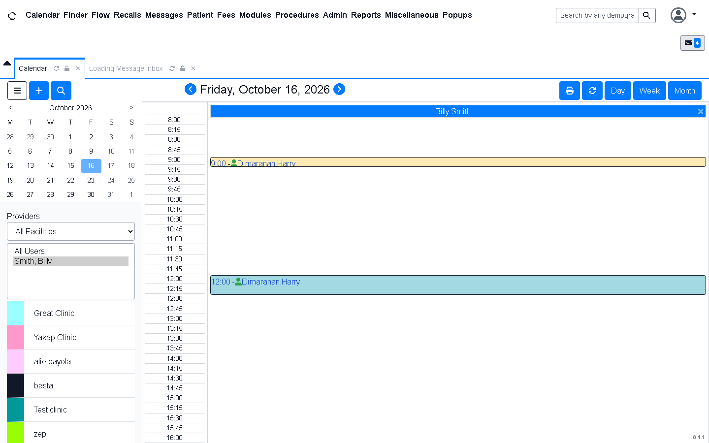

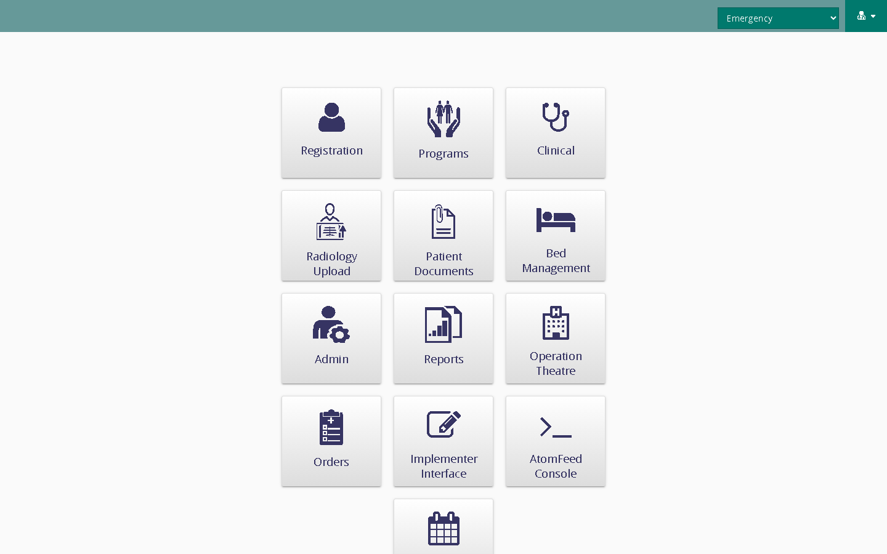

### 3.2 主内容区只有两种形态

| 形态 | 结构 | 实证 |
|---|---|---|
| **列表页** | 标题 + 操作按钮 → 标签页 → 多字段搜索行 → 表格（可排序）→ 分页 | `screenshots/openemr/03_patient_finder.png`、`screenshots/bahmni/04_registration_search.png` |
| **详情页** | 标题 → 横向标签页 → 卡片式分区（表单）→ 内嵌子表格 | `screenshots/openemr/04_patient_dashboard.png` |

- 列表页三件套：**搜索 + 表格 + 分页**（OpenEMR Finder：`Showing 1 to 10 of 77 entries`，`Previous 1 2 3 … 8 Next`）。
- 详情页三件套：**表单 + 标签页 + 卡片**（OpenEMR Dashboard：Allergies / Medical Problems / Medications 三列卡片，每卡右上角有编辑入口）。

**列表页实证 · OpenEMR 患者查询**

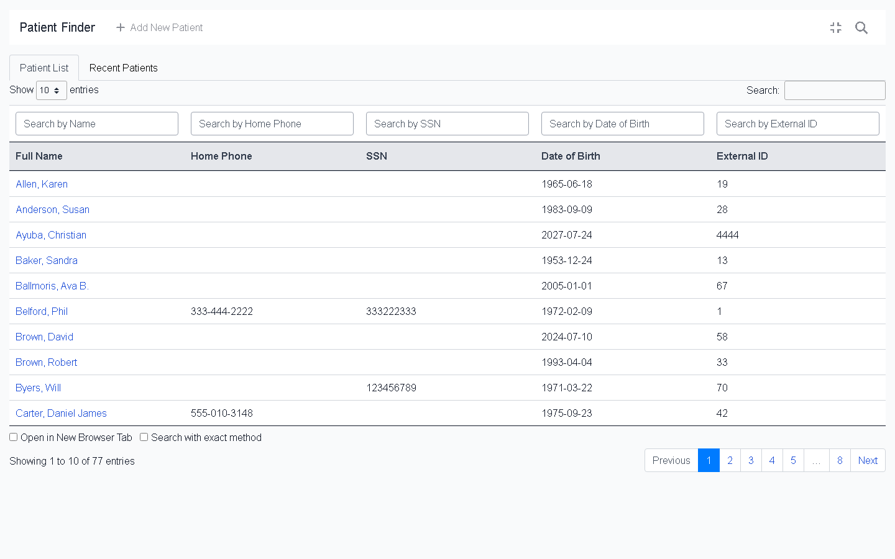

**列表页实证 · Bahmni 挂号搜索**（搜索行改用"分组面板"，其余同构）

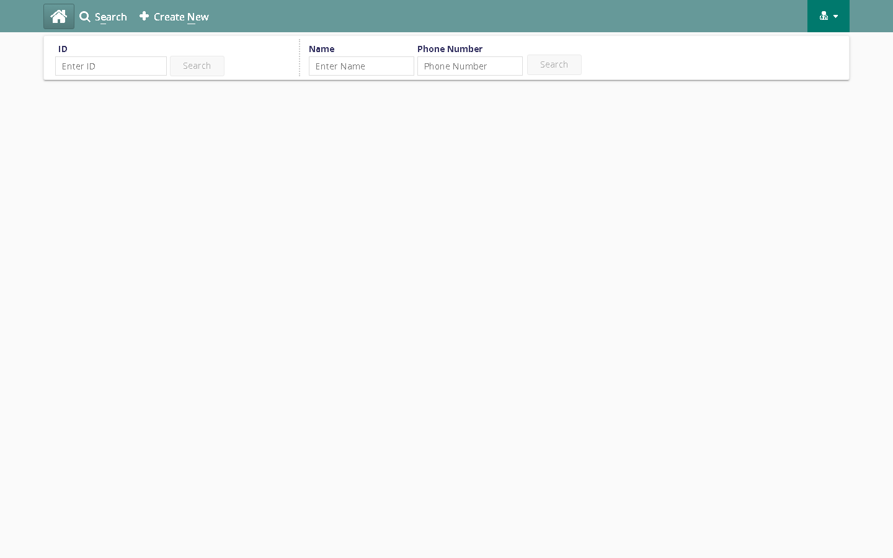

**详情页实证 · OpenEMR 病历仪表盘**

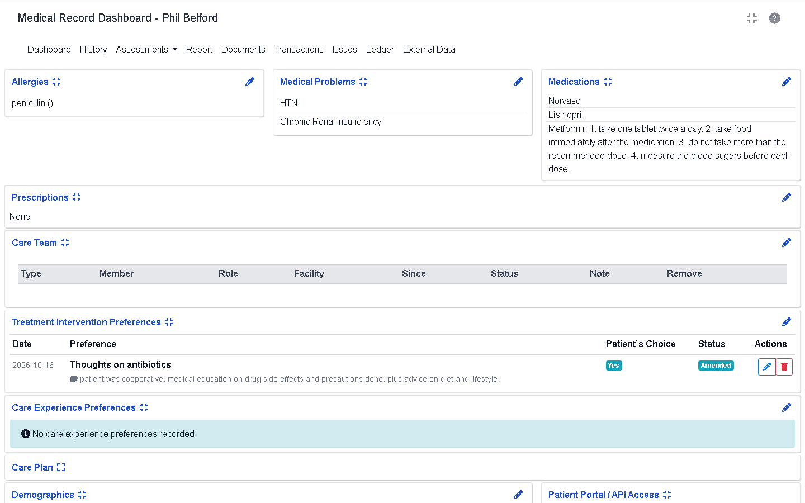

### 3.3 业务页面统一"三级钻取"

```
列表 → 详情 → 编辑
```

列表页点行 → 进详情页 → 详情页内点"编辑"或子标签进入编辑态。20+ 款主流 HIS/EMR 高度一致。

### 3.4 登录与门户范式

- **登录页**：居中卡片（logo + 标语 + 账号/密码 + 主按钮 + 次要说明）。
  实证：`screenshots/openemr/01_login.png`、`screenshots/bahmni/01_login.png`。
- **门户两种流派**：
  - **应用宫格**（入口即导航）：`screenshots/bahmni/00_portal.png`、`screenshots/bahmni/03_clinical_dashboard.png`（Registration / Clinical / Radiology / Bed Management … 卡片宫格）。
  - **单工作台**（登录即干活）：`screenshots/yunhis/01_img.png`（欢迎卡 + 指标卡 + 快捷导航按钮网格 + 日历）。
- **多机构/多库房切换**：顶部栏右侧下拉（Bahmni 的 Location、云HIS 的"西药库"、OpenHIS 的"【西药库】"）——**这是医疗系统的标志性控件**。

**登录页实证**（两家国际开源系统，同一范式）

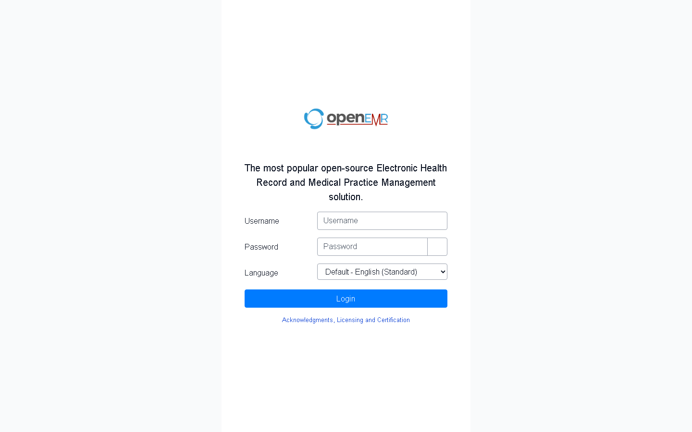

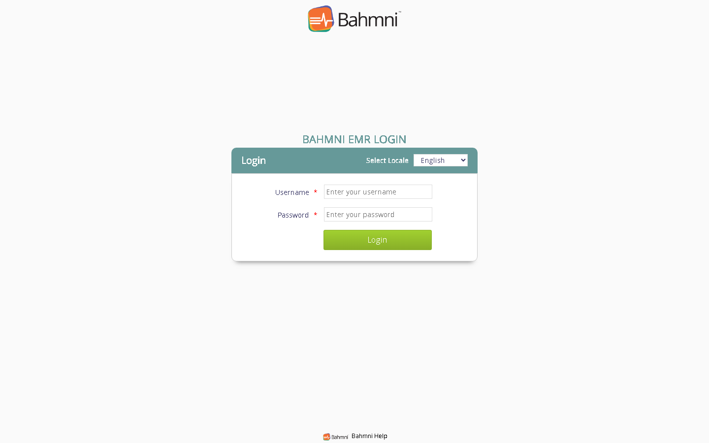

**门户流派 ① · 应用宫格（Bahmni）**

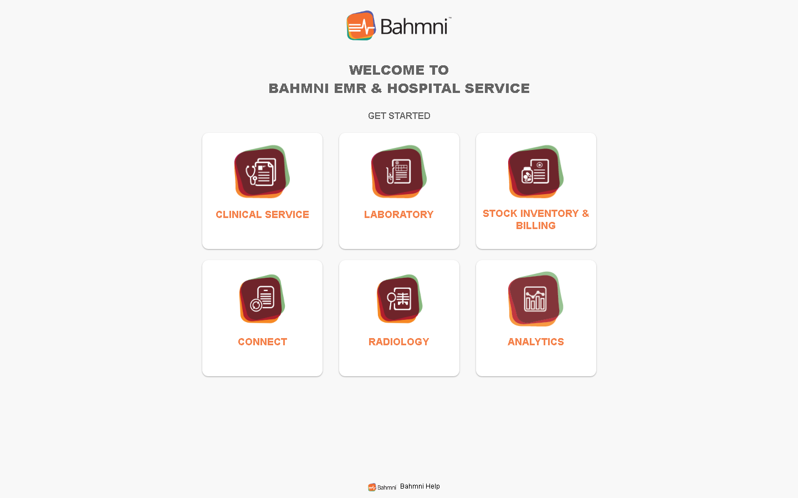

**多机构/多地点切换实证 · Bahmni 登录后强制选工作地点**

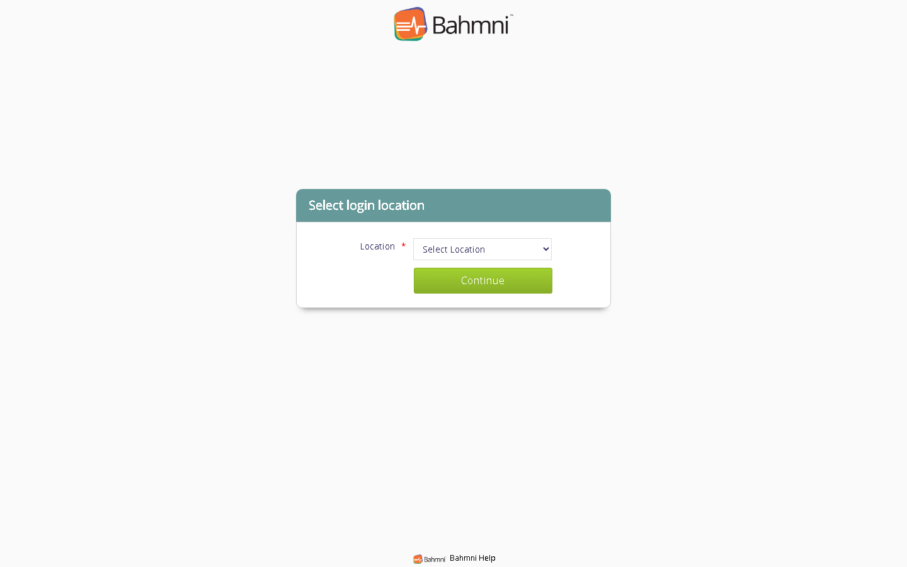

### 3.5 规范细节（默认答案，直接抄进提示词）

| 规范 | 约定 | 实证 |
|---|---|---|
| **状态色** | 绿=正常/已传 · 黄=待办 · 红=异常/停止 · 蓝=信息 | 云HIS 医嘱页状态块（`02_inpatient_order.png`）；OpenHIS 统计卡（红/橙/绿/蓝，`01_pharmacy_manage.png`）；OpenEMR 标签（Yes 蓝 / Amended 绿） |
| **金额** | 右对齐、两位小数、禁编辑置灰 | OpenEMR Visit History：`175.00 / 350.00 / -175.00` 右对齐 |
| **时间** | 统一 `yyyy-MM-dd HH:mm:ss` | OpenEMR 顶部"当前时间"、医嘱下达时间 |
| **快捷键** | 高频操作进快捷键并**在按钮上标注** | 云HIS：开医嘱`F1`/保存`F8`/开检查`F2`/开检验`F3`/开中草药`F4`/手术申请`F5`；OpenHIS：重置`F7`/提交`F8` |
| **搜索** | 多字段并列一行，各带独立查询按钮 | OpenEMR Finder（Name/Phone/SSN/DOB/External ID）；Bahmni（ID 组 / Name+Phone 组） |
| **主从表** | 表单头 + 明细表格（可增删行） | OpenHIS 药房申领（单号/部门 + 药品明细表） |
| **空态** | 灰底提示条 + 说明文字 | OpenEMR "No care experience preferences recorded." |
| **密集表格** | 20+ 列、行内下拉、行内状态标签 | 云HIS 医嘱页（操作/组号/医嘱状态/下达时间/医嘱类别…） |
| **右侧竖排功能标签** | 病历相关的快捷入口竖排贴右边 | 云HIS 医嘱页右侧（病人信息/诊断/今日出院/退药/费用查询…） |

**规范实证 ① · 云HIS 住院医嘱**——状态色 + 快捷键标注 + 密集表格 + 右侧竖排标签，一图四证

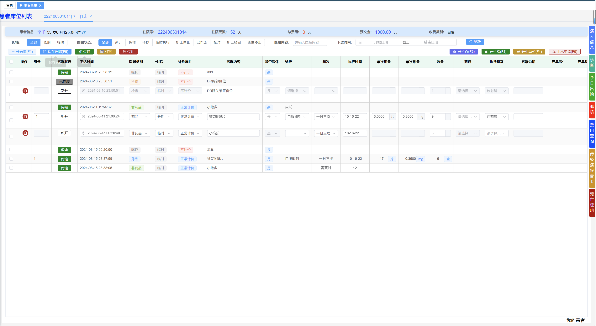

**规范实证 ② · OpenHIS 药房申领**——主从表 + 快捷键（F7/F8）

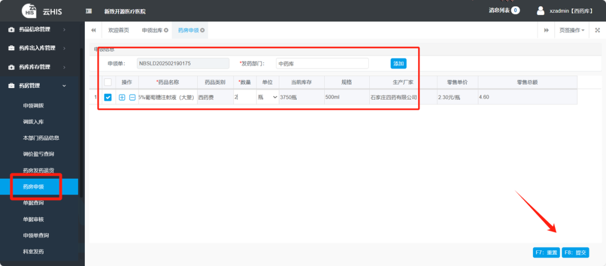

**规范实证 ③ · OpenEMR 就诊历史**——金额右对齐、两位小数、编码着色

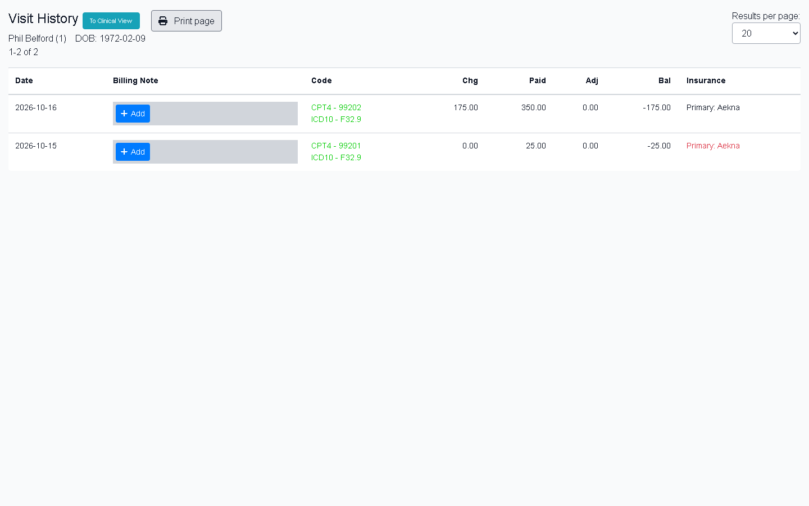

---

## 4. 远程会诊平台 · 页面骨架（落地方案）

> 结合本项目《用户故事集》的四大模块（音视频会诊 / 病历共享 / 会诊记录 / 多方协同）与《合规红线清单》设计。

### 4.1 站点地图

```
登录（机构对机构）
└── 工作台/首页（四层骨架）
    ├── 会诊工单
    │   ├── 工单列表（列表页）
    │   ├── 发起会诊（表单页）
    │   └── 会诊协同工作台（详情页 · 核心页）
    │       ├── 音视频区
    │       ├── 病历/影像共享区
    │       ├── 结构化记录/意见区
    │       └── 存证时间轴
    ├── 会诊记录
    │   ├── 记录列表（列表页）
    │   └── 记录详情/签署（表单页）
    └── 合规与审计（列表页）
        ├── 操作/调阅日志
        ├── 授权记录
        └── 对接机构清单
```

### 4.2 核心页面骨架（草图级）

**① 登录页**
```
┌───────────────────────────────┐
│          [平台 logo]           │
│      远程会诊平台 · 机构端      │
│  ┌─────────────────────────┐  │
│  │ 机构           [下拉/搜索]│  │
│  │ 账号           [        ] │  │
│  │ 密码           [        ] │  │
│  │ 验证码         [    ][图] │  │
│  │        [ 登  录 ]         │  │
│  └─────────────────────────┘  │
│  实名核验 · 等保三级 · 操作留痕  │
└───────────────────────────────┘
```

**② 会诊工单列表（列表页）**
```
[面包屑] 会诊工单
[标签页] 待受理 | 进行中 | 待签署 | 已归档 | 全部
[搜索行] 患者姓名 | 住院号 | 申请科室 | 会诊类型▾ | 日期范围 | [查询][重置]
[操作行] [+ 发起会诊]  [批量导出]
┌────────────────────────────────────────────────────────────┐
│ ☐ 单号      患者  类型  申请科室  受邀专家  状态    创建时间   操作│
│ ☐ HC2026.. 李*    MDT   呼吸科   张*(…)   ●进行中  10-16 09:12 详情│
│ ...                                                          │
└────────────────────────────────────────────────────────────┘
[分页] 共 77 条  < 1 2 3 … 8 >
```

**③ 会诊协同工作台（详情页 · 核心，三段式 + 底部时间轴）**
```
┌─ 顶部栏：机构 · 科室 · 当前用户 · 网络状态 · [结束会诊] ──────────┐
├───────────────┬──────────────────────────┬───────────────────┤
│ 左：患者/病历  │ 中：音视频 + 共享画布      │ 右：结构化记录/意见 │
│ · 患者信息卡   │ ┌──────────────────────┐ │ · 各方意见分区署名  │
│   (脱敏)       │ │   多方视频宫格        │ │ · 结论/下一步计划   │
│ · 病历时间轴   │ ├──────────────────────┤ │ · 影像标注/批注     │
│   (门诊/住院/  │ │  DICOM 阅片 + 标注层  │ │ · 语音转写片段      │
│    检验/影像)  │ └──────────────────────┘ │ · [保存][提交签署]  │
│ · 授权范围标签 │ [共享][标注][翻页][缩放]  │                   │
├───────────────┴──────────────────────────┴───────────────────┤
│ 底部：存证时间轴  09:12 建立房间 → 09:15 影像标注#3 → 09:20 意见… │
└──────────────────────────────────────────────────────────────┘
```

**④ 会诊记录详情/签署（表单页）**
```
[面包屑] 会诊记录 > 记录详情
[标题] 会诊意见书 · HC2026xxxx    [状态: 待签署]
[结构化模板]
  参与人 / 时间 / 讨论要点 / 结论 / 下一步计划   ← 关键字段强制填写
[各方意见区]  发起方[署名] | 专家A[署名] | 专家B[署名]  （单方可确认/撤回本人意见）
[签名区]      [可靠电子签名]  ← 各方签署后方可归档
[归档]        保存期：门诊≥15年 / 住院≥30年
```

---

## 5. 字段与控件清单（可直接喂 AI）

### 5.1 通用列表页字段

| 区块 | 控件 | 备注 |
|---|---|---|
| 标题区 | 页标题（左）+ 主操作按钮（右） | 主操作按钮靠右 |
| 标签页 | 状态 tab | 每个 tab 带数量徽标 |
| 搜索行 | 输入框 × N + 下拉 × N + 日期范围 | 多字段并列，各带查询按钮 |
| 操作行 | 新增 / 导出 / 批量操作 | 高频操作标快捷键 |
| 表格 | 序号 · 主键链接列 · 业务列 · **状态列（色点+文字）** · 时间列 · 操作列 | 金额右对齐两位小数 |
| 分页 | 每页条数 + 总数 + 页码 | "共 N 条" |

### 5.2 通用详情页字段

| 区块 | 控件 | 备注 |
|---|---|---|
| 标题区 | 标题（含主键）+ 状态标签 + 右上操作 | |
| 标签页 | 横向 tab 导航 | 卡片化分区 |
| 卡片 | 标题 + 右上编辑图标 + 内容/子表格 | 空态用灰底提示条 |
| 主从表 | 表头表单 + 明细表格（可增删行） | |

### 5.3 状态字典与状态色（会诊状态机）

| 状态 | 含义 | 状态色 | 对应合规红线 |
|---|---|---|---|
| 待受理 | 工单已提交 | ⚪ 灰 | 红线1 机构对机构 |
| 已受理 | 已确认参与方 | 🔵 蓝 | 红线2 资质核验 |
| 排期/待开始 | 已约定时间 | 🟡 黄 | 红线3 首诊红线（校验） |
| 进行中 | 会诊进行 | 🟢 绿 | 红线13 录制留存 |
| 待签署 | 记录待电子签名 | 🟠 橙 | 红线6 电子签名 |
| 已归档 | 记录归档完成 | ✅ 绿 | 红线5 病历保存 |
| 已作废 | 异常终止 | 🔴 红 | 红线9 全程留痕 |

### 5.4 布局规范速查（写进组件库）

```
主色：医疗蓝   #1677ff 类
状态色：绿 #52c41a / 黄 #faad14 / 红 #f5222d / 蓝 #1677ff / 灰 #bfbfbf
间距：8 的倍数（8/16/24）
圆角：4px（卡片 8px）
表格：斑马纹可选；表头灰底；行高 40px（密集模式 32px）
字体：14px 正文 / 16px 卡片标题 / 20px 页面标题
时间：yyyy-MM-dd HH:mm:ss
金额：右对齐 · 两位小数 · 千分位
```

---

## 6. 提示词包（AI 输入模板）

> 把下面这段连同第 5 节一起喂给 AI，即可生成"符合行业范式"的页面代码。

```
你是一名医疗软件前端工程师。请严格遵循以下【行业默认范式】生成页面，不要自行发挥：

【页面骨架】顶部栏(机构/科室/用户/消息) → 左侧导航(按业务域分组) → 主内容区 → 底部状态栏。
【主内容区】只有两种形态：
  - 列表页 = 标题 + 标签页 + 多字段搜索行 + 表格 + 分页
  - 详情页 = 标题 + 横向标签页 + 卡片式分区(表单) + 内嵌子表格
【交互】业务页面统一"列表 → 详情 → 编辑"三级钻取。
【状态色】绿=正常/进行中，黄=待办，红=异常，蓝=信息，橙=待签署，灰=待受理。
【规范】金额右对齐两位小数；时间统一 yyyy-MM-dd HH:mm:ss；高频操作标注快捷键。
【合规】涉及病历/记录的区域必须预留：授权范围标签、操作留痕、电子签名位、脱敏标记。

【本次要生成的页面】<在此填写，例如：会诊工单列表页>
【字段】<粘贴第 5 节的字段清单>
【用户故事与验收标准】<粘贴《用户故事集》对应条目>
```

---

## 7. 截图索引

> 全部 14 张图已按结论就地嵌入**第 3 节**（图1–图14），本节为索引表，点击文件名可打开原图。
> 路径相对本文件所在目录（`交付物/板块二-布局设计/`）。抓取脚本：`../../补充物/tools/shoot.mjs`；执行计划：`../../补充物/tools/plans/*.json`。

### OpenEMR（国际开源 EMR）

| 图号 | 文件 | 内容 | 可复用范式 | 所在段落 |
|---|---|---|---|---|
| 图8 | [`01_login.png`](screenshots/openemr/01_login.png) | 登录页 | 居中卡片登录 | 3.4 |
| 图3 | [`02_main_calendar.png`](screenshots/openemr/02_main_calendar.png) | 日历主工作台 | 顶部菜单 + 标签页栏 | 3.1 |
| 图5 | [`03_patient_finder.png`](screenshots/openemr/03_patient_finder.png) | 患者查询 | **列表页范式（搜索+表格+分页）** | 3.2 |
| 图7 | [`04_patient_dashboard.png`](screenshots/openemr/04_patient_dashboard.png) | 病历仪表盘 | **详情页范式（卡片+标签页）** | 3.2 |
| 图14 | [`05_patient_visits.png`](screenshots/openemr/05_patient_visits.png) | 就诊历史 | 金额右对齐、编码着色 | 3.5 |

### Bahmni（国际开源 HIS 标杆）

| 图号 | 文件 | 内容 | 可复用范式 | 所在段落 |
|---|---|---|---|---|
| 图10 | [`00_portal.png`](screenshots/bahmni/00_portal.png) | 应用门户 | 模块卡片入口 | 3.4 |
| 图9 | [`01_login.png`](screenshots/bahmni/01_login.png) | 登录页 | 居中卡片登录 | 3.4 |
| 图11 | [`02_login_location.png`](screenshots/bahmni/02_login_location.png) | 选择工作地点 | 多机构/多地点选择 | 3.4 |
| 图4 | [`03_clinical_dashboard.png`](screenshots/bahmni/03_clinical_dashboard.png) | 应用宫格 | **宫格门户 + 顶部地点切换** | 3.1 |
| 图6 | [`04_registration_search.png`](screenshots/bahmni/04_registration_search.png) | 患者搜索 | 分组搜索面板 | 3.2 |

### 云HIS（国产开源 HIS）

| 图号 | 文件 | 内容 | 可复用范式 | 所在段落 |
|---|---|---|---|---|
| 图1 | [`01_img.png`](screenshots/yunhis/01_img.png) | 工作台首页 | **四层骨架 + 指标卡 + 快捷导航 + 日历** | 3.1 |
| 图12 | [`02_inpatient_order.png`](screenshots/yunhis/02_inpatient_order.png) | 住院医嘱 | **密集表格 + 快捷键标注 + 状态色 + 右侧竖排标签** | 3.5 |

### OpenHIS（国产开源 HIS · 信创版）

| 图号 | 文件 | 内容 | 可复用范式 | 所在段落 |
|---|---|---|---|---|
| 图2 | [`01_pharmacy_manage.png`](screenshots/openhis/01_pharmacy_manage.png) | 药房管理 | 彩色统计卡 + 折线/饼图 + 多级左导航 | 3.1 |
| 图13 | [`02_pharmacy_apply.png`](screenshots/openhis/02_pharmacy_apply.png) | 药房申领 | **主从表 + 快捷键(F7/F8)** | 3.5 |

---

## 8. 待补清单（下一轮）

- [ ] **渠道②招标文档**：政府采购网搜"远程会诊/医院信息系统 采购 需求"，下 3~5 份，抄功能清单（免费的调研报告）。
- [ ] **渠道③厂商材料**：卫宁/创业慧康/协和/腾讯觅影等的产品演示截图（登录墙后需人工截）。
- [ ] **渠道⑥录屏**：B 站卫宁/东软演示，连播看流程，暂停看分区。
- [ ] **代码级逆向**：克隆 OpenHIS / 云HIS，只读 `views / components / router` 三个目录，确认组件拆分与路由结构。
- [ ] **会诊工作台专项**：音视频 + 影像 + 记录三合一的画布布局，目前无开源实证，需从厂商 Demo 补。
- [ ] 与本项目《用户故事集》《合规红线清单》交叉核对：每条骨架是否都能落到某条用户故事与红线。

---

## 附：可复现的抓取方式

```bash
# 无头抓取（自动登录 + 逐页截图），脚本位于 补充物/tools/
node ../../补充物/tools/shoot.mjs ../../补充物/tools/plans/openemr.json   # OpenEMR 5 页
node ../../补充物/tools/shoot.mjs ../../补充物/tools/plans/bahmni.json    # Bahmni 登录+门户+工作台
node ../../补充物/tools/shoot.mjs ../../补充物/tools/plans/bahmni2.json   # Bahmni 挂号搜索
```

`../../补充物/tools/plans/*.json` 中 `steps` 支持：`goto` / `wait` / `waitFor` / `fill` / `click` / `js` / `shot(full)`。
