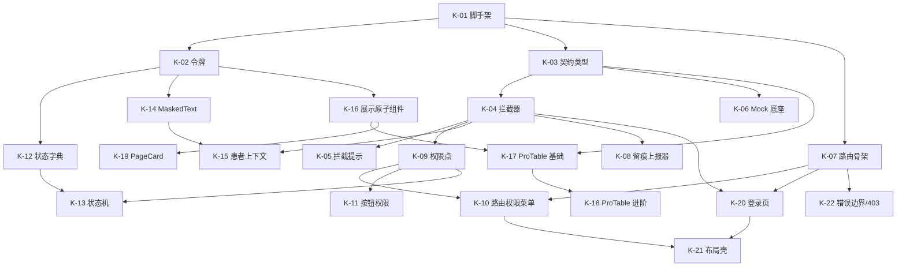
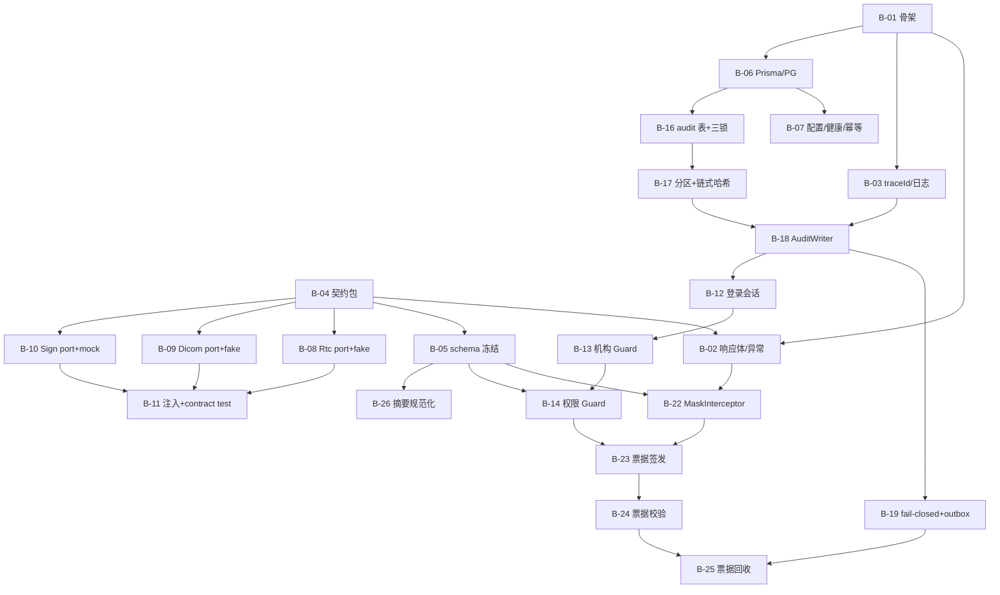
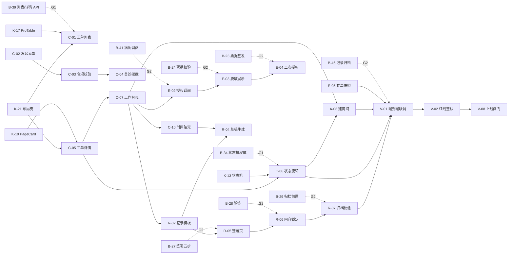

# 远程会诊平台 · 施工期 WBS 与 Agent 分工方案（全栈版）

> **定位**：施工前图纸（板块一/二/三 + 架构决策）已完成，本文是**进入编码的第一份可派活文档**。本版起覆盖**前端线 + 后端线 + 契约包**三条并行战线。
> **上游**：`补充物/架构决策.md`（**29 条已定 / 3 条待定**，本版起含 3.8 后端架构）、`交付物/板块一-需求调研/远程会诊平台-用户故事集.md`（22 条 US）、`交付物/板块一-需求调研/远程会诊平台-合规红线清单.md`（16 条 R）、`交付物/板块三-软件升级/板块三-软件升级七步法.md`（V1/V2/V3 + F1–F5）、`交付物/板块二-布局设计/README.md`（四层骨架 + 四种页面形态）。
> **下游**：`bmad-create-epics-and-stories` 导入、subagent 派发、进度看板。
> **编制**：技术项目经理 ｜ **初版**：2026-10-23 ｜ **本版**：2026-10-23（第二轮：P-01 定"自建后端"→ 新增后端线，重排波次与 Agent 分工）｜ **状态**：待评审后开工
>
> **本版改了什么**：① 新增 **10 个后端 Epic（EP-20～EP-29）+ 52 条后端 story（B 系列）**；② EP-18 三条患者端 story 移出本期（P-05 落地），**E-08 保留并升格为 R4 唯一落点**；③ 波次 **12 → 14 波**，W0 由"1 条前端脚手架"改为"**三线同时起跑**"；④ 新增 **4 个 Agent 角色**；⑤ 关键路径由"纯前端 11 节点"改为"**双线 17 节点**"；⑥ 第八节待定项 **14 → 3**；⑦ 第九节结论由"不能全量开工"改为"**能开工**"。
>
> **本版没改什么**：**92 条前端 story 的编号与内容一字未动**（除 P-05 相关的 P-01/P-02/P-03 三条按第二节 3.12 处置）。新增一律用 B 系列编号——K/C/E/R/A/L/U/G/P/V 编号一旦重排，全文档追溯（附录 A/B、各 Epic 覆盖表、依赖图）会全部断链。

**标记约定**

| 标记 | 含义 |
|---|---|
| 【实证】 | 有源文件出处，给 `file:line` |
| 【推断】 | 本文推导，需评审确认 |
| `[联调]` | 该 story 的完成标志含"**联调通过**"，对接具体后端 B-xx，**未过闸门不算完成**（见 6.3 联调闸门） |
| `[降级]` | 受 P-02/P-03/P-04 影响，按 `架构决策.md` 3.8.5 的 port + fake 路径验收（见第八节） |
| `[范围外·V3]` | 受 P-05 影响，本期不做，不计入总量（见 3.12） |

**技术栈声明（全文强制）**：S-01（Vue3）/ S-09（TypeScript）/ P-01（自建后端）/ B-01（NestJS 11）/ B-02（PostgreSQL 16）/ B-03（Prisma）**均已定稿**（`架构决策.md:155-172`）。由此定两条写法规则：

1. **92 条前端 story 的标题与验收标准保持原样**，仍以**层名**表述（`views/`、`components/`、`api/`、`domain/`、`store/`、`router/`、`layouts/`、`mock/`）——它们的验收对象是"页面行为"，与文件扩展名无关；改写成 `.vue` 只会让既有追溯失效而没有任何收益。
2. **52 条后端 story 直接写技术名词**（NestJS、Prisma、PostgreSQL、Guard、Interceptor、migration）——这些是 B-01～B-03 已锁定的**实现对象**，抽象掉反而无法验收。后端 story 的文件落位引用 `架构决策.md:716-745` 的 `server/` 目录。

**两条跨线铁律**

- **`shared/` 是唯一契约源**（S-10）：前端 `src/api/types`、后端 `dto/` 一律从 `shared/` 引入，**禁止两端各写一份**。
- **`src/` 与 `server/` 之间零依赖**（`架构决策.md:196`）：只通过 HTTP 契约通信，任何"前端直接 import 后端代码"的做法一律驳回。

**编号空间说明（必读，避免歧义）**

`B-01`～`B-52` 在本版里是**后端 story 编号**；而 `架构决策.md` 里的 `B-01`～`B-03` 是**后端技术栈决策**（NestJS / PostgreSQL / Prisma）。两者撞号是任务要求所致（story 用 B 系列、且不得动 K/C/E/R/A/L/U/G/P/V），为免混淆约定：

- 引用**决策**时一律写 **「决策 B-01」/「决策 B-02」/「决策 B-03」**（或直接写 `架构决策.md:B-01`）；
- 引用**story** 时直接写 `B-01`～`B-52`（出现于表格首列、波次表、分工表、附录）。
- 同理，`P-01`～`P-05` 是决策编号，`P-01`～`P-03` 曾是患者端 story 编号——**后者已随 P-05 移出本期**（见 3.12），所以本版不会再有歧义。

---

## 一、拆分口径

### 1.1 Epic 怎么切 —— 三线并行：**线为纵轴，域为横轴，版本为第三维，Kernel 独立前置**

不按 V1/V2/V3 切，也不纯按业务域切，而是"**Epic 按线 × 域切、版本作为 Epic 属性、跨版本时按版本再切一刀**"。

**三条线（`架构决策.md:1054`）**

| 线 | 代码根 | 通信方式 | 本版 story 数 |
|---|---|---|---|
| **前端线** | `src/`（A-02 不变，既有路径全部有效） | 只调 HTTP 接口 | 89（原 92 − 3 条 P-05） |
| **后端线** | `server/`（3.8.3 四层 + common + adapters） | 只提供 HTTP 接口 | **52（新增，B 系列）** |
| **契约包** | `shared/`（类型 + Zod + 权限点 + 状态字典 + ports） | 被两条线**单向依赖** | 含在 B-04 / B-05 内，不单列 Epic |

**理由（五条）**

1. **线是并行维度，不是组织维度。** `src/` 与 `server/` 之间零依赖（`架构决策.md:196`），一个 Agent 改前端不可能让另一个 Agent 的后端编译失败——这是全项目唯一"天然无冲突"的切分轴。
2. **域是第二维度。** 同一域的前后端 story 必须**分开验收**：前端验"页面行为"，后端验"接口契约 + 负向用例"（`架构决策.md:1049` 规则 7）。混成一条 story，既无法并行，也无法判定完成。
3. **版本是时间维度。** 若纯按版本切，`V2` 这个 Epic 会同时含 AV / EMR / REC / COL / 后端五块，一个 Agent 领不动。
4. **纯按域切则无法排期。** 一个域横跨 3 个版本（如 AV 域从 V1 邀约到 V2 SDK），Epic 的完成标志会变成"三期都做完"，等于没有里程碑。故 `EP-11 邀约与入会`（V1，纯前端 + adapter 占位）与 `EP-12 音视频与影像`（V2，依赖 P-02/P-03）必须分开。
5. **后端 Kernel 必须独立成 Epic。** `架构决策.md:1047` 规则 5 把后端五项内核（traceId、审计写入器、脱敏管道、票据、错误码外壳）列为业务 story 的前置。散进业务 Epic 会导致"红线无人认领"——R6/R8/R9 的验收主体恰恰是这五项。

**Epic 总数 23 个**：前端 13（EP-00/01/02 + EP-10～EP-19，其中 EP-18 本期 0 条）+ 后端 10（EP-20～EP-29）。

### 1.2 Story 的粒度标准 —— "一个会话能做完"

**定义**：一个 Agent 在一次 `bmad-build` 循环内（含自测）能交付、且评审能当场勾完全部验收标准的量级 = **0.5–2 天**。

**六条硬指标（任一不满足就继续拆）**

| # | 指标 | 判据 |
|---|---|---|
| 1 | **单域单目录** | 前端只落在 `views/<一个域>/` 或 `components/` 或 `api/` 的一处；后端只落在 `server/src/modules/<一个模块>/` 或 `common/<一个子域>/` 或 `adapters/<一个能力>/` 的一处（`架构决策.md:1043` 规则 1） |
| 2 | **验收项 ≤ 7 条** | 超过 7 条说明混了多个可交付行为 |
| 3 | **改动文件 ≤ 8 个** | 超过则大概率含"顺手重构"，应剥离 |
| 4 | **不夹带契约变更** | 改 `shared/`、前端 `api/types`、`domain/*`、后端 `dto/` 的 story 必须单列，且只归契约 Agent / Kernel Agent |
| 5 | **必带一条负向用例**（后端） | 每条后端 story 至少一条"越权 / 未授权 / 签名不符 / 审计失败"的可执行负例。**没有负向用例的后端 story = 没有验证红线**（`架构决策.md:1050` 规则 8） |
| 6 | **一个用例一个事务边界**（后端） | service 是唯一事务边界（`架构决策.md:752` 规则 2）。一条 story 若横跨两个事务（如"签署 + 归档"），必须拆 |

**拆法规则**：按"**用户可验收的行为**"拆，不按技术层拆（`架构决策.md:1044` 规则 2）。反例：✗ "写 consult 的 api 层" / ✗ "写 record 的 repository"；正例：US-AV-01 拆成 `A-01 邀约弹窗` / `A-02 邀请状态回显` / `A-03 建房间与状态联动` / `A-04 通知推送` —— 每条都能独立演示、独立勾验收。后端同理：✗ "写审计模块"；正例拆成 `B-16 表与三道锁` / `B-17 分区与链式哈希` / `B-18 唯一写入口与三条事务路径` / `B-19 fail-closed 与 outbox`。

**合并规则**：多条 US 可合并成一条 story，条件是"**同一套代码单元 + 同一套验收动作**"。本 WBS 里 `U-01 审计日志列表` 同时承接 US-EMR-04 与 R9，`K-17 ProTable 基础` 被 5 个列表页共用，都是合并的例子。

**规模口径**：S ≈ 半天 ｜ M ≈ 1 天 ｜ L ≈ 2 天以上。**超过 L 必须继续拆**。本文 L 共 3 条，全部在前端线（见 1.4）；**后端 52 条无 L，最大 M**——因为后端 story 已按"一个用例一个事务边界"切到天然上限，再合就会跨事务。

### 1.3 不进 WBS（Out of Scope）

> **本版最大变化**：P-01 定"自建后端"后，**"后端实现"从排除项变成主项**（原第 1、2 项作废）。仍排除的是"代码解决不了的那部分"。

| # | 排除项 | 理由 | 承接方式 |
|---|---|---|---|
| 1 | 等保三级测评、密评、机房与网络合规 | 不是代码能完成的（`架构决策.md:897`） | 代码侧只保证"可加密传输、日志留存 ≥6 月、访问控制、无境外外联、可审计"；V-07 / V-08 出清单 |
| 2 | 生产部署、CI/CD 流水线、镜像仓库、备份与容灾 | 课程交付不要求上线运维；写进 WBS 会造出无法验收的 story | 容器化**只做到开发态**：`docker compose` 起 PG 16（B-06） |
| 3 | CA / 电子签名服务资质 | 法律效力取决于服务资质（P-04） | 后端 `SignatureProvider` + `MockSignatureProvider`（B-10），V1 标注 `legalEffect=false`；**禁止**用"前端算个 hash 存库"冒充签名（`架构决策.md:887`） |
| 4 | 音视频 SDK、DICOM SDK 的采购与选型 | P-02 / P-03 未定，是采购项 | 后端 port + fake（B-08 / B-09），前端 adapter（A-07 / A-11）；业务只依赖 port |
| 5 | 短信网关、推送通道 | 不可控 | 站内通知 + 接口调用（A-04） |
| 6 | FHIR 接入层、MDT 会前预审工作台、医保分账 | **无 US 承接**（差距分析第 18/19 项、痛点 P5），强行拆会造出无法验收的 story | 列入"候选需求"，待补 US 后再进 WBS（见 3.24） |
| 7 | 美颜 / 虚拟背景 / 个性化主题 | 用户故事集明确"暂不做"（`用户故事集.md:185-186`） | — |
| 8 | 患者端实体（独立端 / 小程序 / H5） | P-05 已定"本期不做" | 3 条 story 标 `[范围外·V3]`，**不计入 141 条总量**；R4 由 E-08 承接（见 3.12） |
| 9 | 压测、渗透测试、国际化、暗色主题 | 无需求来源 | 只做 V-03 / V-04 的轻量验证 |
| 10 | 微前端、Monorepo 编排（Turborepo / Nx / pnpm workspace） | A-01 调和条款明确禁止（`架构决策.md:180`） | 只用 **npm workspaces 三包**（B-04） |

### 1.4 三条 L 级 story 为何不再拆（后端无 L）

| Story | 为何是 L | 为何不再拆 |
|---|---|---|
| **K-17 ProTable 基础** | 搜索行 + 表格 + 分页 + 虚拟滚动 + 列配置，是 5 个列表页的公共底座 | 拆开后每条都不构成"可演示的列表页"，验收无法独立勾选；且拆开会让 5 个页面各等一次 |
| **A-08 真实音视频 SDK 接入** | 含 SDK 加载、adapter 实现、多人入会、错误降级 | adapter 契约（A-07）已单列，剩余部分是"一次接通"，拆开会出现"半个 SDK 能用"的中间态 |
| **A-11 DICOM 阅片工作台** | 含 SDK 加载、翻页/缩放、标注层、与音视频同视图 | 翻页/缩放/标注共用一套画布状态，拆开会产生两次画布重构 |

> **后端为什么一条 L 都没有**：后端 story 的天然粒度由"**一个用例一个事务边界**"决定（`架构决策.md:752`）。最容易膨胀的三条已按此拆开：
> - 审计被拆成 `B-16 表与三道锁` → `B-17 分区与链式哈希` → `B-18 唯一写入口与三条事务路径` → `B-19 fail-closed 与 outbox`（4 条 M）；
> - 签署被拆成 `B-26 摘要规范化` → `B-27 签署五步` → `B-28 验签` → `B-29 归档前置`（4 条 M）；
> - 票据被拆成 `B-23 签发` → `B-24 校验` → `B-25 回收与留痕`（3 条 M）。
>
> 这 11 条若合成 3 条，每条都会跨 2 个以上事务，**验收时无法回答"失败发生在哪一步"**——而这恰恰是红线验收要回答的问题。

---

## 二、Epic 清单

### 2.1 全量（23 个）

| Epic ID | 线 | 名称 | 目标（一句话） | 覆盖用户故事 | 覆盖红线 | 版本 | 预估 Story |
|---|---|---|---|---|---|---|---|
| **EP-00** | 前端 | 工程地基与契约层 | 让前端工程能跑、契约能查，后面所有页面 story 有共同的语言 | —（追溯 A-01/A-02/A-07/A-08/A-09） | R7（部分）、R9（traceId 透传） | V1 | 7 |
| **EP-01** | 前端 | 合规内核（权限 / 留痕 / 脱敏 / 状态） | 把 A-10/A-11/A-04/A-06 四条约束做成前端不可绕过的公共能力 | —（追溯 A-04/A-06/A-10/A-11） | R8、R9 | V1 | 8 |
| **EP-02** | 前端 | 展示与列表内核 | 让"一个列表页 / 一个详情页"不用写业务代码就能搭出来 | —（追溯 A-05/A-08/A-13 + README 3.1/3.2） | R5（书写规范展示面）、R8（脱敏展示） | V1 | 7 |
| **EP-10** | 前端 | 会诊工单（consult 域） | 工单从发起到归档的骨架页与状态流转，是全部业务的入口 | US-AV-01、US-AV-02、US-AV-06、US-AV-07、US-COL-03、US-REC-06（时间轴壳） | R1、R2、R3、R9、R12、R13、R16 | V1 | 10 |
| **EP-11** | 前端 | 邀约与入会（AV 域） | 一键邀请多方专家、建房间、准入核验，把工单变成一场会 | US-AV-01、US-AV-02、US-AV-05 | R2、R4、R15 | V1 | 7 |
| **EP-12** | 前端 | 音视频与影像能力（AV 域） | 弱网可用的多方音视频 + 屏幕共享 + DICOM 同步 | US-AV-03、US-AV-04、US-AV-06 | R8、R13、R15 | V2 | 7 |
| **EP-13** | 前端 | 病历共享（EMR 域） | 授权范围内调阅、脱敏、共享快照、知情同意 | US-EMR-01～05 | R4、R8、R9 | V1→V2 | 8 |
| **EP-14** | 前端 | 会诊记录与签署（REC 域） | 结构化记录 + 分区署名 + 电子签名 + 归档前置校验 | US-REC-01～04 | R5、R6、R9、R10 | V1 | 10 |
| **EP-15** | 前端 | 会场协同（COL 域） | 会场控场、协同标注、状态监控与异常告警 | US-COL-01、US-COL-02、US-COL-03、US-REC-06（时序总线） | R9、R14 | V2 | 8 |
| **EP-16** | 前端 | 审计与合规（audit 域） | 日志只读可导出、授权可追溯、机构协议可配置 | US-EMR-04、US-EMR-05、US-COL-04 | R1、R8、R9、R12 | V2 | 5 |
| **EP-17** | 前端 | 智能纪要与时序存证 | 语音转写 + 统一时间轴 + 纪要草稿，草稿须医师确认 | US-REC-06 | R9、R13 | V3 | 4 |
| **EP-18** | 前端 | 患者端（**本期不做**） | ~~患者查结论、查调阅、签知情同意~~ → 全部移出本期 | US-REC-05、US-EMR-05 | R4（改由 E-08 承接） | `[范围外·V3]` | **0**（3 条挂起） |
| **EP-19** | 前端 | 验证与上线闸门 | 六查 + 16 条红线逐条签认 + 闸门清单归档 | 全部 22 条（横切） | 全部 16 条 | 跨版本 | 8 |
| **EP-20** | 后端 | 后端工程地基与契约包 | 让服务能起、契约能被两端 import、迁移可回放 | —（追溯 A-01/A-07/A-09/B-01～B-03/S-10） | R7（依赖白名单）、R9（traceId 载体） | V1 | 7 |
| **EP-21** | 后端 | 外部能力适配层（port + fake） | 三个外部能力今天就能跑，不等采购 | US-AV-04、US-AV-06（port 侧） | R6（签名 provider）、R13（录制） | V1 | 4 |
| **EP-22** | 后端 | 鉴权、机构与准入 | 谁、代表哪个机构、能不能干这件事——三个问题的权威答案 | US-AV-05、US-COL-04 | R1、R2、R12、R16 | V1 | 4 |
| **EP-23** | 后端 | 留痕与审计（R9） | 日志仅追加、敏感动作 fail-closed、traceId 贯穿 | US-EMR-04 | **R9** | V1 | 6 |
| **EP-24** | 后端 | 脱敏与授权票据（R8） | 默认脱敏、二次授权可展开、离场即失效 | US-EMR-01、US-EMR-05 | **R8** | V1 | 4 |
| **EP-25** | 后端 | 电子签名（R6） | 签摘要不签正文、可验签、归档前置校验 | US-REC-04 | **R6** | V1 | 4 |
| **EP-26** | 后端 | 文件与影像存储 | 附件/影像/录制文件的受控存取，前端不持长期凭证 | US-AV-06、US-AV-04 | R11、R13 | V2 | 4 |
| **EP-27** | 后端 | 工单与会场 API（consult + av） | 状态机权威实现、四项准入、房间与录制编排 | US-AV-01、US-AV-06、US-AV-07、US-COL-03 | R1、R2、R3、R13、R15、R16 | V1 | 7 |
| **EP-28** | 后端 | 病历与记录 API（emr + record） | 字段级授权调阅、共享快照、记录版本、署名、归档 | US-EMR-01～05、US-REC-01～04 | R4、R5、R6、R8、R9 | V1 | 7 |
| **EP-29** | 后端 | 协同、时序与作业（col + jobs） | 会场角色与发言权、标注同步、统一授时、后台补偿 | US-COL-01、US-COL-02、US-REC-06 | R9、R14 | V2→V3 | 5 |
| **合计** | | | | **22 / 22** | **16 / 16** | | **141** |

### 2.2 分线核对

| 线 | Epic | Story | 说明 |
|---|---|---|---|
| 前端 | 13（EP-00/01/02 + EP-10～EP-19） | **89** | 原 92 条 − EP-18 的 3 条（`[范围外·V3]`），编号与内容未动 |
| 后端 | 10（EP-20～EP-29） | **52** | 全部新增，B 系列编号 |
| 契约包 | （含在 EP-20 的 B-04 / B-05） | 2 | 不单列 Epic：它只有两个交付物（包工程 + schema 冻结），单列会让"契约"看起来像一个业务域 |
| **合计** | **23** | **141** | |

> **Story 数 141**（前端 89 + 后端 52）；规模 **S 32 / M 106 / L 3**，无超 L。后端 52 条全为 M（见 1.4 的说明）。
> **与上一版对比**：13 Epic / 92 Story → **23 Epic / 141 Story**。增量 49 条 = 后端 52 条 − 患者端 3 条。

---

## 三、Story 清单

> 每张表列：`Story ID` ｜ 标题 ｜ 关联 US / 红线 ｜ 契约三要素（权限点 · 留痕动作 · 状态流转，`架构决策.md:1045` 强制）｜ 验收标准（①–⑦ 每项按复选框验收）｜ 依赖 ｜ 规模 ｜ 类型。
> `—` 表示不涉及。
>
> **3.1～3.13 是前端线（89 条）**，表结构与上一版完全一致，内容一字未改（仅 3.12 的 3 条按 P-05 处置）。
> **3.14～3.23 是后端线（52 条）**，第 4 列扩为**契约四要素**：权限点 · 留痕动作 · 状态流转 · **是否敏感动作（fail-closed）**（`架构决策.md:1045` 规则 3）。"敏感"= 该动作留痕失败时必须拒绝执行（`架构决策.md:805`）。
> **3.24 是候选需求**（不进 WBS）。

### 3.1 EP-00 工程地基与契约层（7 条 · V1）

| ID | 标题 | US/红线 | 契约（权限·留痕·状态） | 验收标准 | 依赖 | 规模 | 类型 |
|---|---|---|---|---|---|---|---|
| **K-01** | 工程脚手架与目录骨架 | 地基（A-01/A-02） | — | ① 开发服务器可启动，首页返回 200<br>② `src/` 下按 `架构决策.md:174-230` 建齐 12 个层目录<br>③ 路径别名 `@/` 在任意层可用<br>④ 4 个域目录 `views/consult`、`views/emr`、`views/record`、`views/audit` 存在<br>⑤ Lint 含两条禁令：`views/a` 不得 import `views/b`；`record/**` 不得 import `prescription/**`<br>⑥ 空页面路由可访问不报错 | — | M | 地基 |
| **K-02** | 设计令牌与全局样式 | README 5.4 / A-05 | — | ① `tokens.css` 定义主色 `#1677ff`、7 个状态 token（`--status-neutral/info/warning/active/pending-sign/success/danger`）<br>② 间距为 8 的倍数、圆角 4/8px、字号 14/16/20<br>③ 全仓检索 `.vue/.tsx/.css` 中无裸十六进制色值（白名单仅 `tokens.css`）<br>④ 任意组件写 `color: var(--status-danger)` 能正确渲染 | K-01 | S | 地基 |
| **K-03** | 契约类型与错误码常量 | A-07/A-08 | — | ① `ApiResponse` 含 `code/message/data/traceId/timestamp` 五字段<br>② `PageQuery` 为 `page/pageSize/sortBy/sortOrder`，`PageResult` 为 `list/total/page/pageSize`<br>③ 错误码按 `0/1xxxx/2xxxx/3xxxx/4xxxx/5xxxx/6xxxx/9xxxx` 分段常量，覆盖 `架构决策.md:471-479` 全部示例<br>④ 类型检查零报错 | K-01 | S | 地基 |
| **K-04** | 请求实例与拦截器三件套 | A-07/A-09 | 留痕：自动注入 `X-Trace-Id` | ① 每个请求自动带 `Authorization: Bearer`、`X-Org-Id`、`X-Trace-Id`<br>② `code≠0` 统一进错误分支，`data` 只在 `code=0` 时返回<br>③ `10002` 跳登录并带回跳地址；`10003` 渲染无权限页<br>④ `traceId` 每次请求唯一，响应回填后可与之比对<br>⑤ 写操作可挂 `Idempotency-Key`<br>⑥ 敏感接口可挂 `X-Authz-Ticket`（默认不带） | K-03 | M | 地基 |
| **K-05** | 拦截类错误的分级提示 | R1/R2/R3/R16 | 留痕：`CONSULT_CREATE`（失败也记） | ① `20001` 机构协议未签、`20002` 资质无效、`20003` 首诊拦截、`20004` 超执业范围各有一条独立文案<br>② 每条提示含"原因 + 下一步"，`20003` 提供"转线下首诊"可点击入口<br>③ 四条文案可通过 Mock 逐一触发并截图比对<br>④ 提示不覆盖页面主体（可关闭） | K-04 | S | 公共能力 |
| **K-06** | 契约级 Mock 底座 | 地基（P-01/S-10） | — | ① `mock/` 按域分文件，响应体与 A-07 完全一致<br>② 环境变量可切换真实/Mock，切换不需改页面代码<br>③ 分页 Mock 返回 `list/total/page/pageSize` 且 `pageSize` 上限 100 生效<br>④ 可主动触发 `2xxxx/3xxxx/4xxxx/5xxxx/6xxxx` 任一错误码（供 K-05 与后续负向用例）<br>⑤ Mock 记录被调用序列，可断言"某接口被调了几次、参数是什么" | K-03 | M | Mock |
| **K-07** | 路由骨架与按域拆文件 | 地基（A-02/A-10） | — | ① `router/routes/` 下 `consult/record/emr/audit` 四个文件，统一在 `index` 注册<br>② 路由 `name` 全 PascalCase 且全局唯一、`path` 全 kebab-case<br>③ `meta` 含 `title/permission/keepAlive` 三字段<br>④ 未知路径落 404 页不白屏 | K-01 | S | 地基 |

### 3.2 EP-01 合规内核（8 条 · V1）

| ID | 标题 | US/红线 | 契约（权限·留痕·状态） | 验收标准 | 依赖 | 规模 | 类型 |
|---|---|---|---|---|---|---|---|
| **K-08** | 留痕动作枚举与上报器（fail-closed） | R9 / A-11 | 留痕：全部 17 个动作 | ① `domain/audit/actions.ts` 声明 `架构决策.md:553` 的 17 个动作常量<br>② 上报器只接受枚举内的动作，传字符串字面量在类型检查期报错<br>③ 上报参数含 `traceId/actorId/actorRole/orgId/action/resourceType/resourceId/result`<br>④ 收到 `60001` 时抛错并阻断调用方后续代码（fail-closed），敏感动作（调阅/导出/签署/归档/展开明文）UI 不前进<br>⑤ 用 Mock 断言：敏感动作失败时业务请求**未发出**<br>⑥ 非敏感动作失败只提示不阻断 | K-04 | M | 公共能力 |
| **K-09** | 权限点常量与角色映射 | A-10 / 3.6 | 权限：全部权限点 | ① `domain/authz/permissions.ts` 覆盖 8 个资源（`consultation/room/patient_record/record/signature/consent/audit_log/org_protocol`）<br>② 命名统一 `域:资源:动作` 全小写<br>③ 6 角色（DO/EXP/PAT/COORD/IT/MQ）→ 权限点集合的映射表与 `架构决策.md:513-525` 矩阵**逐格一致**（写一个对照测试）<br>④ 新增权限点必须同文件登记，无散落字符串 | K-01 | M | 地基 |
| **K-10** | 路由级权限与菜单生成 | A-10 | 权限：`*:*:list` 决定菜单可见 | ① `menu.ts` 由权限点集合生成菜单，代码内无手写死菜单数组<br>② 6 角色分别登录，菜单项与 3.6 矩阵一致（可截图比对 6 张）<br>③ 低权限账号直接输无权 URL → 无权限页（非白屏、非 404）<br>④ 切换角色/机构后菜单实时刷新 | K-07, K-09 | M | 公共能力 |
| **K-11** | 按钮级权限与 PermissionButton | A-10 | 权限：按钮粒度 | ① `usePermission().can('consult:order:create')` 在 6 角色下返回与矩阵一致<br>② `<PermissionButton>` 无权限**默认不渲染**；需解释时 `disabled` + tooltip<br>③ 无权限时点击不触发任何请求（Mock 断言零调用）<br>④ 组件不自行拼权限字符串，必须传常量 | K-09 | S | 公共能力 |
| **K-12** | 状态字典与 StatusTag / FlagBadge | A-04 / 3.3 | 状态：7 主态 | ① 7 主态（`PENDING_ACCEPT/ACCEPTED/SCHEDULED/IN_PROGRESS/PENDING_SIGN/ARCHIVED/VOIDED`）中文名 + token 单点定义<br>② StatusTag 渲染"色点 + 文字"，色觉障碍下仍可读<br>③ `IN_PROGRESS` 实心点、`ARCHIVED` 对勾 + 0.75 不透明度（同色区分）<br>④ FlagBadge 支持超时/异常/待补签/录制中/已脱敏 5 种，可与主态叠加<br>⑤ 全仓检索无硬编码状态中文（白名单仅字典文件） | K-02 | M | 公共能力 |
| **K-13** | 状态机单点定义 | A-04 / F1 | 状态：7 态全流转 + 权限 + 留痕 | ① `domain/consult/stateMachine.ts` 定义"当前态 + 动作 → 目标态 + 所需权限 + 所需留痕"<br>② 覆盖 `PENDING_ACCEPT→ACCEPTED→SCHEDULED→IN_PROGRESS→PENDING_SIGN→ARCHIVED` 主链与 `→VOIDED` 旁路<br>③ 非法流转返回可枚举的错误（对应 `20005`），不静默失败<br>④ 提供"当前态可执行动作列表"查询，供按钮渲染<br>⑤ 任何 store 不得直接赋值状态字段（Lint 规则或代码评审项） | K-09, K-12 | M | 地基 |
| **K-14** | MaskedText 脱敏展示 | R8 / A-06 | 留痕：`MASK_REVEAL`（由调用方触发） | ① 按 `maskLevel` 渲染：姓名 `李*`、身份证 `110***********1234`、手机 `138****8000`、住院号 `****1234`<br>② 组件内**不存在** `unmask/decrypt` 函数（代码评审项）<br>③ 组件不写 `localStorage/sessionStorage`、不 `console.log` 原文<br>④ 字段旁可挂"已脱敏"锁图标，点击回调由调用方决定 | K-02 | S | 公共能力 |
| **K-15** | 患者上下文与会话票据生命周期 | A-03 / R8 | 权限：`patient_record:read`；留痕：`ROOM_LEAVE` | ① `store/kernel/patientContext` 保存"脱敏患者视图 + 授权范围 + 会话票据 + 过期时刻"<br>② 工作台与记录页读取同一 store，不各自请求<br>③ 离场 / 票据过期时清空内存明文并置票据失效<br>④ 刷新页面后票据不复活（不落 localStorage / sessionStorage）<br>⑤ 过期后任意调阅请求返回 `30002` 并触发重新申请入口 | K-04, K-14 | M | 公共能力 |

### 3.3 EP-02 展示与列表内核（7 条 · V1）

| ID | 标题 | US/红线 | 契约（权限·留痕·状态） | 验收标准 | 依赖 | 规模 | 类型 |
|---|---|---|---|---|---|---|---|
| **K-16** | 展示原子组件（时间 / 金额 / 空态） | A-05 / 3.4 | — | ① `formatDateTime` 输出 `yyyy-MM-dd HH:mm:ss`；`formatDuration` 输出 `hh:mm:ss`<br>② `formatAmount` 输出右对齐、两位小数、千分位（`1,175.00`），负数带符号<br>③ 只读空值统一 `—`，表单空值留空 + placeholder<br>④ EmptyState 四态：无数据 / 无权限（带申请入口）/ 加载失败（可重试）/ 加载中（骨架屏），互不混用<br>⑤ 全仓检索无 `getFullYear() + '-'` 拼接、无手写 `toFixed` | K-02 | M | 公共能力 |
| **K-17** | ProTable 基础（搜索 + 表格 + 分页 + 虚拟滚动） | A-08 / A-13 | — | ① 传入列定义与查询函数即可渲染完整列表页，页面侧零重复代码<br>② 分页 `page` 从 1 起、`pageSize` 默认 20 上限 100，总数显示"共 N 条"<br>③ 20+ 列 × 1000 行滚动不卡顿（虚拟滚动开启，DevTools 帧率可测）<br>④ 搜索行支持多字段并列 + 日期范围，重置清空全部条件<br>⑤ 列表 → 详情 → 返回，搜索条件与页码保留（`keepAlive`）<br>⑥ 加载中用骨架屏、失败用"点击重试"，均不显示空表 | K-03, K-16 | L | 公共能力 |
| **K-18** | ProTable 进阶（列冻结 / 行内编辑 / 行内状态） | A-13 / README 3.5 | — | ① 支持列冻结（左 2 列）与列宽拖拽<br>② 行内编辑可开关，编辑态有明确视觉区分，取消可还原<br>③ 状态列通过插槽渲染 StatusTag，不写死色值<br>④ 支持行选择 + 批量操作按钮区<br>⑤ 列显隐可配置并持久化到当前会话（不落盘） | K-17 | M | 公共能力 |
| **K-19** | PageCard 详情卡片 | README 3.2/5.2 | — | ① 标题 + 右上编辑入口 + 内容区/子表格<br>② 空态复用 EmptyState 灰底提示条<br>③ 卡片间距 16px、圆角 8px、标题 16px（对齐 K-02 令牌）<br>④ 详情页由 N 张 PageCard 组合而成，页面侧无重复布局代码 | K-16 | S | 公共能力 |
| **K-20** | 登录页与登录态 | R1 / README 4.2① | 留痕：`LOGIN` | ① 居中卡片含机构下拉 / 账号 / 密码 / 验证码 / 登录按钮 / 底部合规说明<br>② 登录成功 token 仅存内存 + 有刷新机制，**不写 localStorage**<br>③ 未登录直访任意路由 → 跳登录并带回跳地址，登录后回到原页<br>④ 登录失败按错误码给出区分提示（账号错 / 密码错 / 机构未签约 `20001`）<br>⑤ 登录成功与失败均上报 `LOGIN` 留痕 | K-04, K-07 | M | 页面 |
| **K-21** | 四层布局壳与机构切换 | README 3.1 | 权限：决定导航可见 | ① 顶部栏含 logo / 机构名 / 当前用户 / 消息入口 / 机构切换下拉<br>② 左侧导航按业务域分组，可折叠<br>③ 主内容区承载路由出口<br>④ 底部状态栏显示当前患者 / 科室 / 时间 / 版本<br>⑤ 1440×900 与 1280×800 下四区不重叠、不出现双滚动条<br>⑥ 机构切换后列表数据与菜单同步刷新 | K-02, K-10, K-20 | M | 页面 |
| **K-22** | 全局错误边界与 403 / 404 页 | A-10 | — | ① 未捕获异常落错误边界，展示 traceId 供报障，不整页白屏<br>② 403 页含"申请权限"入口，与"无数据"视觉可区分<br>③ 404 页含返回工作台入口<br>④ 三类页面均在 DefaultLayout 内渲染（保留导航） | K-07 | S | 公共能力 |

### 3.4 EP-10 会诊工单（10 条 · V1 · consult 域）

| ID | 标题 | US/红线 | 契约（权限·留痕·状态） | 验收标准 | 依赖 | 规模 | 类型 |
|---|---|---|---|---|---|---|---|
| **C-01** | 会诊工单列表页 | US-COL-03 / R9 | 权限 `consult:order:list`；留痕 —；状态：7 态筛选 | ① 标签页 待受理 / 进行中 / 待签署 / 已归档 / 全部，每页带数量徽标<br>② 搜索行含患者姓名 / 住院号 / 申请科室 / 会诊类型 / 日期范围<br>③ 表格列含单号 / 患者（脱敏）/ 类型 / 申请科室 / 受邀专家 / 状态 / 创建时间 / 操作<br>④ 患者姓名列为 `李*` 形态（走 K-14），不出现全名<br>⑤ 状态列为色点 + 文字（走 K-12），无裸色值<br>⑥ 点行进入工单详情；分页与筛选返回后保留 | K-17, K-12, K-06 | M | 页面 |
| **C-02** | 发起会诊表单页 | US-AV-07 | 权限 `consult:order:create`；留痕 `CONSULT_CREATE`；状态：新建 → `PENDING_ACCEPT` | ① 分组表单：患者信息 / 申请科室 / 会诊类型 / 会诊事由 / 期望时间 / 受邀机构<br>② 患者信息区默认脱敏展示，需授权后才能补全<br>③ 必填项为空时提交被拦，字段标红并给"未填写"<br>④ 会诊类型下拉中"首诊"不可选（置灰 + tooltip 说明）<br>⑤ 提交成功后跳工单详情并显示 `PENDING_ACCEPT`<br>⑥ 重复点击提交只产生一条工单（幂等键生效） | K-06, K-16 | M | 页面 |
| **C-03** | 发起前合规校验编排与结果面板 | US-AV-07 / R1、R2、R12、R16 | 权限 `consult:order:create`；留痕 `CONSULT_CREATE`；状态：校验不过不进状态机 | ① 提交前依次校验：机构双方协议已签（R1/R12）、医师资质在有效期且主诊 ≥3 年（R2）、科目在机构执业范围（R16）<br>② 校验面板逐项显示"通过 / 不通过 + 原因 + 下一步"，不通过项可点开详情<br>③ 任一项不通过则提交按钮禁用，且不发出建单请求（Mock 断言零调用）<br>④ 校验结果与拦截原因写入留痕，可在审计页按 traceId 查到<br>⑤ 校验结果支持导出（CSV/Excel 任一）<br>⑥ 全部通过才允许进入 C-04 首诊校验 | C-02, K-05, K-08 | M | 集成 |
| **C-04** | 首诊拦截与转线下引导 | US-AV-07 / R3 | 权限 `consult:order:create`；留痕 `CONSULT_CREATE`（result=fail）；状态：不建单 | ① 无首诊记录时阻断建单，提示"本次为首次就诊，远程会诊不得开展首诊"<br>② 提示中提供"转线下首诊"入口（可跳转/可复制指引），不是纯文字<br>③ 已有首诊记录或本次为复诊时放行，并在页面回显判定依据<br>④ 拦截事件可在审计日志中按 `20003` 检索到<br>⑤ 拦截文案与 K-05 的 `20003` 文案一致（不出现两套说法） | C-03 | S | 页面 |
| **C-05** | 工单详情页 | US-COL-03 | 权限 `consult:order:read`；留痕 —；状态：回显当前态 | ① 标题含单号 + 状态标签（走 K-12）+ 右上操作区<br>② 横向标签页：基本信息 / 参与方 / 病历资料 / 会诊记录 / 时间轴<br>③ 卡片分区（走 K-19），空分区用灰底空态<br>④ 时间字段全部 `yyyy-MM-dd HH:mm:ss`<br>⑤ 从列表进入再返回，列表筛选条件不丢<br>⑥ 无 `consult:order:read` 权限时整页落 403（不是空白） | K-19, K-12 | M | 页面 |
| **C-06** | 状态流转动作条 | US-COL-03 / R9 | 权限：按动作取（`consult:order:accept` 等）；留痕：`VOID` 等；状态：7 态流转 | ① 动作条只渲染当前态允许的动作（由 K-13 查询得出），不允许的动作不出现<br>② 点"受理/排期/开始/结束/作废"后状态即时更新，列表页同步<br>③ 作废需二次确认并填原因，原因为空不可提交<br>④ 每次流转上报留痕，含原态 / 目标态 / 操作人<br>⑤ 构造非法流转（如待受理直接归档）返回 `20005` 并提示，UI 状态不回滚成错误值<br>⑥ 无权限角色看不到对应动作按钮 | K-13, C-05 | M | 集成 |
| **C-07** | 工作台三段式壳与中栏占位 | US-AV-01 / US-AV-04（壳） | 权限 `room:join`；留痕 `ROOM_JOIN`；状态：`IN_PROGRESS` | ① 左（患者/病历）/ 中（音视频 + 影像）/ 右（意见）三栏 + 底部存证时间轴，五区不重叠<br>② 中栏为 adapter 占位区，接口签名固定，不含任何 SDK 引用<br>③ 顶部栏显示机构 / 科室 / 当前用户 / 网络状态 / 结束会诊<br>④ 非 `IN_PROGRESS` 态进入工作台给出明确提示并可返回详情<br>⑤ 进入工作台上报 `ROOM_JOIN`，离开上报 `ROOM_LEAVE`<br>⑥ 1280 宽下三栏仍可用（左栏可收起） | K-21, K-15, C-05 | M | 页面 |
| **C-08** | 工作台左栏患者信息卡与授权范围标签 | US-AV-02 / R8 | 权限 `patient_record:read`；留痕 `EMR_READ`；状态：— | ① 展示姓名（脱敏）/ 性别 / 年龄 / 主诉 / 诊断摘要<br>② 卡片只展示授权范围内的字段，范围外字段显示"未授权"而非空<br>③ 授权范围以标签形式常显（字段范围 + 有效期）<br>④ 点开任一敏感字段触发 `MASK_REVEAL` 留痕<br>⑤ 不额外暴露住院号、身份证等无关字段 | C-07, K-14 | S | 页面 |
| **C-09** | 工作台顶部运行状态条 | US-AV-06 / R13 | 权限 `room:join`；留痕 —；状态：`IN_PROGRESS` | ① 常显网络状态（良好 / 一般 / 差）、录制状态、会诊已进行时长<br>② 录制中显示红点 + 呼吸动画，与主态不冲突<br>③ 时长按 `hh:mm:ss` 每秒递增，切后台再回来不跳变<br>④ 状态色只用 token，不新增色值<br>⑤ 结束会诊前若仍在录制，二次确认提示"录制将同时结束" | C-07, K-12 | S | 页面 |
| **C-10** | 工作台底部存证时间轴（壳） | US-REC-06 / R9 | 权限 `room:join`；留痕 —；状态：— | ① 时间轴按时间升序渲染事件（建房间 / 入会 / 标注 / 意见 / 离场），同日显示 `HH:mm:ss`、跨日显示完整日期<br>② 事件条目含类型图标 + 摘要 + 操作人<br>③ 数据源为事件数组接口，V1 由 Mock 提供，接口签名与 V2 事件总线一致<br>④ 时间轴可折叠，折叠后底部高度 ≤ 40px<br>⑤ 无事件时显示空态而非空白条 | C-07 | S | 页面 |

### 3.5 EP-11 邀约与入会（7 条 · V1 · AV 域）

| ID | 标题 | US/红线 | 契约（权限·留痕·状态） | 验收标准 | 依赖 | 规模 | 类型 |
|---|---|---|---|---|---|---|---|
| **A-01** | 邀约专家弹窗 | US-AV-01 / R2、R4 | 权限 `consultation:invite`；留痕 `INVITE`；状态：`ACCEPTED` 前 | ① 支持多选专家，选中数 ≥5 时仍可提交（不设 5 人上限）<br>② 候选专家只显示资质有效者，资质过期者置灰并说明原因<br>③ 患者知情同意未取得时，弹窗顶部红条阻断并给"去登记同意"入口<br>④ 提交后逐个显示邀请结果，失败项可单独重试<br>⑤ 每成功邀请一条上报 `INVITE` 留痕<br>⑥ 弹窗关闭后工单参与方列表即时刷新 | C-05, K-11, K-14 | M | 页面 |
| **A-02** | 邀请状态实时回显 | US-AV-01 | 权限 `consultation:invite`；留痕 —；状态：— | ① 每个受邀方显示"已接受 / 忙线 / 超时"三态之一，色与图标齐备<br>② 超时态在阈值后自动切换（阈值可配，默认 60s），不需手动刷新<br>③ 状态变化时该行有轻微高亮动效（不整行铺色）<br>④ 已接受人数实时汇总在弹窗标题（如"已接受 3/6"）<br>⑤ 页面刷新后状态从接口恢复，不回退成"邀请中" | A-01 | S | 页面 |
| **A-03** | 建房间与工单状态联动 | US-AV-01 | 权限 `room:join`；留痕 `ROOM_JOIN`；状态：`ACCEPTED/SCHEDULED → IN_PROGRESS` | ① 首个受邀方接受后自动建房间，前端从点击到可进入计时 **< 10 秒**（Mock 环境记录耗时）<br>② 建房间成功后工单态变为 `SCHEDULED`，到点变 `IN_PROGRESS`<br>③ 建房间失败（`50001`）给出降级提示 + 重试入口，工单态不变<br>④ 同一工单重复触发不产生第二个房间（幂等）<br>⑤ 建房间事件出现在 C-10 时间轴首条 | A-01, A-07, C-06 | M | 集成 |
| **A-04** | 站内通知与消息中心 | US-AV-01 | 权限 —；留痕 —；状态：— | ① 顶部栏消息入口显示未读数角标，点击展开最近 20 条<br>② 邀请通知含工单号 / 患者（脱敏）/ 时间 / 快捷进入按钮<br>③ 已读/未读状态可切换，未读数随之变化<br>④ 无消息时显示空态，不显示"0"角标<br>⑤ 通知内容不含患者全名或诊断原文 | K-21 | S | 页面 |
| **A-05** | 会前患者关键信息卡（接通前） | US-AV-02 / R8 | 权限 `patient_record:read`；留痕 `EMR_READ`；状态：`SCHEDULED` | ① 接通前展示姓名（脱敏）/ 性别 / 年龄 / 主诉 / 诊断摘要<br>② 数据来自授权病历接口，字段清单固定，不多请求无关字段<br>③ 未授权字段显示"未授权"并可发起申请<br>④ 卡片在接通成功后自动收起为侧栏小卡<br>⑤ 卡片内容不含住院号、联系方式 | K-14, K-06 | S | 页面 |
| **A-06** | 参与医师身份与资质面板（含准入拦截） | US-AV-05 / R2 | 权限 `room:join`；留痕 `ROOM_JOIN`（result=fail）；状态：— | ① 会前展示每位参与医师的姓名 / 科室 / 执业资质标识 / 有效期<br>② 资质未核验或已过期者标红，且**无法进入会场**（按钮禁用 + 后端兜底 `20002`）<br>③ 用未核验账号直调入会接口返回 `20002`，前端展示对应提示<br>④ 面板可折叠为"参与方头像条"，头像描边表示在线/忙线/离席<br>⑤ 资质核验结果进入留痕，可审计 | K-11, K-14 | M | 页面 |
| **A-07** | 音视频 adapter 接口定义与占位实现 | 地基（A-14 / P-02） | — | ① `adapters/av/` 定义统一接口：`join/leave/toggleMute/startShare/stopShare/on(event)`<br>② 页面与组件**不直接 import 任何 SDK**（Lint 禁令）<br>③ 提供占位实现（本地假流/静帧），工作台可在无 SDK 时完整演示<br>④ 替换实现只改 adapter 一个文件，页面零改动（做一次替换演练验证）<br>⑤ 接口含错误与降级回调（断连/重建/码率变化） | K-01 | M | 地基 |

### 3.6 EP-12 音视频与影像能力（7 条 · V2 · AV 域）

| ID | 标题 | US/红线 | 契约（权限·留痕·状态） | 验收标准 | 依赖 | 规模 | 类型 |
|---|---|---|---|---|---|---|---|
| **A-08** | 真实音视频 SDK 接入与多方入会 | US-AV-03（基础） | 权限 `room:join`；留痕 `ROOM_JOIN`；状态：`IN_PROGRESS` | ① 用选定 SDK 实现 A-07 接口，页面代码零改动<br>② 单场 **≥5 方**同时入会，宫格自动布局（1/2/4/6/9 分屏）<br>③ 入会成功率 100%（10 次连续入会无失败）<br>④ SDK 加载失败时降级到占位实现并提示，不白屏<br>⑤ SDK 资源本地打包，不从第三方 CDN 加载 | A-07, C-07 | L | 集成 |
| **A-09** | 弱网自适应与断线重连 | US-AV-03 / R15 | 权限 `room:join`；留痕 —；状态：`IN_PROGRESS` | ① 模拟丢包 20% 下音频可懂度 ≥90%（主观评分表 + 3 人独立打分）<br>② 同条件下视频帧率 ≥15fps（SDK 统计面板读数）<br>③ 自动降码率生效，且音频优先于视频<br>④ 主动断网后 **5 秒内**自动重连成功，重连期间显示"重连中"占位<br>⑤ 重连失败 3 次后给出"切换音频模式"入口 | A-08 | M | 集成 |
| **A-10** | 屏幕共享 | US-AV-04 | 权限 `room:join`；留痕 —；状态：`IN_PROGRESS` | ① 可共享整个屏幕或单个窗口，共享中本地有明确"正在共享"标识<br>② 共享画面与其他参会方视频在同一视图内对齐（不弹独立窗口）<br>③ 停止共享后布局自动回到宫格<br>④ 共享中切换窗口不中断会话<br>⑤ 无权限/被拒绝授权时给出可操作提示 | A-08 | M | 集成 |
| **A-11** | DICOM 阅片工作台 | US-AV-04 / R8 | 权限 `patient_record:read`；留痕 `EMR_READ`；状态：— | ① 可加载并渲染 DICOM 序列，支持翻页 / 缩放 / 平移 / 窗宽窗位<br>② 标注层可绘制（箭头/矩形/文字），标注带作者与时间戳<br>③ 影像区患者信息条脱敏 + 水印（操作者 + 时间 + 机构）<br>④ 加载失败给出"影像不可用"占位，不影响音视频<br>⑤ 关闭影像区后内存释放（连续开关 10 次无内存持续增长） | A-07, C-07 | L | 集成 |
| **A-12** | 影像同步与共享画面对齐 | US-AV-04 | 权限 `room:join`；留痕 —；状态：`IN_PROGRESS` | ① 主讲方翻页/缩放后，各端画面同步，**延迟 < 500ms**（双端打点测 10 次取 P95）<br>② 同步可临时关闭（"跟随主讲"开关），关闭后本地操作不广播<br>③ 共享画面与音视频同视图对齐，不出现遮挡<br>④ 同步中断时显示"已断开跟随"并可一键恢复<br>⑤ 标注同步与翻页同步互不阻塞 | A-11, A-08 | M | 集成 |
| **A-13** | 录制发起/停止与录制状态常显 | US-AV-06 / R13 | 权限 `room:control:manage`；留痕 `RECORDING_START`、`RECORDING_STOP`；状态：随 `IN_PROGRESS` 起止 | ① 录制覆盖音视频 + 共享画面（回放可见两者）<br>② 录制起止与会诊生命周期一致：进入 `IN_PROGRESS` 自动起录，结束会诊自动停录<br>③ 手动起停均上报留痕，含操作人与时间<br>④ 录制中工作台顶部红点常显，任何人不得关闭该指示<br>⑤ 录制启动失败（`50003`）给出提示且不阻断会诊 | A-08 | M | 集成 |
| **A-14** | 录制调阅受控与留痕 | US-AV-06 / R13 | 权限 `record:recording:view`；留痕 `RECORDING_VIEW`；状态：`ARCHIVED` 后可查 | ① 录制列表只在有权限时可见，无权限不渲染入口<br>② 播放前必须上报 `RECORDING_VIEW` 留痕，上报失败则不播放（fail-closed）<br>③ 播放地址为短期凭证，页面不缓存长期地址（刷新需重新取）<br>④ 播放器带水印（操作者 + 时间 + 机构）<br>⑤ 保存期提示与病历一致（门诊 ≥15 年 / 住院 ≥30 年） | A-13, K-08 | S | 页面 |

### 3.7 EP-13 病历共享（8 条 · V1→V2 · EMR 域）

| ID | 标题 | US/红线 | 契约（权限·留痕·状态） | 验收标准 | 依赖 | 规模 | 类型 |
|---|---|---|---|---|---|---|---|
| **E-01** | 病历时间轴视图 | US-EMR-03 | 权限 `patient_record:read`；留痕 `EMR_READ`；状态：— | ① 时间轴按就诊时间倒序，分组为门诊 / 住院 / 检验 / 检查影像<br>② 异常指标与危急值高亮（用状态 token，不新增色值）<br>③ 支持关键词检索，命中项在时间轴上标记并可跳转<br>④ 跨资料跳转（检验 → 对应报告 → 对应就诊）可用浏览器返回<br>⑤ 空分区显示灰底空态，不显示空白区 | K-16, K-06 | M | 页面 |
| **E-02** | 授权范围调阅（scope / fields / ttl） | US-EMR-01 / R8 | 权限 `patient_record:read`；留痕 `EMR_READ`；状态：— | ① 请求带 `scope`（资料范围）/ `fields`（字段范围）/ `ttl`（有效期）三参数<br>② 页面顶部常显当前授权范围标签（范围 + 到期时间）<br>③ 范围外资料显示"未授权"并提供申请入口，不显示空表<br>④ 授权到期后再次操作返回 `30002` 并触发重新申请<br>⑤ 越界字段不进入前端内存（DevTools Network 响应中即为脱敏值） | K-04, K-15 | M | 集成 |
| **E-03** | 脱敏展示与"已脱敏"标记 | US-EMR-01 / R8 | 权限 `patient_record:read`；留痕 `MASK_REVEAL`；状态：— | ① 姓名 / 身份证 / 手机 / 住院号按 K-14 规则渲染<br>② 每个脱敏字段旁有锁图标，hover 说明"已脱敏，可申请查看"<br>③ 点击锁图标触发二次授权流程（E-04），不在本地解掩码<br>④ 检索仍可按完整住院号搜索（输入框收全值，列表仍显示掩码）<br>⑤ 页面源码与 Network 中均无明文 | E-02, K-14 | S | 页面 |
| **E-04** | 二次授权申请与重新请求 | US-EMR-01 / R8 | 权限 `consent:apply`；留痕 `MASK_REVEAL`；状态：— | ① 申请弹窗展示"申请字段 + 用途 + 预计时长"，用途必填<br>② 提交后状态为"待审批"，审批通过后自动重新请求并展开明文<br>③ 展开动作上报 `MASK_REVEAL`（谁、何时、哪个字段），上报失败则不展开<br>④ 明文只在内存，页面离开或票据过期即失效（返回列表再回来需重新申请）<br>⑤ 被驳回时给出原因，不静默失败 | E-03, K-08 | M | 集成 |
| **E-05** | 共享区间勾选与快照生成 | US-EMR-02 / R8 | 权限 `patient_record:share`；留痕 `EMR_READ`；状态：— | ① 支持按时间区间 + 资料类型勾选，实时显示"已选 N 项"<br>② 生成共享清单后可预览，清单内字段全部为授权范围内<br>③ 生成快照后清单锁定（可重新生成，但旧快照保留编号）<br>④ 快照随会诊记录归档（在记录详情可看到快照入口）<br>⑤ 未勾选任何项时"生成"按钮禁用 | E-01, K-08 | M | 页面 |
| **E-06** | 越界调阅告警与阻断 | US-EMR-02 / R8、R9 | 权限 `patient_record:read`；留痕 `EMR_READ`（result=fail）；状态：— | ① 调阅授权范围外资料时后端返回 `30003`，前端展示"越权调阅已阻断"告警<br>② 告警同时上报留痕（含请求的字段与范围），可在审计页查到<br>③ 连续 3 次越界后当前会话调阅入口置灰并提示联系管理员<br>④ 告警不阻断用户查看已授权部分（局部阻断，不整页失败）<br>⑤ 告警样式用 `--status-danger` 顶部条，不用整页铺色 | E-02, K-05 | S | 集成 |
| **E-07** | 调阅留痕上报（人/时间/内容/用途/授权来源） | US-EMR-04 / R9 | 权限 `patient_record:read`；留痕 `EMR_READ`；状态：— | ① 每次调阅上报五要素：调阅人、时间、内容（资料类型 + 字段范围）、用途、授权来源<br>② 上报在请求前发生，上报失败则不发调阅请求（fail-closed）<br>③ traceId 与业务请求同源，可在审计页按 traceId 串联<br>④ 一次会话内重复调阅同一资料合并为一条（含次数），不刷屏<br>⑤ Mock 断言：调阅 1 次 = 1 条留痕，字段齐全 | E-02, K-08 | S | 集成 |
| **E-08** | 知情同意状态登记与撤回（机构端兜底） | US-EMR-05 / R4 | 权限 `consent:manage`；留痕 `PERM_CHANGE`；状态：— | ① 机构端可登记"患者/代理人知情同意"，记录同意方式（现场/电子）、时间、经办人、同意范围<br>② 未登记同意时，调阅与邀约入口均阻断并指向本页<br>③ 撤回同意后，相关调阅立即失效，已进入会场的会话在下次请求返回 `30001`<br>④ 同意与撤回均上报 `PERM_CHANGE` 留痕<br>⑤ 该页在 P-05 定为"不做患者端"时是 R4 的**唯一落点**，因此强制进 V1 | K-11, K-08 | M | 页面 |

> **E-08 的红线声明（本版加强，务必写进评审纪要）**
>
> **E-08 是红线 R4（患者知情同意）的唯一落点，任何情况下不得砍。**
> - P-05 定"本期不做患者端"后，原 EP-18 的 P-03（患者端知情同意签署）移出，E-08 成了 R4 的**唯一入口**（见 3.12）。
> - 它同时承接 P-03 的语义：**患者本人的签署行为，由机构端代录 + 签字件上传 + 撤回同步来满足**。
> - 执行方式：**W8、`build`（禁止 `build-auto`）**；验收必须有"未登记同意 → 邀约与调阅**双入口**均阻断"的实测截图。
> - 后端对应 story：**B-47**（同意登记/撤回 API，含"撤回后立即失效"）；两者必须同波联调（G2 闸门）。
> - 若被砍：V-02 红线签认必然不通过，R4 直接违规——**这不是排期问题，是合规问题**。

### 3.8 EP-14 会诊记录与签署（10 条 · V1 · REC 域）

| ID | 标题 | US/红线 | 契约（权限·留痕·状态） | 验收标准 | 依赖 | 规模 | 类型 |
|---|---|---|---|---|---|---|---|
| **R-01** | 记录列表页 | US-REC-03 | 权限 `record:doc:list`；留痕 —；状态：`PENDING_SIGN/ARCHIVED` | ① 标签页 待签署 / 待补签 / 已归档 / 全部，带数量徽标<br>② 搜索行含单号 / 患者（脱敏）/ 签署状态 / 日期范围<br>③ 列表含"待补签"标记（FlagBadge），显示未签方数量<br>④ 已归档行显示保存期提示（门诊 ≥15 年 / 住院 ≥30 年）<br>⑤ 点行进记录详情；无权限时列表不渲染导出按钮 | K-17, K-12 | M | 页面 |
| **R-02** | 结构化记录模板与关键字段强制 | US-REC-01 / R5 | 权限 `record:doc:write`；留痕 `OPINION_WRITE`；状态：`IN_PROGRESS → PENDING_SIGN` | ① 模板含参与人 / 会诊时间 / 讨论要点 / 结论 / 下一步计划五段<br>② 五段均为必填，任一为空时"提交"禁用并高亮未填段<br>③ 参与人与时间自动带出且只读，不允许手改<br>④ 保存草稿不校验必填，提交才校验<br>⑤ 提交后状态变 `PENDING_SIGN`，页面顶部状态标签同步<br>⑥ 页面内**不存在**任何"开处方/转处方"入口或链接 | K-19, K-06 | M | 页面 |
| **R-03** | 各方意见分区署名与确认/撤回 | US-REC-02 / R9 | 权限 `record:opinion:write`（仅本人）；留痕 `OPINION_WRITE`；状态：— | ① 每位参与医师一个独立意见区，显示姓名 + 科室 + 提交时间<br>② 只能编辑本人意见区，他人意见区为只读（无编辑入口，非 disabled 假禁用）<br>③ 本人可"确认"或"撤回"，撤回后该区标"已撤回"并保留历史<br>④ 他人尝试改本人意见时后端返回 `10003`，前端提示无权限<br>⑤ 每次写入/确认/撤回上报 `OPINION_WRITE` 留痕 | R-02, K-11 | M | 页面 |
| **R-04** | 会后记录草稿自动生成 | US-REC-01 / US-REC-06（前置） | 权限 `record:doc:write`；留痕 —；状态：`IN_PROGRESS → PENDING_SIGN` | ① 会诊结束后自动生成草稿，草稿含参与人 / 时间 / 各意见摘要 / 时间轴要点<br>② 生成耗时 **≤ 60 秒**（Mock 计时），生成中显示进度而非空白<br>③ 草稿明确标注"系统生成草稿，待医师确认"，未经确认不进入病历<br>④ 医师可整段采纳或逐段编辑，编辑留痕<br>⑤ 生成失败时提供"手动新建"入口，不阻断归档流程 | R-02, C-10 | M | 集成 |
| **R-05** | 签署页（摘要 + 内容哈希 + 触发签名 + 验签结果） | US-REC-04 / R6 | 权限 `record:doc:sign`；留痕 `SIGN`；状态：`PENDING_SIGN` | ① 签署页独立于记录编辑页，展示待签内容**摘要 + 内容哈希**<br>② 签署人可核对"我签的是哪一版"，哈希与后端返回一致<br>③ 触发签名（V1 为模拟签署，页面明示"演示环境，不具法律效力"）<br>④ 签署成功后展示验签状态与签署时间（`yyyy-MM-dd HH:mm:ss`）<br>⑤ 签名值**不由前端拼装**，前端只提交签署意图（代码评审项）<br>⑥ 签署动作上报 `SIGN` 留痕，失败则不展示成功态 | R-02, K-08 | M | 页面 |
| **R-06** | 签署后内容锁定与版本哈希 | US-REC-04 / R6 | 权限 `record:doc:sign`；留痕 `SIGN`；状态：`PENDING_SIGN` | ① 某人签署后，该人意见区与已签内容变为只读<br>② 内容被改动后哈希变化，页面提示"内容已变更，需重新签署"<br>③ 已签版本可查看历史哈希列表（版本号 + 哈希 + 时间）<br>④ 尝试修改已签内容时后端拒绝并返回 `40003`<br>⑤ 未签方的区域仍可编辑（不因他人签署而锁死） | R-05 | S | 集成 |
| **R-07** | 归档动作与未签方前置提示 | US-REC-04 / US-REC-01 / R5、R6 | 权限 `record:doc:archive`；留痕 `ARCHIVE`；状态：`PENDING_SIGN → ARCHIVED` | ① 归档前列出未签方清单（姓名 + 科室），不只给一个错误码<br>② 未签齐时归档按钮禁用；强行调接口返回 `40002` 并高亮未签方<br>③ 签齐后归档成功，状态变 `ARCHIVED`，记录转只读<br>④ 归档上报 `ARCHIVE` 留痕，失败则归档不生效（fail-closed）<br>⑤ 归档后页面显示保存期与"已纳入病历管理"标识<br>⑥ 前端的前置提示**不作为拦截依据**，以后端校验为准（负向用例可绕过前端） | R-05, R-06, K-05 | M | 集成 |
| **R-08** | 保存期与病历规范字段校验 | US-REC-03 / R5 | 权限 `record:doc:read`；留痕 —；状态：`ARCHIVED` | ① 记录详情展示保存期（门诊 ≥15 年 / 住院 ≥30 年）与到期日<br>② 规范字段齐备性检查项可见（参与人 / 时间 / 结论 / 建议 / 签名）<br>③ 缺项时在检查面板中标红并可定位到对应段落<br>④ 检查结果可导出为质控单<br>⑤ 检查面板只读，不在本页做修改 | R-02, K-16 | S | 页面 |
| **R-09** | 记录导出与质控抽查 | US-REC-03 | 权限 `record:doc:export`；留痕 `EMR_EXPORT`；状态：`ARCHIVED` | ① 导出前上报 `EMR_EXPORT` 留痕，失败则不导出（fail-closed）<br>② 导出件带水印（操作者 + 时间 + 机构）<br>③ 质控抽查可按日期范围 + 科室筛选并批量导出<br>④ 导出格式至少含 PDF（打印友好），文件名含单号与日期<br>⑤ 未归档记录不可导出（按钮禁用 + 说明原因） | R-01, K-08 | S | 页面 |
| **R-10** | 处方解耦与路由禁令 | US-REC-01 / R10 | — | ① 路由表中不存在"会诊意见 → 开处方"的任何跳转（全路由表检索为空）<br>② `views/record/**` 不得 import `views/prescription/**`，Lint 规则可拦截（构造一次违规验证报错）<br>③ 记录页、工作台右栏、归档页均无处方相关按钮/链接/文案<br>④ 该约束无开关、无配置项（代码评审项） | K-01, C-07 | S | 地基 |

### 3.9 EP-15 会场协同（8 条 · V2 · COL 域）

| ID | 标题 | US/红线 | 契约（权限·留痕·状态） | 验收标准 | 依赖 | 规模 | 类型 |
|---|---|---|---|---|---|---|---|
| **L-01** | 会场角色与权限矩阵配置 | US-COL-01 | 权限 `room:control:manage`；留痕 `PERM_CHANGE`；状态：`IN_PROGRESS` | ① 可为每位参会方指定角色（主持人 / 发言者 / 观察者）<br>② 矩阵以表格呈现，可勾选每种角色能否静音他人 / 指定发言 / 移出<br>③ 保存后立即生效，无需重进会场<br>④ 变更上报 `PERM_CHANGE` 留痕（谁改了谁的什么权限）<br>⑤ 非主持人看不到配置入口 | K-11, K-09 | M | 页面 |
| **L-02** | 静音 / 指定发言 / 移出会场 | US-COL-01 / R9 | 权限 `room:control:manage`；留痕 `PERM_CHANGE`；状态：`IN_PROGRESS` | ① 主持人可静音/解静音任一方，被静音方看到明确提示<br>② 可指定当前发言人，其他人麦克风自动受限<br>③ 移出会场需二次确认，被移出方看到原因并可申诉入口<br>④ 三类操作**实时生效**（≤2 秒内对端可见），并各自上报留痕<br>⑤ 主持人移出自己时被阻止 | L-01, A-07 | M | 集成 |
| **L-03** | 协同标注实时同步 | US-COL-02 / R9 | 权限 `patient_record:annotate`；留痕 `OPINION_WRITE`；状态：`IN_PROGRESS` | ① 在共享病历上绘制标注，**实时同步**至各方（≤2 秒）；影像标注在 A-11 交付后复用同一图层组件（不在本条验收）<br>② 每条标注带作者姓名（脱敏）+ 时间戳，hover 可见<br>③ 并发标注不互相覆盖（各自独立图层）<br>④ 同步失败时本地标注保留并标记"未同步"<br>⑤ 标注动作上报留痕 | E-01, K-08 | M | 集成 |
| **L-04** | 标注层显隐与导出 | US-COL-02 | 权限 `patient_record:annotate`；留痕 —；状态：— | ① 可一键显隐全部标注层，状态在本次会话内保持<br>② 可按作者筛选显示<br>③ 导出标注层为独立文件（PNG/SVG 任一），导出件含水印<br>④ 导出后原图不被修改<br>⑤ 无标注时导出按钮禁用 | L-03 | S | 页面 |
| **L-05** | 状态机可视化看板（医务科） | US-COL-03 | 权限 `consultation:monitor`；留痕 —；状态：7 态统计 | ① 以漏斗/柱图展示各状态工单数量，点击柱条下钻到列表<br>② 可按机构、科室、日期范围筛选<br>③ 图表配色与状态字典同源（不出现第二套色板）<br>④ 数据每 30 秒刷新，刷新时有轻量加载态<br>⑤ 图表空数据时显示空态，不显示空坐标系 | K-13, K-17 | M | 页面 |
| **L-06** | 异常告警（断连 / 超时 / 越权 / 未签名） | US-COL-03 / R14 | 权限 `consultation:monitor`；留痕 —；状态：— | ① 四类异常各自可识别：断连、邀约超时、越权调阅、未签名归档<br>② 异常实时出现在告警列表（≤10 秒），带严重级与时间<br>③ 告警可标记"已处理"，处理后从待办计数中移除<br>④ 点告警可下钻到对应工单（L-07）<br>⑤ 告警样式用 `--status-danger`，不整页铺色 | L-05, L-08 | M | 集成 |
| **L-07** | 单场会诊全程轨迹下钻 | US-COL-03 | 权限 `consultation:monitor`；留痕 —；状态：全 7 态 | ① 展示该场会诊的状态流转轨迹（时间 + 原态 → 目标态 + 操作人）<br>② 与 C-10 存证时间轴合并展示，可切换"仅状态 / 全部事件"<br>③ 轨迹含异常节点标记（超时/断连/越权）<br>④ 可按 traceId 检索该场的所有留痕记录<br>⑤ 只读，无任何编辑入口 | L-05, C-10 | S | 页面 |
| **L-08** | 会场时序事件总线 | 地基（A-03 三条横向依赖） | — | ① 定义统一事件结构：`{seq, ts, type, actorId, resourceId, payload}`<br>② AV 与 REC 只能"发布"事件，COL 只能"订阅"，不允许反向调用（Lint/评审项）<br>③ 事件按 `seq` 有序，落库后不可改<br>④ 断线重连后可从 `lastSeq` 续订，不丢事件<br>⑤ 订阅方渲染失败不影响发布方（隔离） | K-03, C-07 | M | 地基 |

### 3.10 EP-16 审计与合规（5 条 · V2 · audit 域）

| ID | 标题 | US/红线 | 契约（权限·留痕·状态） | 验收标准 | 依赖 | 规模 | 类型 |
|---|---|---|---|---|---|---|---|
| **U-01** | 审计日志列表（只读） | US-EMR-04 / R9 | 权限 `audit_log:list`；留痕 —；状态：— | ① 表格列含时间 / 操作人 / 角色 / 机构 / 动作 / 资源 / 结果 / traceId<br>② 全页**无编辑、无删除**入口（按钮、右键菜单、行内操作列均无）<br>③ 点 traceId 可复制，便于串联排查<br>④ 动作列显示中文名 + 英文码（如"调阅病历 EMR_READ"）<br>⑤ 失败记录标红并显示 failReason | K-17, K-06 | M | 页面 |
| **U-02** | 日志筛选与导出 | US-EMR-04 / R9 | 权限 `audit_log:export`；留痕 `AUDIT_EXPORT`；状态：— | ① 支持按时间段 / 操作人 / 机构 / 动作 / 结果筛选<br>② 导出前上报 `AUDIT_EXPORT` 留痕，失败则不导出（fail-closed）<br>③ 导出文件含筛选条件说明与导出人信息<br>④ 单次导出上限有提示（如 1 万条），超限提示缩小范围<br>⑤ 导出件水印含操作者 + 时间 + 机构 | U-01, K-08 | M | 集成 |
| **U-03** | 授权记录列表 | US-EMR-05 / R8 | 权限 `audit_log:list`；留痕 —；状态：— | ① 展示授权方 / 被授权方 / 授权范围（scope + fields）/ 有效期（ttl）/ 状态 / 回收时间<br>② 可筛选"生效中 / 已过期 / 已撤回"<br>③ 已撤回记录保留，不物理删除<br>④ 点记录可看该次授权的调阅次数<br>⑤ 无"延长有效期"入口（需走重新申请） | K-17, K-14 | M | 页面 |
| **U-04** | 对接机构清单与协议管理 | US-COL-04 / R1、R12 | 权限 `org_protocol:manage`；留痕 `PERM_CHANGE`；状态：— | ① 机构列表含机构名 / 统一社会信用代码（脱敏）/ 协议状态 / 协议有效期 / 责任划分备注<br>② 可上传《远程医疗服务协议》电子件，上传后可在列表预览<br>③ 协议过期或未签的机构在发起会诊时被 C-03 拦截（两处数据同源）<br>④ 新增/变更机构上报 `PERM_CHANGE` 留痕<br>⑤ 仅信息科/医务科可见，其他角色菜单不出现 | K-17, K-11 | M | 页面 |
| **U-05** | 审计统计概览 | US-EMR-04 / R9（展示面） | 权限 `audit_log:list`；留痕 —；状态：— | ① 展示日调阅量趋势（折线）与动作分布（柱图）<br>② 图表可切换近 7 / 30 天<br>③ 配色与状态字典同源<br>④ 数据来自日志接口聚合，不新增独立埋点<br>⑤ 空数据显示空态 | U-01 | S | 页面 |

### 3.11 EP-17 智能纪要与时序存证（4 条 · V3 · REC/COL）

| ID | 标题 | US/红线 | 契约（权限·留痕·状态） | 验收标准 | 依赖 | 规模 | 类型 |
|---|---|---|---|---|---|---|---|
| **G-01** | 语音实时转写 | US-REC-06 / R13 | 权限 `room:join`；留痕 `RECORDING_START`；状态：`IN_PROGRESS` | ① 普通话安静环境下转写准确率 **≥90%**（30 句标准语料人工核对）<br>② 转写片段实时滚动显示，延迟 ≤3 秒<br>③ 每片段带说话人标识与时间戳<br>④ 转写失败不影响音视频主流程（降级为无字幕）<br>⑤ 转写文本不在前端持久化 | A-08, L-08 | M | 集成 |
| **G-02** | 统一时间轴联合回放 | US-REC-06 | 权限 `room:join`；留痕 `RECORDING_VIEW`；状态：`ARCHIVED` | ① 转写片段 / 标注帧 / 文字意见在同一时间轴按统一时间戳对齐<br>② 点击任一节点，音视频跳到对应时刻（误差 ≤2 秒）<br>③ 时间戳由服务端归一，前端只提交相对序号 + 本地时刻<br>④ 联合回放需上报 `RECORDING_VIEW` 留痕<br>⑤ 缺失片段显示"该段无数据"占位，不跳轴 | G-01, L-08, C-10 | M | 集成 |
| **G-03** | 纪要草稿生成与医师确认门 | US-REC-06 | 权限 `record:doc:write`；留痕 `OPINION_WRITE`；状态：`IN_PROGRESS → PENDING_SIGN` | ① 会诊结束后 **1 分钟内**生成纪要草稿（讨论要点 / 结论 / 待办三段）<br>② 草稿标注"待确认"，未经参与医师确认**不进入病历**（确认前归档入口禁用）<br>③ 医师可逐段采纳/改写，改写留痕<br>④ 全部参与医师确认后才可提交签署（R-05）<br>⑤ 生成失败可手动新建，不阻断流程 | G-02, R-02 | M | 集成 |
| **G-04** | 转写与音频一并存证 | US-REC-06 / R13 | 权限 `record:recording:view`；留痕 `RECORDING_VIEW`；状态：`ARCHIVED` | ① 存证包含音频 + 转写文本 + 标注层，三者共用一套时间戳<br>② 保存期与病历一致（门诊 ≥15 年 / 住院 ≥30 年）并页面明示<br>③ 调阅存证包需 `RECORDING_VIEW` 留痕，失败则不展示<br>④ 存证包不可编辑（无编辑入口，接口拒绝写）<br>⑤ 导出存证包带水印与校验码 | G-03, A-13 | S | 集成 |

### 3.12 EP-18 患者端（**0 条 · 本期不做** · `[范围外·V3]`）

> **P-05 已定：本期不做独立患者端**（`架构决策.md:169`）。原 3 条 story 全部移出本期排期，**不计入 141 条总量**。保留在本节仅为留痕与 V3 起点——删掉它们，评审就看不到"为什么不做了"。

| ID | 标题 | US/红线 | 处置 | 移出理由 | 语义承接方 |
|---|---|---|---|---|---|
| **P-01** | 患者结论摘要与通俗化说明 | US-REC-05 / R8 | **延至 V3** | US-REC-05 **无红线绑定**，延后不影响任何红线签认；且患者身份体系（实名核验 / 跨端登录）本期未建 | V3 补做，前置为 2 条未包含的 story（跨端登录态、实名核验） |
| **P-02** | 患者授权查询"谁在何时调阅了什么" | US-EMR-05 / R8 | **移出本期** | ① "知情同意"部分已由 **E-08** 完整覆盖；② "患者自查调阅记录"依赖患者本人登录，本期无承载端；③ R8 的主体（后端脱敏 + 授权 + 留痕）由 EP-24 与 U-03 承接，**不依赖本 story** | E-08（同意部分）、U-03（授权记录，机构端视角） |
| **P-03** | 知情同意签署与撤回（患者端） | US-EMR-05 / **R4** | **移出本期；语义由 E-08 承接** | R4 必须有落点，但**落点不必是患者端**：E-08 以"机构端登记同意 + 患者签字件上传 + 撤回同步"满足流程要求（`架构决策.md:169`） | **E-08** |

> **红线声明（不可协商，写进评审纪要）**
>
> **E-08 是 R4（患者知情同意）的唯一落点，任何情况下不得砍。**
> - 依据：`合规红线清单.md:80` 明确 R4 只由 US-EMR-05 承接；P-05 定"不做患者端"后，US-EMR-05 的其余承载（P-02 / P-03）全部移出，**E-08 成了唯一入口**。
> - 后果：E-08 若被砍或降级，V1 的红线签认（V-02）必然不通过，R4 直接违规。
> - 因此 E-08 排在 **W8**，执行方式为 `build`（**不可 build-auto**），且验收时必须有"未登记同意 → 邀约与调阅双入口均阻断"的实测截图。
>
> **回退条件**：若课程评审要求"必须由患者本人线上签署"（而非机构代录），按 P-05 的回退条件启用 **E-08 升级版**——轻量患者 H5 单页（仅知情同意，不含查结论），追加 1 条 story，不影响其他排期；**US-REC-05 仍留 V3**。

### 3.13 EP-19 验证与上线闸门（8 条 · 跨版本）

| ID | 标题 | US/红线 | 契约（权限·留痕·状态） | 验收标准 | 依赖 | 规模 | 类型 |
|---|---|---|---|---|---|---|---|
| **V-01** | 主流程 7 节点端到端联调 | 六查① / 诊断三图 N1–N7 | — | ① 走通：发起 → 上传资料 → 邀约 → 会中 → 出意见书 → 归档 → 审计可查<br>② 7 个校验点均能触发并通过/拦截（构造 7 组反例）<br>③ 全流程 traceId 可串联，审计页能查到每一步<br>④ 全流程无白屏、无控制台报错<br>⑤ 产出一份带截图的走查记录 | C-06, A-03, E-05, R-07 | M | 验证 |
| **V-02** | 16 条红线逐条签认 | 六查② / 全部 R | — | ① 逐条列出"红线 → 承接 story → 验证方式 → 结论"<br>② 13 条有 US 承接的给出实测证据（截图/日志）<br>③ 3 条无 US 的（R7/R11/R14）单列检查方式，不默认通过<br>④ 任一条不通过则 V1 不得发布<br>⑤ 输出签认表并归档 | V-01 | M | 验证 |
| **V-03** | 性能验证 | 六查③ / R15 | — | ① 列表页（1000 行）首屏响应 **< 2 秒**<br>② 建房间耗时 **< 10 秒**<br>③ 影像同步延迟 **< 500ms**（P95）<br>④ 弱网丢包 20% 下音频可懂度 ≥90%、视频 ≥15fps<br>⑤ 断线重连 **≤5 秒**<br>⑥ 五项指标各留一份测量记录 | V-01 | S | 验证 |
| **V-04** | 权限负向用例 | A-10 / 3.6E | 权限：全部 | ① 用最低权限 token 直调 8 个资源的关键接口，全部返回 `10003` 或 `3xxxx`<br>② 越权调阅返回 `30003` 且留痕<br>③ 前端隐藏的按钮对应接口不可被直接调用成功<br>④ 6 角色 × 关键操作矩阵抽测 ≥18 组，结论写入表<br>⑤ 任何一组前端拦住了但后端没拦住 → 记为缺陷 | K-10, V-01 | S | 验证 |
| **V-05** | 脱敏与留痕专项 | R8 / R9 | 留痕：敏感动作全量 | ① 全站检索 `localStorage/sessionStorage` 无明文患者字段<br>② 控制台与错误上报无明文<br>③ 敏感动作在留痕接口不可用时被真实阻断（关掉审计服务重放，应失败）<br>④ `MASK_REVEAL` 可查到"谁在何时展开了哪个字段"<br>⑤ 票据过期后调阅被拒（`30002`） | K-08, E-04, R-05 | M | 验证 |
| **V-06** | 三方用户可用性测试 | 六查④ | — | ① 3 名真实用户（医生 / 护士 / 质控各 1）独立完成主流程<br>② 全程不提示、不干预，记录卡点与耗时<br>③ 每人完成率 100%，卡点数 ≤3 个/人<br>④ 卡点整理成改进项并标注是否阻塞发布<br>⑤ 产出测试记录与结论 | V-01 | S | 验证 |
| **V-07** | 无第三方外联与依赖本地化自查 | R7 / R11 | — | ① 构建产物无第三方 CDN 引用（脚本/字体/样式）<br>② 运行时 Network 面板无境外域名请求<br>③ 无境外分析/埋点 SDK<br>④ 依赖清单可导出，许可证可查<br>⑤ 输出自查清单供上线闸门归档 | K-01 | S | 验证 |
| **V-08** | 上线闸门清单汇总 | R7 / R11 / R14 | — | ① 汇总等保三级测评、密评、境内存储、应急预案四项状态<br>② 明确每项"已完成 / 进行中 / 未开始"与责任人<br>③ 未完成项不得标记"可上线"<br>④ 输出一页纸闸门结论（放行 / 有条件放行 / 不放行）<br>⑤ 归档到 `补充物/` 并在 README 索引 | V-02 | S | 验证 |

### 3.14 EP-20 后端工程地基与契约包（7 条 · V1 · 后端线）

> 与 EP-00 一一对应，但**技术栈不同、验收对象不同**，故独立成 Epic 而不合并（`架构决策.md:1060`）：EP-00 验"前端能起页面"，EP-20 验"**服务能起、契约能被两端 import、迁移可回放**"。
> 本组完成 = **W0 三件产出物到位**（`架构决策.md:25`）：① `shared/` 契约包 ② 三个 port 接口 + fake（在 EP-21）③ 前后端两条脚手架。

| ID | 标题 | US/红线 | 契约（权限·留痕·状态·敏感） | 验收标准 | 依赖 | 规模 | 类型 |
|---|---|---|---|---|---|---|---|
| **B-01** | 后端工程骨架与四层目录 | 地基（B-01 / 3.8.3） | — | ① `server/src/` 按 `架构决策.md:716-745` 建齐 `common/`、`modules/`、`adapters/`、`jobs/` 与 `prisma/`、`test/`<br>② 每个 module 固定四个位置：`*.controller.ts` / `*.service.ts` / `*.repository.ts` / `dto/`<br>③ `npm run dev:server` 起服务，`/health` 返回 200<br>④ Lint 落地六条依赖规则（`架构决策.md:749-756`）：controller 不写业务判断、domain 不 import Nest/Prisma、禁止跨模块 import repository、controller 不直连 SDK<br>⑤ 构造 4 次违规各一条，Lint 均报错（截图） | — | M | 地基 |
| **B-02** | 统一响应体与全局异常过滤器 | A-07 / 3.5B | 敏感：否 | ① 所有响应经拦截器包成 `{code,message,data,traceId,timestamp}`，`code=0` 表成功<br>② 业务失败统一 **HTTP 422 + 分段 `code`**；`401/403/429/5xx` 只表传输与会话层<br>③ 错误码常量来自 `shared/`，与前端 K-03 **同一文件被两端 import**（非两份拷贝）<br>④ 未捕获异常 → `90001`，堆栈只进日志不返前端<br>⑤ 负向：抛一个未分类异常，返回 422 + `90001`，响应体含 traceId 且不含堆栈 | B-01, B-04 | M | 地基 |
| **B-03** | traceId 中间件与结构化日志 | A-09 / R9 / 3.8.4A5 | 留痕：全部动作的载体 | ① 读 `X-Trace-Id` 并校验格式（16–32 hex）；缺失或非法时**由后端生成**（不假设前端一定合法）<br>② 存 `AsyncLocalStorage`，Prisma 中间件 / AuditWriter / 日志器自动读取，**业务代码不手工传参**<br>③ 响应体与响应头都回填 traceId<br>④ 日志器 `redact` 覆盖姓名/身份证/手机/住院号/口令/token，日志中无明文<br>⑤ 负向：传 `X-Trace-Id: ../../etc/passwd`，被拒并重新生成，不产生日志注入 | B-01 | M | 地基 |
| **B-04** | `shared/` 契约包工程 | S-10 / A-01 调和 | — | ① 根 `package.json` 用 **npm workspaces** 声明三包（前端根 / `server` / `shared`），一条命令起全栈<br>② `shared/` 导出五类：实体类型、Zod schema、权限点常量、状态字典、错误码；另有 `ports/` 占位目录<br>③ 前端与后端各 import 一次同一类型，两端 `tsc --noEmit` 均零报错<br>④ **不引入** Turborepo / Nx / pnpm workspace，不做独立发包与版本管理（A-01 调和条款）<br>⑤ 负向：在 `src/api/types` 私自复制一份 `ConsultOrder`，被 PR 检查项与评审拒绝（写进 CONTRIBUTING） | — | M | 契约 |
| **B-05** | 契约 schema 冻结与 OpenAPI 生成 | S-10 / A-07 / A-08 | — | ① 六域 DTO 的 Zod schema 齐全：consult / av / emr / record / col / audit<br>② 分页契约由 schema 表达：请求 `page/pageSize/sortBy/sortOrder`（`page` 1 起、`pageSize` 上限 100）→ 响应 `{list,total,page,pageSize}`<br>③ 状态枚举用 UPPER_SNAKE 字符串码（7 态），与前端 K-12 字典同源<br>④ OpenAPI 由 schema **生成**而非手写，`/docs` 可访问且与实现一致<br>⑤ **冻结判据**：六域 schema 各有对应 controller 契约测试通过；此后只允许新增，改既有签名走 R6 + 附录 C | B-04 | M | 契约 |
| **B-06** | Prisma + PostgreSQL + 迁移基线 | B-02 / B-03 / 3.8.2 | — | ① `docker compose up` 起 **PG 16**，开发/测试同一镜像，**不用 SQLite**（`架构决策.md:675`）<br>② Prisma schema 覆盖 6 域主表 + `audit` schema 占位；首个 migration `migrate deploy` 成功<br>③ 建两个 role：`app_rw`（业务读写）与 `app_audit_w`（对 `audit.audit_log` 仅 INSERT/SELECT）<br>④ 迁移工作流验证：`migrate dev --create-only` 生成的文件可手工插入 PG 专有 DDL（分区 / 触发器 / REVOKE）并成功 apply<br>⑤ **B-03 回退判定（W1 末必须出结论）**：若"按月分区 + 触发器 + 列级授权"无法用 Prisma 表达、或需大量 `@@ignore` 破坏类型完整性 → 触发 B-03 回退到 **Kysely**，结论与影响面写入附录 C | B-01 | M | 地基 |
| **B-07** | 配置校验、健康检查与幂等键 | A-09 / R11 / 3.8.2 | 敏感：否 | ① 启动时校验 env（DB URL、JWT 密钥、三个 provider 开关），缺失即 **fail-fast** 并报出变量名<br>② 密钥不入库不入仓；`.env.example` 只列变量名与说明<br>③ `/health` 分三项：进程存活、DB 连通、审计表可写<br>④ `Idempotency-Key` 中间件：同 key 同 payload 返回首次结果；同 key 异 payload 返回 `10005`<br>⑤ 负向：重复提交同 key 的签署请求，只产生一条签名记录 | B-01, B-06 | M | 地基 |

### 3.15 EP-21 外部能力适配层（4 条 · V1 · 后端线）

> **本组是 P-02 / P-03 / P-04 三条待定项"不阻塞 W0"的全部依据**（`架构决策.md:962-965`）。完成判据与"厂商是否已定"无关——所以它必须单独可见，否则会被当成"等 SDK 再说"。
> 五条规则见 `架构决策.md:918-924`；**port 里出现厂商专有名词就说明抽象漏了**。

| ID | 标题 | US/红线 | 契约（权限·留痕·状态·敏感） | 验收标准 | 依赖 | 规模 | 类型 |
|---|---|---|---|---|---|---|---|
| **B-08** | `RtcProvider` port 与 `FakeRtcProvider` | A-14 / P-02 / 3.8.5 | 留痕：`ROOM_JOIN`、`RECORDING_START`（由调用方写）；敏感：否 | ① `shared/ports` 定义 `RtcProvider { createRoom, issueToken, closeRoom, startRecording, stopRecording, onEvent }`<br>② port 内**不出现任何厂商专有名词**（grep 断言 + 评审项）<br>③ `FakeRtcProvider`：内存房间表 + 假 token + 占位录制文件<br>④ **可主动模拟四类失败**：建房间超时、断连、忙线、录制启动失败（`架构决策.md:922` 规则 3）<br>⑤ contract test 对 fake 全绿；real 实现留 `VIDEO_PROVIDER=vendor` 挂载点 | B-04 | M | 适配 |
| **B-09** | `DicomProvider` port 与 `FakeDicomProvider` | A-14 / P-03 / US-AV-04 | 敏感：否 | ① port 定义 `listSeries / getMetadata / getFrameUrl / syncViewport`<br>② fake 提供 **3 组脱敏样本序列 + 静态帧**，可完全离线跑<br>③ 可模拟"影像不可用"与"同步超时"两类失败<br>④ port 不含 `dcm4cheeStudyUid` 类专有名词<br>⑤ 负向：请求未授权 study，fake 返回拒绝并写 `DENIED` 留痕 | B-04 | M | 适配 |
| **B-10** | `SignatureProvider` port 与 `MockSignatureProvider` | A-12 / P-04 / **R6** | 留痕：`SIGN`（由调用方写）；敏感：否 | ① port 定义 `sign / verify / getCertInfo`<br>② Mock 用 **ECDSA P-256** 自签，私钥存本地加密文件（仅开发环境），**签名值真实可验**（`架构决策.md:884`）<br>③ `verify` 能验过自己签的值；**篡改内容后 verify 必须失败**<br>④ 响应固定带 `provider: "MOCK"` 与 `legalEffect: false`<br>⑤ 负向：把签名值改一个字节，验签返回 `CONTENT_CHANGED` 而非通过 | B-04 | M | 适配 |
| **B-11** | 适配层配置注入与 contract test 双跑 | A-14 / 3.8.5 五条规则 | 敏感：否 | ① 三个 provider 由配置开关注入（`VIDEO_PROVIDER=fake\|vendor` 等），Nest `useClass` 工厂实现<br>② 全仓 grep 不到 `if (provider === 'x')` 形式的业务分支<br>③ **同一套 contract test 对 fake 与 real 各跑一遍**；real 缺凭据时跳过并在报告中标 `SKIPPED`（不得标通过）<br>④ SDK 异步回调归一为内部事件 `room.joined` / `recording.started` / `peer.left`，业务只订阅内部事件<br>⑤ 负向：provider 配成不存在的值，**启动即报错**而非静默降级到 fake | B-08, B-09, B-10 | M | 适配 |

### 3.16 EP-22 鉴权、机构与准入（4 条 · V1 · 后端线）

> 回答三个问题：**你是谁、代表哪个机构、能不能干这件事**。三个答案的**权威来源都在服务端**（`架构决策.md:710`），前端只消费。
> 本组完成 = `X-Org-Id` 与权限点两条 Guard 上线，且"用低权限 token 直调接口"的负向用例全红。

| ID | 标题 | US/红线 | 契约（权限·留痕·状态·敏感） | 验收标准 | 依赖 | 规模 | 类型 |
|---|---|---|---|---|---|---|---|
| **B-12** | 登录与会话（JWT 签发与刷新） | R1 / A-09 / R9 | 留痕：`LOGIN`（成功与失败均记）；敏感：否 | ① `POST /auth/login` 校验机构 + 账号 + 口令，返回短期 accessToken + 可吊销 refreshToken<br>② 登录成功与失败均写 `LOGIN` 留痕（失败含 `failReason`）<br>③ token 只经响应体下发，不落 Cookie 明文；refresh 独立端点且可主动吊销<br>④ 负向：已注销账号登录 → `10002`；用错机构登录 → `20001`（机构协议未签）<br>⑤ 负向：无 token 访问任一业务接口 → `401`，**不进业务逻辑**（日志可见未触达 service） | B-02, B-06, B-18 | M | 地基 |
| **B-13** | 机构上下文 Guard（`X-Org-Id`） | R1 / A-09 | 敏感：否 | ① 从 `X-Org-Id` 解析当前机构，校验该用户**确属该机构**且机构状态正常<br>② 机构上下文写入请求作用域，service 不手工取 header<br>③ 越机构访问（用 A 机构 token 请求 B 机构资源）→ `10003`，并写 `DENIED` 留痕<br>④ 缺失 `X-Org-Id` → `10001`（参数校验失败），不默认取用户主机构<br>⑤ 负向：伪造 `X-Org-Id` 为未签约机构，`20001` 而非放行 | B-12 | M | 地基 |
| **B-14** | 角色权限 Guard（权限点同源） | A-10 / 3.6E | 权限：全部 8 资源 × 11 操作；敏感：否 | ① 权限点从 `shared/` 引入，与前端 `domain/authz/permissions.ts` **同一份常量**（不是两份对照表）<br>② `@RequirePermission('consult:order:create')` 装饰器 + Guard 落地，6 角色 × 8 资源的判定与 `架构决策.md:537-549` 矩阵**逐格一致**（写一个表驱动测试）<br>③ 无权限 → `10003`，且**不执行 service**<br>④ 负向：6 角色 × 关键接口抽测 ≥18 组，全部按矩阵返回（对齐 V-04）<br>⑤ 负向：前端隐藏的按钮对应接口被直调，必须失败（前端不是安全边界） | B-05, B-13 | M | 地基 |
| **B-15** | 机构协议、医师资质与准入校验 | R1 / R2 / R12 / R16 | 权限 `org_protocol:manage`；留痕：拦截时 `DENIED`；敏感：否 | ① 机构协议数据：签约状态、有效期、责任划分；医师资质：执业范围、主诊年限、有效期<br>② 准入校验服务一次返回四项结论：机构双方协议已签（R1/R12）、资质有效且主诊 ≥3 年（R2）、科目在执业范围（R16）、**判定依据可回显**<br>③ 不通过返回对应分段码 `20001` / `20002` / `20004`，且每条带"原因 + 下一步"字段<br>④ 负向：协议过期的机构发起 → `20001`；资质过期医师被邀约 → `20002`<br>⑤ 负向：科目超执业范围 → `20004`，且不产生工单 | B-06, B-13 | M | 地基 |

### 3.17 EP-23 留痕与审计（6 条 · V1 · 后端线 · **R9 唯一落点**）

> **这一组是 R9 能不能验收的全部依据。** 纯 Mock 只能演"发了一条日志"，验不了"日志改不了""日志写失败业务就不许成功"。三条锁（权限 / 触发器 / 应用层）缺一不可（`架构决策.md:785-791`）。
> 本组完成 = `REVOKE INSERT ON audit.audit_log` 后重放敏感操作，返回 `422 + 60001` 且业务表零变更。

| ID | 标题 | US/红线 | 契约（权限·留痕·状态·敏感） | 验收标准 | 依赖 | 规模 | 类型 |
|---|---|---|---|---|---|---|---|
| **B-16** | `audit` schema 与 append-only 三道锁 | **R9** / 3.8.2 / A-11 | 敏感：是（本表是 fail-closed 的物理基础） | ① 审计表建在独立 schema `audit`，与业务表**同库不同 schema 不同 role**（`架构决策.md:671-676`）<br>② 表字段按 `架构决策.md:766-781` 建齐，含 `trace_id / ts / actor_* / action / resource_* / patient_id_masked / scope / fields / result / fail_reason / ip / user_agent / prev_hash / row_hash`<br>③ 三道锁：`app_rw` 仅 `INSERT,SELECT`（`TRUNCATE` 一并回收）+ `BEFORE UPDATE OR DELETE` 触发器抛异常 + 应用层无 update/delete 入口<br>④ 负向：用 `app_rw` 执行 `UPDATE audit.audit_log` → 触发器报错；执行 `DELETE` → 同样报错（贴出 SQL 与错误）<br>⑤ 负向：`app_rw` 执行 `TRUNCATE` → 权限拒绝 | B-06 | M | 合规 |
| **B-17** | 按月分区与链式哈希 | **R9** / R5 | 敏感：是 | ① `audit_log` 按 `ts` RANGE 月分区，历史归档走 `DETACH PARTITION` 而非 `DELETE`（`架构决策.md:676`）<br>② `row_hash = sha256(prev_hash ‖ 规范化(本行))`，由写入口计算，不接受外部传入<br>③ 校验作业可重算全链并报告首个断点行<br>④ 负向：手工改一行（先临时关触发器）后跑校验 → 报出该行及其后所有行不一致<br>⑤ 文档写明局限：能发现篡改、不能阻止有 DBA 权限者重算整链（属部署侧） | B-16 | M | 合规 |
| **B-18** | `AuditWriter` 唯一写入口与三条事务路径 | **R9** / A-11 / 3.8.4A3 | 留痕：全部 17 个动作；敏感：是 | ① `AuditWriter` 是**唯一写入口**，只暴露 `writeOrThrow()` 与 `writeOrQueue()`，**不暴露** update/delete；ESLint 禁止 `auditLog.update/delete`<br>② 动作枚举来自 `shared/`，与前端 K-08 **同源**；传枚举外字符串在类型检查期报错<br>③ 三条路径分开：**写操作**与业务同事务（业务变更 → INSERT 审计 → COMMIT）；**读操作**日志先行（INSERT → SELECT → COMMIT）；**拒绝路径**独立事务补写 `result=DENIED`<br>④ 负向：读操作中让审计 INSERT 失败 → 整个事务回滚，**不出现"读了但没记"**<br>⑤ 负向：拒绝路径的独立事务失败 → 只告警并进 outbox，业务侧无感知（业务本就没执行） | B-17, B-03 | M | 合规 |
| **B-19** | fail-closed 端到端与 outbox 重试 | **R9** / A-11 / 3.8.4A4 | 敏感：是 | ① 敏感动作集合（`EMR_READ / EMR_EXPORT / MASK_REVEAL / SIGN / ARCHIVE / AUDIT_EXPORT / PERM_CHANGE`）强制走 `writeOrThrow()`<br>② 写入失败 → 抛 `AuditWriteError` → 全局过滤器映射 `60001`（HTTP 422）<br>③ 非敏感动作走 `writeOrQueue()`：outbox 表 + `jobs` 定时重试，不阻断业务<br>④ **验收脚本（可直接执行）**：`REVOKE INSERT ON audit.audit_log FROM app_rw` → 重放调阅 / 签署 / 归档 → 必须 `422 + 60001`，且业务表**无任何变更**；随后 `GRANT` 恢复<br>⑤ 负向：恢复权限后重放同一请求 → 成功且只产生一条业务记录（验证前面的失败没有留半截数据） | B-18 | M | 合规 |
| **B-20** | 审计查询 API（只读） | US-EMR-04 / **R9** | 权限 `audit_log:list`；留痕：否；敏感：否 | ① `GET /audit/logs` 支持 `from/to/actor/action/result/traceId` 筛选 + 分页（A-08 契约）<br>② **不提供任何写接口**（路由表 grep 无 `POST/PUT/PATCH/DELETE /audit/logs`）<br>③ 按 `traceId` 可把"一次请求引发的所有副作用"串起来返回<br>④ 返回的 `patient_id` 为脱敏值（审计表本身不存明文）<br>⑤ 负向：用 `DO` 角色调本接口 → `10003`（仅 IT/MQ 可读） | B-18, B-14 | M | 业务 |
| **B-21** | 审计导出 API | US-EMR-04 / **R9** | 权限 `audit_log:export`；留痕：`AUDIT_EXPORT`；敏感：**是** | ① 导出前先写 `AUDIT_EXPORT` 留痕，**写失败则不导出**（fail-closed）<br>② 导出件含筛选条件说明、导出人、机构、时间，并带水印元数据<br>③ 单次导出上限（如 1 万条）硬限制，超限返回 `10001` 并提示缩小范围<br>④ 导出走流式，不把全量结果读进内存<br>⑤ 负向：用 `DO` 角色调导出 → `10003`；关掉审计写入后导出 → `60001` 且无文件生成 | B-20, B-19 | M | 业务 |

### 3.18 EP-24 脱敏与授权票据（4 条 · V1 · 后端线 · **R8 唯一落点**）

> **脱敏的唯一位置是响应序列化层**（`架构决策.md:827`）——SQL 层无法按票据动态展开，controller 手写必漏。票据是"一次会诊内、对某患者某几个字段"的短期通行证，不是永久解密权（`架构决策.md:844`）。
> 本组完成 = 无票据调阅返回全字段脱敏；票据吊销后**下一次请求立即失效**。

| ID | 标题 | US/红线 | 契约（权限·留痕·状态·敏感） | 验收标准 | 依赖 | 规模 | 类型 |
|---|---|---|---|---|---|---|---|
| **B-22** | 字段策略与 `MaskInterceptor` | **R8** / A-06 / 3.8.4B1 | 敏感：是（泄露面） | ① 字段策略放 `shared/`，与前端 `domain/mask/rules.ts` **同源**，避免"前端以为脱敏、后端没脱"<br>② `MaskInterceptor` 全局注册，是**唯一出口**：按 `{role, scope, ticket}` 动态决定掩码级别<br>③ 掩码规则对齐 `架构决策.md:427-435`：姓名 `李*`、身份证前 3 后 4、手机 `138****8000`、住院号后 4 位、住址到区县<br>④ 明文不进日志（pino redact）、审计表（存 masked）、错误堆栈、APM<br>⑤ 负向：新增一个 controller 且**忘了加脱敏注解**，仍被全局拦截器脱敏（证明不是"靠记得"） | B-02, B-05 | M | 合规 |
| **B-23** | 授权票据签发 | **R8** / A-09 / 3.8.4B2 | 权限 `consent:apply`；留痕：签发一条；敏感：是 | ① `POST /authz/tickets`：申请（字段 + 用途 + 预计时长）→ 审批 → 签发 **256bit 随机 opaque token**<br>② 库里**只存 `sha256(token)`**，绑定 `{actor, org, patient, fields[], scope, exp, session_id, granted_by, reason}`<br>③ 默认 TTL 30 分钟，且 ≤ 会诊剩余时长，上限 4 小时（可配）<br>④ 负向：申请"长期 / 全字段"票据被拒（业务规则），返回 `10001` 并说明原因<br>⑤ 负向：同一申请重复提交（同 `Idempotency-Key`）只签发一张 | B-14, B-22 | M | 合规 |
| **B-24** | 票据校验 Guard | **R8** / A-09 | 敏感：是 | ① Guard 校验五项：hash 存在、未过期、未吊销、`patient` 与路径一致、**请求字段 ⊆ 票据 fields**<br>② 校验通过后把 `fields/scope` 注入请求作用域，供 `MaskInterceptor` 决定展开级别<br>③ 失败码分明：无票据 → 全字段脱敏（不报错）；票据过期 → `30002`；字段越界 → `30003`<br>④ 负向：用 A 患者的票据调 B 患者的病历 → `30003` 并写 `DENIED` 留痕<br>⑤ 负向：请求 `fields` 多于票据授权 → `30003`（不是"多脱敏几个字段"糊过去） | B-23 | M | 合规 |
| **B-25** | 票据回收四路与留痕 | **R8** / 3.8.4B2 | 留痕：签发 / 每次使用（`MASK_REVEAL` 记字段范围）/ 吊销各一条；敏感：是 | ① 四路回收全部生效：主动 `DELETE /authz/tickets/{id}`、`ROOM_LEAVE` 钩子兜底、房间结束按 `session_id` 批量吊销、登出/换机构吊销全部<br>② **前端漏调也不留口子**：`ROOM_LEAVE` 钩子是服务端兜底<br>③ 吊销后**下一次请求立即失效**（不依赖缓存过期）<br>④ 负向：吊销后立刻用旧票据调阅 → `30002`；且留痕中能看到"何时被谁吊销"<br>⑤ 负向：不调 `DELETE` 直接离开会场（只发 `ROOM_LEAVE`），票据同样被吊销 | B-24, B-19 | M | 合规 |

### 3.19 EP-25 电子签名（4 条 · V1 · 后端线 · **R6 唯一落点**）

> **签摘要，不签正文**（`架构决策.md:870-872`）：定长、可重算、能证明"签名时内容未被改"。正文任何修订都必须产生新版本 → 新摘要 → 新签名——旧签名不会"跟着变"，这正是可举证的关键。
> 本组完成 = 改正文后重放旧签名验签失败；未签齐归档返回 `40002`。

| ID | 标题 | US/红线 | 契约（权限·留痕·状态·敏感） | 验收标准 | 依赖 | 规模 | 类型 |
|---|---|---|---|---|---|---|---|
| **B-26** | 内容摘要规范化与哈希 | **R6** / A-12 / 3.8.4C3 | 敏感：否（纯计算，可单测） | ① 规范化序列化：键排序、UTF-8、去首尾空白、时间统一转 UTC<br>② 摘要覆盖：记录正文（规范化）+ 参与方与角色 + 版本号 + 会诊单号<br>③ 同一内容重复计算得到同一 hash（跑 100 次一致）；改动一个字符 hash 必变<br>④ `domain` 层纯 TS 实现，**不 import Nest / Prisma**，可脱离数据库单测（`架构决策.md:753` 规则 3）<br>⑤ 负向：用不同键序构造同义 JSON，规范化后 hash 必须相同（证明排序生效） | B-05 | M | 合规 |
| **B-27** | 签署服务（服务端五步） | **R6** / US-REC-04 / A-12 | 权限 `record:doc:sign`；留痕：`SIGN`；敏感：**是** | ① 五步顺序不可换：取不可变 `record_version` → 规范化 + SHA-256 → 比对客户端 `contentHash` → 校验签署人（应签方/未重复签/资质有效 R2）→ 调 `SignatureProvider.sign` → 写签名记录 + 留痕（**同一事务**）<br>② `contentHash` 不一致 → `40003`（签的不是当前版本）<br>③ 非应签方签署 → `10003`；重复签署 → `10005`<br>④ 负向：用旧版本 hash 提交 → `40003`，且**不产生签名记录**<br>⑤ 负向：关掉审计写入后签署 → `60001`，业务表无签名（fail-closed） | B-26, B-44, B-10, B-19 | M | 合规 |
| **B-28** | 验签与签名查询 | **R6** / US-REC-04 / 3.8.4C4 | 权限 `record:doc:read`；留痕：否；敏感：否 | ① `GET /consultations/{id}/signatures` 返回每个签名的 `verifyStatus`：`VALID / CONTENT_CHANGED / CERT_EXPIRED / REVOKED`<br>② 验签从**不可变版本重算 hash**，与签名时摘要比对，不信任库里的 hash 字段<br>③ CA 可用时校验证书链与吊销（OCSP/CRL）；不可用时按 `provider=MOCK` 标注<br>④ 负向：篡改 `record_version` 内容后查询 → `CONTENT_CHANGED`（不是 `VALID`）<br>⑤ 负向：把签名值改一字节 → 验签失败，且状态不为 `VALID` | B-27 | M | 合规 |
| **B-29** | 归档前置校验 | **R6** / R5 / US-REC-04 | 权限 `record:doc:archive`；留痕：`ARCHIVE`；敏感：**是** | ① `POST /consultations/{id}/archive` 服务端校验"各方签名齐全 + 内容哈希一致"<br>② 未签齐 → `40002`，响应体带**未签方清单**（角色 + 姓名脱敏）<br>③ 哈希不一致 → `40003`，拒绝归档<br>④ 归档与 `ARCHIVE` 留痕同事务；留痕失败则归档不生效<br>⑤ 负向：绕过前端直接调归档接口（未签齐）→ `40002`，状态仍为 `PENDING_SIGN`（前端提示不作为拦截依据） | B-28 | M | 合规 |


### 3.20 EP-26 文件与影像存储（4 条 · V2 · 后端线）

> 一条原则：**前端不得持有长期凭证**（`架构决策.md:605`、`:884`）。录制文件地址、影像源地址一律由后端换短期凭证，且换凭证这个动作本身要留痕。

| ID | 标题 | US/红线 | 契约（权限·留痕·状态·敏感） | 验收标准 | 依赖 | 规模 | 类型 |
|---|---|---|---|---|---|---|---|
| **B-30** | 附件上传与存储 | R11 / A-14 | 权限 `patient_record:share`；留痕：上传随业务动作；敏感：否 | ① 上传走 `StorageProvider`（B-11），业务不直连对象存储 SDK<br>② 类型白名单（PDF/JPEG/PNG/DICOM）+ 大小上限，超限返回 `10001`<br>③ 文件按 `orgId/patientId/yyyymm` 分目录，**跨机构不可枚举**<br>④ 入库只存对象 key 与元数据，不存可直连 URL<br>⑤ 负向：上传 `.exe` → 拒绝；上传到他人机构目录 → `10003` | B-11, B-14 | M | 业务 |
| **B-31** | 短期凭证与受控下载 | R13 / R8 | 权限 `record:recording:view`；留痕：`RECORDING_VIEW` / `EMR_EXPORT`；敏感：**是** | ① 下载/播放前先写对应留痕，**写失败则不签发凭证**（fail-closed）<br>② 凭证 TTL ≤ 5 分钟且单次可用，刷新需重新走留痕<br>③ 凭证绑定 `{actor, org, resourceId}`，换人/换机构即失效<br>④ 负向：凭证过期后重放 → `30002`；用 A 的凭证下载 B 的文件 → `30003`<br>⑤ 负向：关掉审计写入后请求凭证 → `60001` 且无 URL 下发 | B-30, B-19, B-24 | M | 业务 |
| **B-32** | 影像代理（前端不直连影像源） | R8 / A-14 / US-AV-04 | 权限 `patient_record:read`；留痕：`EMR_READ`；敏感：**是** | ① 影像元数据与帧均经后端代理，**厂商/影像源地址不出后端**（`架构决策.md:931`）<br>② 代理层按票据 `fields/scope` 裁剪患者信息，返回体只含脱敏患者信息<br>③ 帧请求带水印参数（操作者 + 时间 + 机构），由前端渲染<br>④ 负向：无票据请求帧 → 患者信息区全脱敏（不报错但也不给明文）<br>⑤ 负向：请求未授权 study → `30003` 并留痕 | B-09, B-31 | M | 业务 |
| **B-33** | 录制文件登记与生命周期 | R13 / US-AV-06 | 权限 `room:control:manage`；留痕：`RECORDING_START` / `RECORDING_STOP`；敏感：否 | ① 录制起止与会诊生命周期一致：进入 `IN_PROGRESS` 起录、结束自动停录，服务端兜底（不依赖前端点击）<br>② 录制记录含 `consultationId / roomId / 起止时间 / 文件 key / 时长 / 状态`<br>③ 保存期元数据随记录落库（门诊 ≥15 年 / 住院 ≥30 年），供前端展示<br>④ 负向：录制启动失败（fake 模拟）→ 只告警，**不阻断会诊**，`5xxxx` 返回<br>⑤ 负向：非 `IN_PROGRESS` 状态请求起录 → `20005`（状态机非法流转） | B-11, B-30 | M | 业务 |

### 3.21 EP-27 工单与会场 API（7 条 · V1 · 后端线 · consult + av）

> **状态机的权威实现在这里**（`架构决策.md:703`）：前端那份只用于渲染"当前可执行动作"，不许 set 状态。四项准入（R1/R2/R3/R16）也在这里落地。
> 本组完成 = 建单 → 四项校验 → 邀约 → 建房间 → 入会，五个接口能被前端调通（G1/G2 闸门的后端侧）。

| ID | 标题 | US/红线 | 契约（权限·留痕·状态·敏感） | 验收标准 | 依赖 | 规模 | 类型 |
|---|---|---|---|---|---|---|---|
| **B-34** | 状态机权威实现与工单 CRUD | US-COL-03 / F1 / A-04 | 权限：按动作取；留痕：`CONSULT_CREATE` / `VOID` 等；敏感：否 | ① 7 态状态机单点定义"当前态 + 动作 → 目标态 + 所需权限 + 所需留痕"，**唯一实现**<br>② 覆盖 `PENDING_ACCEPT→ACCEPTED→SCHEDULED→IN_PROGRESS→PENDING_SIGN→ARCHIVED` 主链与 `→VOIDED` 旁路<br>③ 非法流转 → `20005`，**不落任何状态变更**（事务回滚）<br>④ 提供"当前态可执行动作"查询接口，供前端按钮渲染（与 K-13 结果一致）<br>⑤ 负向：待受理直接归档 → `20005`；并发两次"受理"（同 `Idempotency-Key`）只成功一次 | B-06, B-14 | M | 业务 |
| **B-35** | 建单、幂等与首诊拦截（R3） | US-AV-07 / **R3** / A-08 | 权限 `consult:order:create`；留痕：`CONSULT_CREATE`（失败也记）；敏感：否 | ① `POST /consultations` 校验：机构准入（调 B-15）+ 非首诊 + 科目范围，全过才建单<br>② 首诊判定：查该患者是否有首诊记录；无 → `20003`，响应体带"转线下首诊"指引字段<br>③ `Idempotency-Key` 必带，重复提交只产生一条工单<br>④ 建单成功写 `CONSULT_CREATE` 留痕，状态置 `PENDING_ACCEPT`<br>⑤ 负向：无首诊记录建单 → `20003` 且**不建单**；拦截事件可按 `20003` 在审计中检索到 | B-34, B-15, B-07 | M | 业务 |
| **B-36** | 邀约专家与知情同意前置（R4） | US-AV-01 / R2 / **R4** | 权限 `consultation:invite`；留痕：`INVITE`；敏感：否 | ① `POST /consultations/{id}/invite` 支持一次邀约 ≥5 位专家（不设上限）<br>② 逐个校验资质（R2），过期者返回单项失败原因，其余仍成功（**部分成功语义**）<br>③ **知情同意未登记时整体拒绝** → `30001`，提示"先去登记同意"（R4 前置）<br>④ 每成功邀请写一条 `INVITE` 留痕<br>⑤ 负向：资质过期专家 → `20002`（单项）；未登记同意 → `30001` 且不发出任何邀约 | B-34, B-15, B-47 | M | 业务 |
| **B-37** | 房间生命周期与 RTC token 签发 | US-AV-01 / R15 | 权限 `room:join`；留痕：`ROOM_JOIN`；敏感：否 | ① `RtcProvider.createRoom` 封装为服务，**厂商 secret 不下发前端**（`架构决策.md:931`）<br>② 首个受邀方接受后建房间，接口 P95 < 10 秒（fake 环境记录耗时）<br>③ 同一工单重复触发不产生第二个房间（幂等）<br>④ 房间状态与工单态联动：建房间成功 → `SCHEDULED`；到点 → `IN_PROGRESS`<br>⑤ 负向：建房间失败（fake 模拟超时）→ `50001`，工单态**不变** | B-08, B-34 | M | 业务 |
| **B-38** | 录制编排与回调归一 | US-AV-06 / R13 | 权限 `room:control:manage`；留痕：`RECORDING_START` / `RECORDING_STOP`；敏感：否 | ① 起停录制调 `RtcProvider`，业务不感知厂商<br>② 厂商回调归一为内部事件：`recording.started` / `recording.stopped` / `room.joined` / `peer.left`<br>③ 录制起止与会诊生命周期绑定，服务端兜底停录<br>④ 起停均写留痕，含操作人与时间<br>⑤ 负向：录制启动失败 → `50003`，仅告警不阻断；重复 stop 幂等（不产生第二条留痕） | B-37, B-33 | M | 业务 |
| **B-39** | 工单列表与详情查询 | US-COL-03 / A-08 | 权限 `consult:order:list` / `:read`；留痕：否；敏感：否 | ① `GET /consultations` 分页 + 7 态筛选 + 患者姓名/住院号/科室/日期范围（参数平铺在 query，不包 `filter`）<br>② 返回 `{list,total,page,pageSize}`，`pageSize` 上限 100<br>③ 列表患者字段**已脱敏**（经 B-22），时间 ISO 8601 带时区<br>④ `GET /consultations/{id}` 返回详情 + 参与方 + 可执行动作（来自 B-34）<br>⑤ 负向：越机构查工单 → `10003`；不存在的 id → `10004` | B-34, B-22 | M | 业务 |
| **B-40** | 入离场与授权票据联动 | US-AV-01 / R8 / R9 | 权限 `room:join`；留痕：`ROOM_JOIN` / `ROOM_LEAVE`；敏感：**是**（入场即触发票据签发） | ① 入场：校验工单态为 `IN_PROGRESS` + 资质有效 + 知情同意已登记，三者齐才发 RTC token<br>② 入场写 `ROOM_JOIN`，同时按会诊剩余时长签发会话票据（调 B-23）<br>③ 离场写 `ROOM_LEAVE` 并**兜底吊销票据**（B-25 的第二路）<br>④ 负向：非 `IN_PROGRESS` 入场 → `20005`；资质过期入场 → `20002`<br>⑤ 负向：离场接口不调 `DELETE /authz/tickets`，票据仍被 `ROOM_LEAVE` 钩子吊销 | B-37, B-25 | M | 业务 |

### 3.22 EP-28 病历与记录 API（7 条 · V1 · 后端线 · emr + record）

> 字段级 + 时限级授权的**执行者**在这里；记录版本**不可变**也在这里。这两条决定了 R8 与 R6 能否被举证。

| ID | 标题 | US/红线 | 契约（权限·留痕·状态·敏感） | 验收标准 | 依赖 | 规模 | 类型 |
|---|---|---|---|---|---|---|---|
| **B-41** | 病历调阅（scope / fields / ttl） | US-EMR-01 / **R8** | 权限 `patient_record:read`；留痕：`EMR_READ`；敏感：**是** | ① `GET /patients/{id}/records?scope=&fields=&ttl=` 三参数全生效：`scope` 定资料范围、`fields` 定字段范围、`ttl` 定有效期<br>② **日志先行**：先 INSERT 审计 → 再 SELECT → 同事务提交（`架构决策.md:798`）<br>③ 返回体经 `MaskInterceptor`，无票据时全字段脱敏<br>④ 负向：`ttl` 过期 → `30002`；`fields` 超出票据授权 → `30003`<br>⑤ 负向：关掉审计写入 → `60001`，**一条病历数据都不返回**（不出现"读了但没记"） | B-22, B-24, B-19, B-15 | M | 业务 |
| **B-42** | 越界调阅阻断与告警 | US-EMR-02 / R8 / **R9** | 权限 `patient_record:read`；留痕：`EMR_READ`（`result=DENIED`）；敏感：**是** | ① 请求范围超出授权 → `30003`，写 `DENIED` 留痕（含请求的 scope 与 fields）<br>② **拒绝路径走独立事务**：业务已回滚，日志不能跟着消失（`架构决策.md:799-801`）<br>③ 同一 actor 连续 3 次越界 → 该会话调阅入口返回 `10006`（限流）并在响应中提示联系管理员<br>④ 告警数据供 L-06 监控看板消费<br>⑤ 负向：越界请求被拒后查审计 → 能查到 `DENIED` 记录且 `traceId` 与请求一致 | B-41 | M | 业务 |
| **B-43** | 共享快照生成 | US-EMR-02 / R8 | 权限 `patient_record:share`；留痕：`EMR_READ`；敏感：否 | ① 按"时间区间 + 资料类型"生成快照，落 `JSONB`（`架构决策.md:663`）<br>② 快照内容**只含授权范围内字段**，生成时二次校验（不信任前端勾选）<br>③ 快照编号不可变；重新生成产生新编号，旧快照保留<br>④ 快照可被 `record` 模块按 `consultationId` 引用（唯一允许的跨模块读，走 service 不读表）<br>⑤ 负向：勾选未授权资料生成 → `30003`，不产生快照 | B-41 | M | 业务 |
| **B-44** | 记录版本与不可变快照 | US-REC-01 / R5 / **R6** | 权限 `record:doc:write`；留痕：`OPINION_WRITE`；敏感：否 | ① 每次提交产生**新的不可变 `record_version`**（含版本号、内容 JSON、hash、作者、时间）<br>② 已发布版本**不允许 UPDATE**：DB 层禁止（触发器或只 INSERT 的表设计），应用层无 update 入口<br>③ 记录列表/详情查询接口（供 R-01 / R-08 使用），含签署状态与保存期<br>④ 修订必须基于最新版本，基于旧版本提交 → `10005`（版本冲突）<br>⑤ 负向：直接 UPDATE 历史版本行 → DB 拒绝；基于过期版本提交 → `10005` | B-06, B-05 | M | 业务 |
| **B-45** | 分区署名 | US-REC-02 / R9 | 权限 `record:opinion:write`（**仅本人**）；留痕：`OPINION_WRITE`；敏感：否 | ① 每位参与医师一个独立意见区，写入时记录 `authorId / role / ts`<br>② **只能写本人意见区**：写他人区 → `10003`，且不落库<br>③ 确认/撤回：撤回保留历史并标 `WITHDRAWN`，不物理删除<br>④ 每次写入/确认/撤回写 `OPINION_WRITE` 留痕<br>⑤ 负向：用 EXP 的 token 改 DO 的意见 → `10003`（前端假禁用不算，必须后端拒） | B-44, B-14 | M | 业务 |
| **B-46** | 记录归档 | US-REC-04 / R5 / **R6** | 权限 `record:doc:archive`；留痕：`ARCHIVE`；敏感：**是** | ① 归档调 B-29 前置校验通过后，状态 `PENDING_SIGN → ARCHIVED`，记录转只读<br>② 归档与 `ARCHIVE` 留痕同事务<br>③ 归档后记录不可再产生新版本（写接口返回 `20005`）<br>④ 归档时把共享快照（B-43）引用一并固化<br>⑤ 负向：归档后再提交修订 → `20005`；归档留痕失败 → 状态仍为 `PENDING_SIGN` | B-45, B-29, B-19 | M | 业务 |
| **B-47** | 知情同意登记与撤回 API（R4 后端落点） | US-EMR-05 / **R4** | 权限 `consent:manage`；留痕：`PERM_CHANGE`；敏感：**是** | ① `POST /consents` 登记：同意方式（现场/电子）、时间、经办人、同意范围、签字件（可选上传）<br>② `POST /consents/{id}/withdraw` 撤回：撤回后**相关调阅立即失效**，下一次请求返回 `30001`<br>③ 未登记同意时，邀约（B-36）与调阅（B-41）**双入口均阻断**<br>④ 登记与撤回均写 `PERM_CHANGE` 留痕，失败则不生效（fail-closed）<br>⑤ 负向：撤回后仍在会场的会话发起调阅 → `30001`（不是等票据过期才拦） | B-14, B-19 | M | 业务 |

### 3.23 EP-29 协同、时序与作业（5 条 · V2→V3 · 后端线 · col + jobs）

| ID | 标题 | US/红线 | 契约（权限·留痕·状态·敏感） | 验收标准 | 依赖 | 规模 | 类型 |
|---|---|---|---|---|---|---|---|
| **B-48** | 会场角色与发言权 API | US-COL-01 / R9 | 权限 `room:control:manage`；留痕：`PERM_CHANGE`；敏感：否 | ① 可为每位参会方指定角色（主持人/发言者/观察者），变更后**立即生效**（≤2 秒对端可见）<br>② 静音/指定发言/移出三类操作由服务端下发指令，前端不自行广播<br>③ 每次变更写 `PERM_CHANGE`（谁改了谁的什么权限）<br>④ 负向：非主持人调用 → `10003`；主持人移出自己 → `10001`<br>⑤ 负向：被移出方重连后仍被拒（服务端记住 `left` 状态，不靠前端） | B-37, B-14 | M | 业务 |
| **B-49** | 标注同步 API | US-COL-02 / R9 | 权限 `patient_record:annotate`；留痕：`OPINION_WRITE`；敏感：否 | ① 标注按"独立图层 + 作者"存储，并发标注不互相覆盖<br>② 每条标注含 `authorId（脱敏展示）/ ts / 图层 / 几何数据`<br>③ 同步下发按 `seq` 有序，断线重连可从 `lastSeq` 续订<br>④ 负向：改他人标注 → `10003`；重复提交同 `seq` 幂等<br>⑤ 负向：订阅方渲染失败不影响发布方（服务端侧只保证投递，不等待 ACK） | B-48, B-50 | M | 业务 |
| **B-50** | 时序事件总线与服务端授时 | US-REC-06 / A-03 | 留痕：随事件；敏感：否 | ① 统一事件结构 `{seq, ts, type, actorId, resourceId, payload}`，`seq` 单调递增<br>② **时间戳由服务端统一授时**，前端只提交相对序号 + 本地时刻，由服务端归一（`架构决策.md:601`）<br>③ 只允许 AV / REC 发布、COL 订阅；反向调用在服务层被拒（评审项）<br>④ 事件落库后不可改（只 INSERT）<br>⑤ 负向：前端提交一个未来时间戳 → 被服务端时钟覆盖，返回归一后的 `ts` | B-05 | M | 业务 |
| **B-51** | 后台作业（超时扫描 / 归档补偿 / outbox 重试） | R14 / 3.8.3 `jobs/` | 敏感：否（作业本身）；留痕：随业务动作 | ① 超时扫描：邀约超时、会诊未按时开始、签署超时，各自置 flag 并进告警（供 L-06）<br>② 归档补偿：归档后状态与快照引用不一致时重试修复<br>③ 审计 outbox 重试：非敏感动作与拒绝路径的失败留痕定时补写<br>④ 作业幂等：同一任务重复执行不产生重复副作用<br>⑤ 负向：手工制造一条 outbox 失败记录，跑一次作业后被补写且不重复 | B-19, B-34 | M | 业务 |
| **B-52** | `AsrProvider` port 与 `FakeAsrProvider` | US-REC-06 / A-14 | 敏感：否 | ① `shared/ports` 定义 `AsrProvider { startSession, pushChunk, onTranscript, stopSession }`<br>② fake 用预置语料按时序吐出转写片段（含说话人 + 相对时刻），可离线跑<br>③ 可模拟"转写失败"（返回错误），业务降级为无字幕<br>④ port 不含厂商专有名词<br>⑤ 负向：转写失败时音视频主流程**不受影响**（G-01 的降级验收依赖此条） | B-05 | M | 适配 |

### 3.24 候选需求（不进 WBS，需补 US）

| 候选 | 来源 | 为何不进 |
|---|---|---|
| MDT 会前预审工作台 | `板块三-软件升级七步法.md:132` V3 目标、痛点 P3 | **无 US 承接**，无法写验收标准。建议补一条 `US-AV-08 作为协调员，我希望会前把资料预审给专家…`，补完再进 WBS |
| FHIR 标准化接入层 | `板块三-软件升级七步法.md:36`（差距 19） | 属后端/数据层能力，前端无可验收行为 |
| 医保结算与专家劳务分账 | 痛点 P5 | 商业模式，无 US，V1–V3 均未列入 |

---

## 四、公共前置（Kernel）

### 4.1 为什么必须先做

`架构决策.md:306-315` 定义了前端 6 项共享内核，`架构决策.md:1047`（规则 5）又定义了**后端 5 项**（traceId、审计写入器、脱敏管道、票据、错误码外壳）。它们之所以排在所有业务 story 之前，不是因为"架构洁癖"，而是因为**它们是被 N 条 story 同时依赖的公共文件**——先做一次，后面 N 条 story 各自省一次；晚做，就是 N 条 story 各自实现一遍再返工 N 次。

`架构决策.md:1047` 把它写成硬规则：**Kernel 的 story 必须先于业务域 story 完成**。本文的执行口径：

- **W0–W3 四波是纯 Kernel**：前端 19 条（K-01～K-22 中的 19 条）+ 后端 20 条（B-01～B-14、B-16～B-18、B-22、B-23、B-26），合计 **39 条，占 141 条的 28%**，是唯一允许"先不产出用户可见功能"的阶段。
- **W4 是内核收口 + 首批业务接口**：前端剩 3 条（K-11/K-18/K-21），后端补 fail-closed、票据校验、准入、工单 CRUD、列表查询等 8 条，波末跑 **G1 联调闸门**（见 6.3）。

### 4.2 逐项：做什么 / 不做会怎样

**A. 前端内核（9 项，`架构决策.md:306-315`）**

| # | 内核项 | 对应 Story | 被谁依赖（举例） | **不做会导致什么后果** |
|---|---|---|---|---|
| 1 | **目录与构建基线** | K-01, K-07 | 全部 89 条前端 story | 四个域各自起脚手架、各自定别名与 Lint，最后无法合并；`架构决策.md:194` 的"新增模块只动一处"失效，域间横向 import 无人拦截，WBS 退化成串行 |
| 2 | **设计令牌与状态字典** | K-02, K-12 | C-01, C-05, C-09, R-01, L-05, U-01… | 每个页面自己写十六进制与状态中文，同一状态在列表是绿、在详情是蓝；改主题要全站搜替换；A-04 的"7 主态 + flag"无法核对，V-02 红线签认时拿不出统一证据 |
| 3 | **接口外壳与错误码** | K-03, K-04, K-05 | 全部"集成"类 story（约 30 条） | 每个页面自己解包 `res.data.data`，分页各写一套；`20003` 首诊拦截在不同页面有 3 种说法，R3 的"提示转线下首诊"落不了地；traceId 断链，R9 的审计串联失效 |
| 4 | **留痕上报与 fail-closed** | K-08 | E-04, E-07, R-03, R-05, R-07, R-09, A-13, A-14, L-02, L-03, U-02 | 敏感操作可能"无痕成功"，直接破 `架构决策.md:581` 的架构底线；后期补 fail-closed 要改所有调用点（约 12 处），且已发生的"无痕成功"无法追溯 |
| 5 | **权限点表与三级权限** | K-09, K-10, K-11 | 全部页面类 story（约 45 条） | 菜单硬编码，6 类角色看到同一套菜单；权限点命名与后端不一致，联调期全量重命名；`架构决策.md:561` 的"两侧同名同义"无法保证，V-04 负向用例做不了 |
| 6 | **脱敏展示与患者上下文** | K-14, K-15 | C-01, C-08, E-02, E-03, A-05, A-06, U-03 | 各页面自己拼掩码，出现"列表脱敏、详情全名"；票据不回收 → 离场后仍能调阅，**R8 直接违规**；明文散落在各组件 state 里，V-05 专项必然不通过 |
| 7 | **状态机单点定义（渲染用）** | K-13 | C-06, L-05, L-07, R-02 | 四个域各自 `set status`，出现"待受理 → 已归档"的非法流转；F1 无法验收；每加一个动作要改 4 处 |
| 8 | **ProTable / PageCard** | K-16–K-19 | C-01, C-05, R-01, R-02, U-01, U-03, U-04, L-05 | 每个列表页重写搜索 + 分页，A-08 分页契约形同虚设；审计日志超 1000 行卡顿（`架构决策.md:79` 已预警的技术债）；后续换表格方案要重写 8 个页面 |
| 9 | **布局壳** | K-21 | 全部页面类 story（约 45 条） | 页面无处挂载——**这是前端线的"并行开关"**：K-21 不完成，W5 的 8 条业务 story 一条也开不了工 |

**B. 后端内核（5 项，`架构决策.md:1047` 规则 5 + 3.8.4）**

| # | 内核项 | 对应 Story | 被谁依赖（举例） | **不做会导致什么后果** |
|---|---|---|---|---|
| 10 | **traceId + 错误码外壳 + 统一响应体** | B-02, B-03, B-07 | 全部 52 条后端 story | 每个 controller 自己拼响应体、自己生成 traceId；审计表里的 `trace_id` 与响应体的 `traceId` 对不上，R9 的"一次请求引发的所有副作用可串联"直接失效；`60001` 无处映射，fail-closed 落不了地 |
| 11 | **审计写入器 + append-only 表** | B-16, B-17, B-18 | B-19, B-20, B-21, B-27, B-29, B-41, B-42, B-47, B-51 | 各模块自己 `INSERT audit_log`，绕过链式哈希与三路径事务；"日志仅追加"退化成"日志写了两遍但没人保证顺序"；R9 无法验收 |
| 12 | **脱敏管道（唯一出口）** | B-22, B-05 | B-39, B-41, B-42, B-43, B-47, B-32 | 每个 controller 手写脱敏必漏（`架构决策.md:826`）；新增一个接口忘调一次就是一次泄露；R8 的"默认脱敏"变成"大部分脱敏" |
| 13 | **授权票据（签发 / 校验 / 回收）** | B-23, B-24, B-25 | B-32, B-40, B-41, B-42, B-47 | 只有脱敏没有票据 → 二次授权无法"展开"，R8 只剩一半；票据不能即时吊销 → "离场即失效"做不到，**R8 直接违规** |
| 14 | **适配层 port + fake** | B-08, B-09, B-10, B-11 | B-37, B-38, B-32, B-52 | P-02/P-03/P-04 未定就会阻塞业务 story；业务里出现厂商分支后换 SDK 要改业务逻辑（`架构决策.md:924` 规则 5）；三个待定项从"不阻塞"变成"阻塞" |

### 4.3 Kernel 的"完成"判据

Kernel 全部完成不看"代码写完"，看**五张验收动作**（前三条前端线，后两条后端线）：

1. **能空手搭页**：新建一个 `views/xxx/XxxList` 文件，只写列定义与查询函数，就能得到一个符合 README 3.2 的列表页（不写搜索行、不写分页、不写状态色）。
2. **能负向拦截**：低权限账号登录后看不到无权菜单、直输 URL 落 403、点无权按钮不触发请求、越权接口返回 `10003`。
3. **能 fail-closed**：把留痕接口关掉，签署/归档/调阅三个动作全部失败且 UI 不前进。
4. **能空手加接口**：新建一个 `modules/xxx`，只写 controller 映射 + service 用例 + repository 接口，响应体、traceId、脱敏、权限、留痕**五件事自动生效**（不需要在 controller 里写任何一行横切代码）。
5. **能证明没改过**：`UPDATE audit.audit_log` 被触发器拒绝、`REVOKE INSERT` 后敏感操作 `422/60001` 且业务表零变更、改正文后旧签名验签 `40003`——三条命令跑完贴输出。

五条全过，才允许进入 W5。

---

## 五、依赖图与关键路径

### 5.1 三线总览（先看这张）

```
                        ┌──────────────────────────────┐
   W0 三线起跑 ────────▶│ K-01 前端脚手架              │
                        │ B-01 后端骨架                │
                        │ B-04 shared/ 契约包          │──┐
                        └──────────────┬───────────────┘  │
                                       │                  │
                        ┌──────────────▼───────────────┐  │
   W1 契约冻结 ────────▶│ B-05 六域 schema 冻结（W1 末）│◀─┘
                        └──────────────┬───────────────┘
                                       │  冻结后双端各自开发
                    ┌──────────────────┴──────────────────┐
                    ▼                                     ▼
        ┌───────────────────────┐            ┌────────────────────────┐
        │ 前端线（src/）        │            │ 后端线（server/）      │
        │ K-02…K-22 → 业务页面  │            │ B-02…B-52 → 业务接口   │
        └───────────┬───────────┘            └───────────┬────────────┘
                    │       只通过 HTTP 契约通信          │
                    └──────────────────┬──────────────────┘
                                       ▼
              G1（W4 末）→ G2（W9 末）→ G3（W11 末）→ G4（W13 末）
```

> **关键结论**：`src/` 与 `server/` 之间**零代码依赖**（`架构决策.md:196`），唯一的耦合点是 `shared/`。所以"后端能不能并行"这个问题只有一个答案：**契约冻结得越早，并行越真**。

### 5.2 前端内核依赖（不变）



### 5.3 后端内核依赖（新增）



### 5.4 业务与发布链（主干 + 后端汇合）



> 虚线 = **联调汇合**（前端 story 在此处才拿到真实接口）。G1/G2 的含义见 6.3。

### 5.5 关键路径（卡住即全线停）

> **关键路径变了。** 从"**单线 11 节点**"变成"**双线并行 + 两处汇合，共 17 节点**"。
>
> ```
> 起跑三线（并行）          汇合①：契约冻结            双线并行                    汇合②③：签署/归档           发布
> ─────────────────────────────────────────────────────────────────────────────────────────────────────
> K-01 ┐
> B-01 ┼──▶ B-05（W1 末冻结） ─┬─▶ 前端链 K-02→K-16→K-19→R-02（4 节点） ─┐
> B-04 ┘                        └─▶ 后端链 B-06→B-16→B-18→B-19→B-27→B-28→B-29（7 节点）─┤
>                                                                                          ▼
>                                                                     R-05（汇合①）→ R-07 / B-46（汇合②）
>                                                                                          │
>                                                                        V-01 → V-02 → V-08 ◀┘
> ```

**新关键路径（17 节点）**

```
[K-01 ∥ B-01 ∥ B-04] → B-05 → B-06 → B-16 → B-18 → B-19 → B-27 → B-28 → B-29
                                    ↘ R-05（汇合）→ R-07 / B-46（汇合）→ V-01 → V-02 → V-08
```

**变了没有：变了。三处实质变化，逐条说明**

| # | 变化 | 为什么 |
|---|---|---|
| 1 | **起点从"1 条"变成"3 条并行 + 1 个汇合点"** | W0 不再是单点（K-01），而是三线各起一条（K-01 / B-01 / B-04）；三条**都必须在 W1 末汇合到 B-05 契约冻结**。契约不冻结，双线并行就是假的（`架构决策.md:1097`） |
| 2 | **签署链从"前端 3 节点"变成"后端 7 节点"，且不可压缩** | 原路径 `R-05→R-06→R-07` 只描述页面顺序。R6 的验收主体在服务端：审计可写（B-16/B-18）→ fail-closed（B-19）→ 签署（B-27）→ 验签（B-28）→ 归档前置（B-29）。**这个顺序由红线规定，不能并行**——没审计就不能签，没验签就不能归档 |
| 3 | **关键路径的方向没变（仍是记录签署归档），但"最短可能工期"由后端链决定** | 前端链 4 节点 vs 后端链 7 节点。**压前端不会缩短总工期**——这是本版最重要的排期结论：想提前 V1，只能压后端链（B-16/B-18 提前到 W1、B-27 提前到 W5），压 R-05 没用 |

**为什么仍是"记录签署归档"而不是别的链**

- 它是**唯一一条从零到上线闸门不中断的链**，且 R-05/R-06/R-07 + B-27/B-28/B-29 是 **R6（可靠电子签名）的唯一落点**——`合规红线清单.md:39` 把 R6 列为 🔴 高，`架构决策.md:1028` 把它列为"不可作为可选优化"的四条合规架构约束之一。
- **次长链**：后端调阅链 `B-01→B-06→B-16→B-18→B-19→B-24→B-41→B-42`（8 节点）+ 前端 `E-02→E-03→E-04`（3 节点），是 **R8 的唯一落点**，在 G2 与主链汇合。它不通，R8 无法验收。
- **第三条**：音视频链 `B-01→B-06→B-34→B-37→B-38→B-40` + 前端 `A-08→A-11→A-12`，只影响 V2（G3），不阻塞 V1 发布。

**卡点风险（更新）**

| 卡点 | 风险 | 缓解 |
|---|---|---|
| **B-05 契约冻结（W1 末）** | 六域 schema 定不下来 → 双线并行立刻退化成串行，且返工面是全项目 | W1 只做 schema 不做实现；冻结后只允许新增（R10）。**这是新的 1 号卡点**，比原 K-09 更靠前、影响更大 |
| **B-16 → B-18 → B-19（审计三连）** | 三条串行且都在关键路径上；任一条返工都推后 R6 全部验收 | B-16 提前到 W1（表结构先落），B-17/B-18 放 W2，B-19 放 W4；三条由**同一个 Agent 顺序领取**，不换人 |
| **B-27 签署五步** | 依赖 B-26（摘要）+ B-44（记录版本）+ B-10（provider）+ B-19（fail-closed）四条 | 四条全部排在 W6 之前；B-27 单独占一个 Agent，不与业务接口抢 |
| **R-05 / R-07** | 签署与归档依赖 P-04（CA 服务）未定 | 走 B-10 的 `MockSignatureProvider`（可自验、`legalEffect=false`）；R-05 验收降级为"流程 + 哈希 + 验签状态正确"（见 8.3），**不因此延期** |
| **K-21** | 布局壳依赖 K-10 菜单，K-10 依赖 K-09 权限点，任一返工都会推后 W5 的 8 条业务 story | K-09 的权限点表必须在 W2 一次做对（对照 3.6 矩阵写测试），且与 B-14 用**同一份 shared 常量**——一次做对，两端都不返工 |
| **C-03** | 合规校验要串 4 项校验 + 留痕 + 导出，是最容易变成 L 的 story | 已在 C-04 拆出首诊拦截；四项校验的**权威实现在 B-15 / B-35**，前端只做编排与展示，故 C-03 实际只是"调三个接口 + 渲染结论面板" |

---

## 六、施工波次（Wave）

> **三条规则**
> 1. **波次之间串行，波次内部并行**。同一波次内允许"A 先于 B"的顺序依赖（如 W7 内 `B-28→B-29`），但**同一条链的节点数不得超过 4**，且必须在分工表里标注串行顺序、由同一个 Agent 顺序领取——超过 4 个节点说明拆波不彻底。
> 2. **两条线各自并行，不互相等**。`src/` 与 `server/` 零依赖，所以"前端波次"与"后端波次"可以同波不同轮。唯一的强制同步点是 **B-05 契约冻结（W1 末）** 与 **四个联调闸门**。
> 3. **联调型 story 采用"双段完成制"**：第一段在本波内完成（页面 + 契约对齐，用 `shared/` schema 生成的 Mock 跑通）；第二段在闸门波完成（**真实接口联调通过**）。**第二段没过，story 状态只能是 `in_progress`，不能置 `completed`。**

### 6.1 波次表（14 波）

| 波次 | 目标 | 前端线（src/） | 后端线（server/） | 条数 | 完成标志 |
|---|---|---|---|---|---|
| **W0** | **三线起跑** | K-01 | B-01、B-04 | **3** | ① 前端 dev server 起、12 层目录 + 4 域目录建齐；② 后端 `/health` 返回 200、四层目录 + 六条 Lint 规则生效；③ **`shared/` 被两端各 import 一次且 `tsc` 双端零报错** |
| **W1** | **地基 + 契约冻结** | K-02、K-03、K-07 | B-02、B-03、B-05、B-06、B-08、B-09、B-10、B-16 | **11** | ① 7 个状态 token 可引用、4 个域路由文件注册；② 响应体外壳 + traceId 回填 + pino redact 生效；③ PG 16 容器起、首个 migration 可回放、两个 role 建好；④ **B-05 六域 schema 冻结（本轮最硬的门）**；⑤ 三个 port 定稿且 **fake 能模拟失败**、`MockSignatureProvider` 能自验；⑥ **`audit.audit_log` 建表 + 三道锁生效**（`UPDATE`/`DELETE`/`TRUNCATE` 全部被拒） |
| **W2** | 前端请求内核 + 后端鉴权/审计表/脱敏 | K-04、K-06、K-09、K-12、K-14、K-16 | B-07、B-11、B-12、B-17、B-18、B-22 | **12** | ① 拦截器四头齐全 + `10002/10003` 分流正确；② Mock 由 schema 生成、可切真实；③ 权限点表与 3.6 矩阵逐格一致且**与后端同一份 shared 常量**；④ 登录可签发/刷新 token 并写 `LOGIN` 留痕；⑤ 审计表分区 + 链式哈希校验作业可跑；⑥ **`AuditWriter` 三条事务路径各有单测**；⑦ 新增接口忘加脱敏注解仍被脱敏 |
| **W3** | 前端权限/列表内核 + 后端 Guard/票据签发 | K-05、K-08、K-10、K-13、K-15、K-17、K-19、K-20、K-22 | B-13、B-14、B-23、B-26 | **13** | ① 6 角色登录菜单各不同、越机构 `10003`；② 留痕关掉后签署动作被阻断；③ 20 列 1000 行不卡；④ 登录不写 localStorage；⑤ **`X-Org-Id` 与权限 Guard 负向用例 ≥18 组全红**；⑥ 票据可签发（opaque + 只存 hash）；⑦ 摘要规范化 hash 可复现 |
| **W4** | **内核收口 + 首批业务接口** | K-11、K-18、K-21 | B-15、B-19、B-24、B-30、B-34、B-39、B-44、B-47 | **11** | ① 四层骨架四区不重叠、按钮级权限零请求；② **fail-closed 验收脚本通过**（REVOKE INSERT → `422/60001` 且业务表零变更）；③ 票据校验与四路回收可用；④ 工单状态机 + 列表/详情接口可调；⑤ 记录版本不可变；⑥ 同意登记/撤回接口可调——**本波末跑 G1 闸门** |
| **W5** | 业务骨架（前端）+ 工单与会场 API（后端） | C-01、C-05、C-06、E-01、R-01、R-02、A-07、A-04 | B-20、B-25、B-27、B-35、B-36、B-37、B-45 | **15** | ① 3 个列表页 + 2 个详情页可打开且**拉真实接口**；② 状态流转按钮按态渲染且非法流转 `20005`；③ adapter 接口冻结；④ 建单/邀约/建房间接口可调、资质与同意前置生效；⑤ 签署五步可跑通（fake provider）；⑥ 审计查询接口可读 |
| **W6** | 会诊主链路 + 调阅/录制/事件 API | C-02、C-03、C-04、C-07、C-08、C-09、C-10、A-01、A-02 | B-33、B-38、B-40、B-41、B-42、B-50 | **15** | ① 发起 → 4 项校验 → 邀约 ≥5 方 → 建房间 <10s → 进工作台，**全链路走真实接口**；② 首诊拦截 `20003` 可触发；③ 调阅按 scope/fields/ttl 生效、越界 `30003`；④ 录制起止随生命周期；⑤ 时序事件服务端授时；⑥ 全站无处方入口 |
| **W7** | 病历与记录闭环（前端）+ 验签/归档/协同 API | A-03、A-05、A-06、R-10、E-02、E-03 | B-21、B-28、B-29、B-43、B-46、B-48 | **12** | ① 二次授权可展开明文、`MASK_REVEAL` 可查；② 共享快照可生成并锁定；③ 验签状态四值可查；④ 归档前置 `40002` 可触发；⑤ 会场角色/发言权即时生效；⑥ 审计导出 fail-closed |
| **W8** | 合规主线收口（前端）+ 存储/协同/作业（后端） | E-04、E-05、E-06、E-07、E-08、R-03、R-04、R-05 | B-31、B-32、B-49、B-51 | **12** | ① 调阅（脱敏）→ 二次授权 → 共享快照 → 分区署名 → 签署，链路可演示；② **E-08 的"未登记同意 → 邀约与调阅双入口阻断"实测通过**；③ 短期凭证 TTL + 绑定生效；④ 标注同步 ≤2s；⑤ 后台作业幂等 |
| **W9** | **V1 合规主线联调 + 审计页** | R-06、R-07、R-08、R-09、U-01、U-03、U-05 | —（后端线已在 W8 收口，本波转联调支援） | **7** | ① 签署后内容锁定、改正文 → `40003`；② 未签齐归档 → `40002` 且高亮未签方；③ 导出前留痕失败则不导出；④ 审计页无编辑/删除入口、traceId 可串联——**本波末跑 G2 闸门，V1 合规主线闭合** |
| **W10** | 协同与协议（V2） | L-01、L-02、L-03、L-04、L-05、L-06、L-07、L-08、U-04 | — | **9** | ① 会场控场实时生效；② 标注同步 ≤2s、可导出；③ 监控看板可下钻、异常 ≤10s 出现；④ 机构协议可配置且与 C-03 拦截同源 |
| **W11** | 音视频与影像（V2） | A-08、A-09、A-10、A-11、A-12、A-13、A-14、U-02 | — | **8** | ① ≥5 方入会（`[降级]`：P-02 未定时验收"接得上 + 能模拟失败"）；② 丢包 20% 指标（同上）；③ DICOM 同步 <500ms（`[降级]`）；④ 录制起止随生命周期；⑤ 审计导出可用——**本波末跑 G3 闸门** |
| **W12** | 智能纪要（V3） | G-01、G-02、G-03、G-04 | B-52 | **5** | ① 转写 ≥90%（fake 语料下）；② 1 分钟内出纪要；③ 草稿未确认不进病历；④ 存证包不可编辑 |
| **W13** | 验证与上线闸门 | V-01、V-02、V-03、V-04、V-05、V-06、V-07、V-08 | — | **8** | ① 六查全绿；② 16 条红线逐条签认；③ 闸门结论出页——**G4 收口** |

### 6.2 核对算式（必须对得上）

**算式一 · 按波次求和**

```
W0  3 + W1 11 + W2 12 + W3 13 + W4 11 + W5 15 + W6 15
  + W7 12 + W8 12 + W9  7 + W10 9 + W11 8 + W12 5 + W13 8
= 3+11+12+13+11+15+15+12+12+7+9+8+5+8
= 141  ✅
```

**算式二 · 按线求和**

```
前端 89（EP-00/01/02 + EP-10～EP-17 + EP-19）
+ 后端 52（EP-20～EP-29）
+ EP-18 本期 0（3 条移出，不计入）
= 141  ✅
```

**算式三 · 按 Epic 求和**

```
前端：7+8+7+10+7+7+8+10+8+5+4+0+8 = 89
后端：7+4+4+6+4+4+4+7+7+5       = 52
合计：89 + 52 = 141  ✅
```

**算式四 · 按版本求和（交叉校验）**

```
V1（EP-00/01/02/10/11/13/14/20/21/22/23/24/25/27/28）      = 100
V2（EP-12/15/16/26）                                        =  24
V2→V3（EP-29）                                              =   5
V3（EP-17）                                                 =   4
跨版本验证（EP-19）                                          =   8
合计：100+24+5+4+8 = 141  ✅
```

**算式五 · 按编号段求和**

```
前端 K 22 + C 10 + A(EP-11) 7 + A(EP-12) 7 + E 8 + R 10 + L 8 + U 5 + G 4 + V 8 = 89
后端 B-01～B-52 = 52
合计 141  ✅
```

> 五个算式结果一致。**波次表里每一条 story 只出现一次**——联调型 story 的第二段（联调通过）不另计一条，而是改变该 story 的完成状态。

### 6.3 四个联调闸门（"完成标志"在这里改写）

> **为什么需要闸门**：前端 story 的验收标准写的是"页面出现 X""点击后调用 Y 接口"——**这些在 Mock 下都能勾**。若不以闸门收口，会出现"89 条前端全绿、R6/R8/R9 一条都没验"的结果。闸门的作用是把"页面能打开"升级为"**联调通过**"。

| 闸门 | 位置 | 判据（全绿才算过） | 对应红线 / 决策 | 不过的后果 |
|---|---|---|---|---|
| **G1** | **W4 末** | ① 真实登录（B-12）签发 token，前端 K-20 用真实接口登录成功；② 工单列表（B-39）返回真实数据且患者字段脱敏，前端 K-17/C-01 渲染正确；③ 一条留痕写入真实 PG，能用 `GET /audit/logs?traceId=` 查到，且 `traceId` 与前端 K-04 注入的一致 | **P-01 回退条件的唯一判定点**（`架构决策.md:165`） | 三个接口任一不通 → 触发 P-01 回退：V1 退回 Mock 交付，R6/R8/R9 标注"流程级验收"，已写后端代码**冻结为 V2 起点，不删** |
| **G2** | **W9 末** | ① 调阅 → 无票据全脱敏 → 申请 → 审批 → 票据展开明文 → 吊销后立即失效（B-41/B-23/B-24/B-25）；② 签署 → 验签 `VALID` → 改正文 → `CONTENT_CHANGED` → 归档 `40002/40003`（B-27/B-28/B-29/B-46）；③ 未登记同意 → 邀约与调阅**双入口** `30001`（B-47/B-36）；④ 关掉审计写入 → 调阅/签署/归档全部 `422/60001` 且业务表零变更（B-19） | **R6 / R8 / R9 的真实验收** | V1 不得发布；R6/R8/R9 只能写"未通过"，V-02 红线签认必然失败 |
| **G3** | **W11 末** | ① 建房间 → ≥5 方入会 → 录制起停随生命周期（`FakeRtcProvider` 下"接得上 + 能模拟失败"即算过，真实指标 `[降级]`）；② DICOM 帧经后端代理、患者信息区脱敏 + 水印；③ 会场控场 ≤2s 生效、标注同步 ≤2s；④ 录制调阅前留痕失败则不播放 | **R13 / R15**（真实指标待 P-02/P-03） | V2 不得发布；A-08～A-14 标注"降级验收"，已知限制写进交付说明 |
| **G4** | **W13 末** | V-01 端到端 7 节点全通 + V-02 16 条红线逐条签认 + V-03～V-07 六查证据齐 + V-08 闸门结论出页 | 全部红线 | 不发布 |

### 6.4 联调型 story 清单（43 条）

> 这 43 条的**完成标志是"联调通过"**，不是"页面能打开"。它们按闸门分组，每条都必须有"接口真实返回 + 页面正确渲染 + 负向用例可触发"三件证据。

| 闸门 | 联调型 Story（前端） | 对接后端 | 条数 |
|---|---|---|---|
| **G1** | K-04（拦截器四头）、K-08（留痕上报）、K-20（登录）、C-01（工单列表）、C-05（工单详情）、C-06（状态流转） | B-02/B-03、B-18、B-12、B-39、B-39、B-34 | **6** |
| **G2** | C-02（发起）、C-03（合规校验）、C-04（首诊拦截）、C-07（工作台壳）、C-08（患者卡）、A-01（邀约）、A-03（建房间）、A-06（资质面板）、E-01（病历时间轴）、E-02（授权调阅）、E-03（脱敏展示）、E-04（二次授权）、E-05（共享快照）、E-06（越界告警）、E-07（调阅留痕）、E-08（知情同意）、R-01（记录列表）、R-02（记录模板）、R-03（分区署名）、R-05（签署页）、R-06（内容锁定）、R-07（归档）、R-09（导出）、U-01（审计列表）、U-03（授权记录） | B-35、B-15、B-35、B-37、B-41、B-36、B-37、B-15、B-41、B-41、B-22/B-24、B-23/B-24、B-43、B-42、B-18/B-41、B-47、B-44/B-46、B-45、B-45、B-27、B-28、B-29/B-46、B-31、B-20、B-23 | **25** |
| **G3** | L-02（静音/移出）、L-03（标注同步）、L-06（异常告警）、A-08、A-09、A-10、A-11、A-12、A-13、A-14、U-02（日志导出） | B-48、B-49、B-51、B-08、B-08、B-08、B-09/B-32、B-09/B-32、B-38、B-31/B-40、B-21 | **11** |
| **G4** | V-01（端到端 7 节点） | 全部业务接口 | **1**（含在 8 条验证 story 内） |
| **合计** | | | **43**（6 + 25 + 11 + 1） |

> **剩余 98 条**（141 − 43）是"前端独占（纯展示与交互）"或"后端独占（接口 + 负向用例）"，按各自验收标准判定即可，不需要联调闸门。判据见 `架构决策.md:1065-1071`。

**依赖合规性自查**：全部 141 条 story 的依赖均指向**更早波次**或**同波次内的前置节点**，无跨波次倒挂。同波次内的顺序链共 16 条，最长 4 个节点（W12 `G-01→G-02→G-03→G-04`），其次 3 个节点（W6 `C-02→C-03→C-04`、W11 `A-08→A-11→A-12`），其余为 2 个节点；全部在 7.3 分工表中标注为同一 Agent 顺序领取。

---

## 七、Agent 分工方案

### 7.1 分工原则

#### (1) 哪些必须人来做（`bmad-build`，有人参与）

| 类别 | 具体 Story | 为什么必须有人 |
|---|---|---|
| **地基与契约** | K-01、K-03、K-04、K-07、K-09、K-13、**B-01、B-04、B-05** | 一次做错，后面 130+ 条全部返工。这类 story 的验收标准是"**结构对不对**"而不是"**功能有没有**"，AI 无人值守时倾向于"能跑就行"（如给 `ApiResponse` 多加一层 `data.data`）。**B-05 契约冻结是全项目 1 号卡点**，必须人判 |
| **跨域契约** | K-06、K-08、K-12、K-21、L-08、**B-08、B-09、B-10、B-11、B-50** | 影响 ≥2 个域或 ≥2 条线，必须有人做一次"多方对齐"的判断；AI 只看到当前文件，看不到另外三个域的用法 |
| **合规关键路径** | C-03、C-04、R-05、R-06、R-07、E-04、E-08、A-06、U-02、**B-16、B-17、B-18、B-19、B-22、B-23、B-24、B-25、B-26、B-27、B-28、B-29、B-41、B-42、B-46、B-47** | 每条都直接对应一条 🔴 高红线，且都涉及"**该拒绝时是否真的拒绝**"。fail-closed 的反面是 fail-open，AI 默认会走 fail-open（体验更好），必须有人把关。**后端这一组占 16 条，是红线的主体** |
| **任何改 `shared/` 的 story** | B-04、B-05（以及所有契约变更） | 两条线共用的单一事实源，见 7.4 R1′ |
| **任何改 `api/` `domain/` `components/` 的前端 story** | 全部前端 Kernel | 共享文件，见 7.4 |

#### (2) 哪些可以无人值守（`bmad-build-auto`）

**三个前置条件全部满足才可派 build-auto**：

1. **模式已稳定**：同类页面/接口已有 ≥2 个完成样本（如 W10 的审计列表，前面已有 C-01/R-01 两个列表页可参照；后端的 B-20 已有 B-39 一个查询接口可参照）；
2. **文件清单已锁定**：task 描述里写明"只允许新建/修改这 N 个文件"，且这些文件不在共享目录；
3. **验收可自动核对**：验收项能写成"页面出现 X 元素""点击后调用 Y 接口""字段为 `李*` 形态""该请求返回 `30003`"这类可断言的形式，不含"体验流畅""符合规范"。

**可无人值守的典型**：W10 的 U-04（纯 ProTable 套模板）、W9 的 U-03/U-05（模板页）、W5 的 E-01 与 W7 的 E-03（时间轴 + 脱敏展示，模式由 E-02 定死）、后端的 B-39（标准分页查询）、B-45（标准写入 + 本人校验）。

**不可无人值守的典型**：任何含"失败时是否阻断"的 story（K-08、E-04、R-07、U-02、B-19、B-25、B-29、B-41）、任何"跨 3 个以上文件"的 story、任何"依赖外部 SDK"的 story（A-08、A-11）、**任何涉及审计表 / 票据 / 签名的后端 story**（这几类一旦 fail-open，红线直接失守，且事后无法从代码看出问题）。

#### (3) 一次领一条，还是领一组？

**默认：一次只领一条 story（原子 story）。**

理由三条：

1. **验收判定**：一组 story 里只要有一条没过，"这组完成了吗"就无法回答；原子 story 才能给出 `completed / in_progress` 的二值状态。
2. **冲突面**：一组 story 通常意味着多个文件，与 7.4 的"文件级锁"冲突；单条 story 的改动面 ≤8 个文件，冲突概率可控。
3. **中断恢复**：build-auto 的中断恢复以 task 为粒度，一条 story 一个 task 才能"重跑那一条"而不是"重跑那一组"。

**唯一例外（合批）**：同时满足 ① 同一 Epic ② 同一目录 ③ 每条 ≤S ④ 合计 ≤3 条 ⑤ 验收项逐条列出——可以合成一个 task。本 WBS 里符合的只有 `K-02 + K-03 + K-07`（W1）与 `K-11 + K-22`（W4 可选）。**合批必须在 task 描述里逐条抄验收标准，不允许写"同 K-02"**。

> **后端加一条硬约束**：`B-16 → B-17 → B-18 → B-19`（审计四连）与 `B-26 → B-27 → B-28 → B-29`（签署四连）**不允许跨 Agent 拆分，也不允许合批**——它们共用同一套表结构、同一套事务约定，换人必出"两套写法"。这 8 条固定由 **Backend Compliance Agent** 顺序领取。

### 7.2 Agent 角色定义

#### ① Kernel Agent（内核）

| 项 | 内容 |
|---|---|
| **负责范围** | EP-00 / EP-01 / EP-02 全部 22 条；**W13 转岗为验证 Agent**（V-01～V-08） |
| **独占目录** | `src/api/`、`src/domain/`、`src/store/kernel/`、`src/components/`、`src/layouts/`、`src/router/`、`src/styles/`、`src/utils/`、`src/types/`、`src/mock/`、`src/composables/` |
| **输入** | `架构决策.md` 第三节全节（3.1–3.7）、README 3.1/3.2/3.5/5.4、`用户故事集.md` 优先级表 |
| **产出与交付标准** | ① 每条 story 的验收项逐条自查并附证据（截图/测试输出）<br>② 契约文件（types/permissions/actions/stateMachine/tokens）**有且只有一份**<br>③ 交付时附一份"本波新增的公共 API 清单"（给其他 Agent 看） |
| **禁止事项** | ✗ 不写任何业务页面（`views/**` 一行不改）<br>✗ 不在 `components/` 里放业务语义（不认识"会诊""病历"）<br>✗ 不为了让某个页面好用而临时加"专用参数"——那属于页面自己的私有组件<br>✗ 不改 `交付物/` 与 `架构决策.md` |

#### ② 工单与协同 Agent（consult / COL 域）

| 项 | 内容 |
|---|---|
| **负责范围** | EP-10（C-01～C-10）、EP-15（L-01～L-08），共 18 条 |
| **独占目录** | `src/views/consult/`（含 `ConsultList/Create/Detail/Workbench`、`consult/components/`、`consult/monitor/`）、`src/store/modules/consult`、`src/router/routes/consult`、`src/api/consult` |
| **输入** | `架构决策.md:170-230`（目录）、`:271-317`（域边界与 3 条横向依赖）、README 4.1/4.2②③、US-AV-01/02/06/07、US-COL-01/02/03 |
| **产出与交付标准** | ① 页面严格按"列表 / 详情 / 表单 / 工作台"四形态之一实现，不自创第五种<br>② 状态一律经 K-13 查询，不硬编码可执行动作<br>③ 交付时附"本页用到的权限点 + 留痕动作"清单 |
| **禁止事项** | ✗ 不改 `views/emr/**`、`views/record/**`、`views/audit/**`<br>✗ 不改 `src/components/`（要新组件 → 先判"域内私有"，放 `consult/components/`）<br>✗ 不改 `api/consult` 之外的 api 文件<br>✗ 不在工作台里直接 import 任何 SDK（必须走 adapter） |

#### ③ 音视频域 Agent（AV 域）

| 项 | 内容 |
|---|---|
| **负责范围** | EP-11（A-01～A-07）、EP-12（A-08～A-14），共 14 条 |
| **独占目录** | `src/views/consult/workbench/components/VideoGrid`、`src/views/consult/workbench/components/DicomViewer`、`src/adapters/av/`、`src/adapters/dicom/`、`src/api/av` |
| **输入** | `架构决策.md:145`（A-14）、`:157-158`（P-02/P-03）、`:676`（工作台拆到壳为止）、US-AV-01/02/03/04/05/06、README 4.2③ |
| **产出与交付标准** | ① adapter 接口先冻结再实现，页面只调接口<br>② 每条性能类 story 附测量方法与原始数据（≥5 方、<10s、90%/15fps、5s、<500ms）<br>③ 无 SDK 时必须有占位实现可演示 |
| **禁止事项** | ✗ 不改 `ConsultWorkbench` 壳文件（归工单 Agent）<br>✗ 不在页面/组件里出现 SDK 的类名与方法名（只允许出现在 `adapters/`）<br>✗ 不把 SDK 资源指向第三方 CDN（R7/R11）<br>✗ 不改 `components/` |

#### ④ 病历域 Agent（EMR 域）

| 项 | 内容 |
|---|---|
| **负责范围** | EP-13（E-01～E-08），共 8 条 |
| **独占目录** | `src/views/emr/`、`src/api/emr`、`src/store/modules/emr` |
| **输入** | `架构决策.md:137`（A-06）、`:559-568`（R8 分层职责）、`:401-413`（脱敏展示规则）、US-EMR-01～05 |
| **产出与交付标准** | ① 页面内无 `unmask/decrypt`，无明文落盘（自查 Network + Application 面板）<br>② 每次调阅必带五要素留痕<br>③ 交付时附"本页展示的字段 → 脱敏规则"对照表 |
| **禁止事项** | ✗ 不改 `views/record/**`（EMR 不得依赖 REC，`架构决策.md:311`）<br>✗ 不在前端做授权判断（只渲染后端返回的 `maskLevel`）<br>✗ 不缓存明文到任何持久化存储<br>✗ 不改 `components/`、`api/types` |

#### ⑤ 记录与签署 Agent（REC 域）

| 项 | 内容 |
|---|---|
| **负责范围** | EP-14（R-01～R-10）、EP-17（G-01～G-04），共 14 条 |
| **独占目录** | `src/views/record/`、`src/views/consult/workbench/components/OpinionPanel`、`.../EvidenceTimeline`、`src/api/record`、`src/store/modules/record` |
| **输入** | `架构决策.md:143`（A-12）、`:570-577`（R6 位置与职责）、`:585-589`（R10 处方解耦）、`:269`（三条禁令）、US-REC-01～06 |
| **产出与交付标准** | ① 签署页与编辑页物理分离（两个路由）<br>② 前端只提交签署意图，代码中无签名值拼装<br>③ 归档前必须展示未签方清单<br>④ 交付时附"签署 → 归档"时序图（谁在什么时候校验什么） |
| **禁止事项** | ✗ 不 import 任何处方/药品模块（R10，Lint 拦截）<br>✗ 不缓存私钥/证书/签名值<br>✗ 不把签署嵌进记录编辑表单<br>✗ 不改 `views/emr/**`（REC 只能"读取"EMR 的共享快照，走接口不走 import） |

#### ⑥ 页面工厂 Agent（无人值守 · build-auto）

| 项 | 内容 |
|---|---|
| **负责范围** | EP-16 的页面部分（U-01、U-03、U-04、U-05）；以及后续任何"纯模板页"增量。**EP-18 已移出本期，不再派活** |
| **独占目录** | `src/views/audit/`、`src/views/dashboard/`（`src/views/patient/` 随 EP-18 一起挂起） |
| **输入** | 已有 ≥2 个同类页面作为样本（C-01、R-01）、K-17/K-19 的组件 API 文档、对应 US 的验收标准 |
| **产出与交付标准** | ① 页面只由 ProTable / PageCard / StatusTag / MaskedText 组合而成，**不自造布局**<br>② 交付附"与样本页的差异点"清单（证明没有偷偷改模式）<br>③ 验收项逐条可断言（元素存在 / 接口调用 / 文本形态） |
| **禁止事项** | ✗ 不改 `components/`、`utils/`、`api/types`（发现缺能力 → 停下来报告，不自己加）<br>✗ 不改 `views/consult/**`、`views/emr/**`、`views/record/**`<br>✗ 不在页面里写 `style` 覆盖令牌（只允许用 token）<br>✗ 不新建公共组件（跨域复用需求必须回到 Kernel Agent） |

---

> **以下 4 个角色为本版新增（后端线 + 契约线）。**

#### ⑦ Contract Agent（契约包 · `shared/` 独占）

| 项 | 内容 |
|---|---|
| **负责范围** | B-04、B-05；以及全部契约变更的裁定与登记（附录 C）。W1 末完成 schema 冻结后转"契约守护"：只接受新增，评审所有改签名的 PR |
| **独占目录** | **`shared/`（唯一 owner，前端与后端 Agent 都不得直接改）**；`package.json`（workspaces 声明）；根 `tsconfig` 的路径别名 |
| **输入** | `架构决策.md` 3.5（接口契约）、3.6（权限矩阵）、3.3（状态字典）、3.8.5（ports）、3.8.4（审计字段与票据字段） |
| **产出与交付标准** | ① 五类导出齐全：实体类型、Zod schema、权限点、状态字典、错误码；另加 `ports/`（B-08/B-09/B-10/B-52 的接口定义由它先落）<br>② **两端各 import 一次且 `tsc` 零报错**（这是"同语言共享契约"的唯一硬证据）<br>③ OpenAPI 由 schema 生成，`/docs` 与实现一致<br>④ 每次变更在附录 C 登记一行，并广播给两条线 |
| **禁止事项** | ✗ 不写任何页面、不写任何 controller / service<br>✗ 不在 `shared/` 里放业务逻辑（只放类型、schema、常量、port 接口）<br>✗ 不允许"为了某个页面方便"加可选字段——契约是双端的，加字段等于改协议 |

#### ⑧ Backend Platform Agent（后端平台线）

| 项 | 内容 |
|---|---|
| **负责范围** | EP-20（B-01～B-07）、EP-22（B-12～B-15），共 11 条 |
| **独占目录** | `server/src/common/{trace,errors,idempotency,db}/`、`server/src/modules/{auth,org}/`、`server/prisma/`（**含 migrations，串行独占**）、`server/test/`、`docker-compose.yml` |
| **输入** | `架构决策.md` 3.8.1～3.8.3（技术栈、DB、分层与六条依赖规则）、3.5（响应体/错误码/分页/请求头）、3.6（权限矩阵）、B-01～B-03 的回退条件 |
| **产出与交付标准** | ① 每条 story 的负向用例逐条跑通并贴输出<br>② **B-03 spike 结论必须显式写出"Prisma 可表达 / 不可表达"**，不可表达时按回退条件换 Kysely 并回改本文附录 C<br>③ 迁移文件命名带序号，同一时间只允许一个 migration 在写（见 7.4 R15）<br>④ 交付时附"本波新增的 env 变量与 role 权限清单" |
| **禁止事项** | ✗ 不写业务模块（`modules/consult|av|emr|record|col|audit` 一行不改）<br>✗ 不改 `shared/`（缺字段 → 提契约变更请求给 Contract Agent）<br>✗ 不在 controller 里写业务判断（3.8.3 规则 1）<br>✗ 不为了"跑通"关掉 `fail-fast` 或放宽 role 权限 |

#### ⑨ Backend Compliance Agent（后端合规线 · 红线主体）

| 项 | 内容 |
|---|---|
| **负责范围** | EP-21（B-08～B-11）、EP-23（B-16～B-21）、EP-24（B-22～B-25）、EP-25（B-26～B-29），共 18 条。**R6 / R8 / R9 三条红线的实现主体**。其中 **B-16 / B-17 的 DDL 由本角色定稿，migration 文件由 Platform Agent 生成**（R15/R19 结对） |
| **独占目录** | `server/src/common/{audit,mask,authz}/`、`server/src/adapters/`、`server/src/modules/record/signature*.ts`（签署服务三个文件，文件级独占）、`server/src/modules/audit/` |
| **输入** | `架构决策.md` 3.7 全节、3.8.4 全节（A/B/C/E 四小节）、3.8.5（port + fake 五条规则） |
| **产出与交付标准** | ① **每条 story 必带一条可执行负例**，且负例必须"跑出错误码 + 证明业务未发生"两件事<br>② 三条红线的验收命令（REVOKE INSERT / UPDATE 审计行 / 改正文重放旧签名）整理成一页脚本，交付时可直接复跑<br>③ 适配层交付时附 contract test 报告（fake 全绿、real `SKIPPED`）<br>④ 交付时附"本波新增的敏感动作清单"（哪些动作走 `writeOrThrow`） |
| **禁止事项** | ✗ 不写业务 controller（`modules/consult|av|emr|col` 一行不改）<br>✗ 不在业务模块里 `INSERT audit_log`（必须经 `AuditWriter`）<br>✗ 不在 controller 里手写脱敏（必须经 `MaskInterceptor`）<br>✗ 不在 port 里出现厂商专有名词<br>✗ **不允许把 fail-closed 改成 fail-open 来"让流程跑通"**——这是本角色唯一的红线 |

#### ⑩ Backend Domain Agent（后端业务线 · 可 2～3 实例）

| 项 | 内容 |
|---|---|
| **负责范围** | EP-26（B-30～B-33）、EP-27（B-34～B-40）、EP-28（B-41～B-47）、EP-29（B-48～B-52），共 23 条。按域分实例：**甲 = consult + av（B-34～B-40）**、**乙 = emr + record（B-41～B-47，除 signature\*）**、**丙 = col + storage + jobs（B-30～B-33、B-48～B-52）** |
| **独占目录** | `server/src/modules/{consult,av,emr,record,col}/`（除 `signature*.ts`）、`server/src/jobs/`、`server/src/modules/*/dto/`（**只引用 `shared/`，不自己定义**） |
| **输入** | `架构决策.md` 3.8.3（模块映射与六条依赖规则）、3.8.4（合规落点，只读不改）、3.5（接口清单）、各域 US |
| **产出与交付标准** | ① 每条 story 带负向用例；接口的响应体/traceId/脱敏/权限/留痕**五件事自动生效**，controller 里不出现横切代码<br>② DTO 一律从 `shared/` 引入；本模块 `dto/` 只做"引用 + 组合"，不定义字段<br>③ 跨模块只走 service 公开方法或领域事件，**禁止横向读表**（3.8.3 规则 6）<br>④ 交付时附"本模块调用了哪些 port / 哪些 common 能力"清单 |
| **禁止事项** | ✗ 不改 `common/`、`adapters/`、`shared/`（缺能力 → 提请求）<br>✗ 不跨模块 import 别人的 repository<br>✗ 不在 service 之外开事务（controller 不开事务）<br>✗ 不直连 SDK（必须经 port）<br>✗ 不改 `signature*.ts`（属合规线） |

> **角色数 = 10**（前端 6 + 后端 3 + 契约 1）。
> **W13 的验证 Agent 不新增角色**——由 Kernel Agent 转岗（它掌握前端全局契约视角），Backend Compliance Agent 作为副手（它掌握红线证据链）。**G2/G3 两个闸门的复核必须由 Compliance Agent 签字**，因为它最清楚"哪些证据能证明红线成立"。

### 7.3 分工表

| 波次 | Agent 角色 | 领的 Story | 并发 | 执行方式 |
|---|---|---|---|---|
| **W0** | Kernel Agent / Backend Platform Agent / Contract Agent | K-01 ｜ B-01 ｜ B-04 | **3** | `build`（三条线各一人，不允许同一个人串行做完） |
| **W1** | Kernel Agent ×3 | 轮次 1：K-02、K-03、K-07 | 3 | `build` |
| | Backend Platform Agent ×2 | 甲：B-02 → B-03；乙：B-06 → B-16（**B-16 的 DDL 由 Compliance 定、Platform 生成 migration 文件**，见 R15/R19） | 2 | `build`（B-06 的 spike 结论必须人判） |
| | Contract Agent | B-05（**本波末冻结**） | 1 | `build` |
| | Backend Compliance Agent ×3 | B-08、B-09、B-10（三个 port 各一人） | 3 | `build` |
| **W2** | Kernel Agent ×3 | 轮次 1：K-04、K-06、K-09；轮次 2：K-12、K-14、K-16 | 3 | `build` |
| | Backend Platform Agent ×2 | 甲：B-07、B-12；乙：B-17（生成 migration 文件，DDL 与 Compliance 结对） | 2 | `build` |
| | Backend Compliance Agent ×2 | 甲：B-18（**审计四连第三环**）；乙：B-11、B-22 | 2 | `build` |
| **W3** | Kernel Agent ×4 | 轮次 1：K-05、K-08、K-10、K-13；轮次 2：K-15、K-17、K-19、K-20；轮次 3：K-22 | 4 | `build` |
| | Backend Platform Agent ×2 | 甲：B-13 → B-14；乙：—（G1 联调准备：真实登录 + 工单列表探针） | 2 | `build` |
| | Backend Compliance Agent ×2 | 甲：B-23；乙：B-26 | 2 | `build` |
| **W4** | Kernel Agent ×3 | K-11、K-18、K-21 | 3 | `build` |
| | Backend Platform Agent | B-15 | 1 | `build` |
| | Backend Compliance Agent ×3 | 甲：B-19（**审计四连收口**）；乙：B-24；丙：B-30 | 3 | `build` |
| | Backend Domain Agent ×3 | 甲：B-34 → B-39；乙：B-44、B-47；丙：—（G1 联调预留） | 2 | `build` |
| | → **G1 闸门**（波末） | 登录 + 工单列表 + 一条留痕 | — | 项目经理主持，Compliance Agent 出证据 |
| **W5** | 工单与协同 Agent ×2 | 甲：C-01 → C-05 → C-06（串行）；乙：A-04 | 2 | `build` |
| | 病历域 Agent | E-01 | 1 | `build-auto`（人验） |
| | 记录与签署 Agent ×2 | 甲：R-01；乙：R-02 | 2 | `build` |
| | 音视频域 Agent | A-07 | 1 | `build` |
| | Backend Domain Agent ×2 | 甲：B-35 → B-36 → B-37（串行）；乙：B-45 | 2 | `build` |
| | Backend Compliance Agent ×2 | 甲：B-25；乙：B-27 | 2 | `build` |
| | Backend Platform Agent | B-20（需 B-18 已收口） | 1 | `build` |
| **W6** | 工单与协同 Agent ×2 | 甲：C-02 → C-03 → C-04（串行）；乙：C-07 → C-08 → C-09（串行） | 2 | `build`（C-08/C-09 可 auto） |
| | 工单与协同 Agent（第三实例） | C-10、A-01 → A-02 | 1 | `build` |
| | Backend Domain Agent ×3 | 甲：B-40；乙：B-41 → B-42（串行）；丙：B-50 | 3 | `build` |
| | Backend Compliance Agent ×2 | 甲：B-38；乙：B-33 | 2 | `build` |
| **W7** | 音视频域 Agent | A-03、A-05、A-06 | 1 | `build`（A-05 可 auto） |
| | 病历域 Agent | E-02 → E-03（串行） | 1 | `build`（E-03 可 auto） |
| | 记录与签署 Agent | R-10（需 C-07 已交付） | 1 | `build` |
| | Backend Compliance Agent ×3 | 甲：B-28 → B-29（串行，合规）；乙：B-21；丙：B-43 | 3 | `build` |
| | Backend Domain Agent ×2 | 甲：B-46；乙：B-48 | 2 | `build` |
| **W8** | 病历域 Agent ×2 | 甲：E-04（合规，必须 build）；乙：E-05、E-06、E-07 | 2 | `build`（E-05/E-07 可 auto） |
| | 病历域 Agent（第三实例） | **E-08**（R4 唯一落点） | 1 | `build`（**禁止 auto**） |
| | 记录与签署 Agent ×2 | 甲：R-03、R-05；乙：R-04 | 2 | `build`（R-04 可 auto） |
| | Backend Domain Agent ×2 | 甲：B-31 → B-32（串行）；乙：B-49 | 2 | `build` |
| | Backend Platform Agent | B-51（作业） | 1 | `build` |
| **W9** | 记录与签署 Agent | 甲：R-06 → R-07（串行，合规）；乙：R-08、R-09 | 2 | `build`（R-08/R-09 可 auto） |
| | 页面工厂 Agent ×3 | U-01、U-03、U-05 | 3 | `build-auto` |
| | Backend Compliance Agent（联调支援） | —（出 G2 证据链） | 1 | 联调 |
| | → **G2 闸门**（波末） | 调阅 → 二次授权 → 签署 → 归档，真实 DB | — | 项目经理主持，Compliance Agent 签字 |
| **W10** | 工单与协同 Agent ×2 | 甲：L-08 → L-01 → L-02；乙：L-05 → L-06 → L-07 | 2 | `build`（L-05/L-07 可 auto） |
| | 工单与协同 Agent（第三实例） | L-03、L-04 | 1 | `build-auto` |
| | 页面工厂 Agent | U-04 | 1 | `build-auto` |
| **W11** | 音视频域 Agent ×2 | 甲：A-08 → A-09、A-13 → A-14；乙：A-10 → A-11 → A-12 | 2 | `build`（性能类必须人验） |
| | 页面工厂 Agent | U-02 | 1 | `build-auto` |
| | → **G3 闸门**（波末） | 音视频 / 影像 / 录制 / 协同（fake provider 下） | — | 项目经理主持，Compliance Agent 签字 |
| **W12** | 记录与签署 Agent | G-01 → G-02 → G-03 → G-04（严格串行，同一条 4 节点链） | 1 | `build` |
| | Backend Compliance Agent | B-52（ASR port + fake） | 1 | `build` |
| **W13** | Kernel Agent（转岗验证）×2 | 甲：V-01 → V-02 → V-08；乙：V-03、V-04、V-05、V-06、V-07 | 2 | `build` |
| | Backend Compliance Agent（副手） | —（红线证据链复核） | 1 | 复核 |
| | → **G4 闸门**（波末） | 六查 + 16 条红线签认 + 闸门结论 | — | 项目经理主持 |

**并发峰值 = 12**：W1 有 9 个并行 task（3 前端 + 2 平台 + 1 契约 + 3 合规），W4/W5/W6/W7/W8 各 10–11 个。并发上限按线计：

| 线 | 并发上限 | 理由 |
|---|---|---|
| 前端线 | **6** | 共享文件（`api/types`、`components/`、`domain/`）的争用概率随并发上升；超出 6 后 Kernel Agent 成为瓶颈 |
| 后端线 | **5** | `prisma/migrations/` 必须串行（R15）；`common/` 三个子域各一个 owner，最多 5 个实例 |
| 契约线 | **1** | `shared/` 单一 owner，多实例必然打架 |
| **全项目** | **12** | 两条线零文件重叠，故可以相加；W1–W8 的实际峰值即 12 |

> **与原方案的关键差别**：原方案"默认上限 6"是按**单线**定的；扩成两条线后，上限不是 6 而是 **6 + 5 + 1 = 12**。这不是放宽纪律，而是因为 `src/` 与 `server/` **物理上不共享任何文件**——真正需要控制的只有各线内部。

### 7.4 冲突预防

多 Agent 并行最容易出的四类问题与对应规则（第 (4) 类是后端线新增的）：

#### (1) 同时改同一个文件

| 规则 | 内容 | 落地方式 |
|---|---|---|
| **R1 共享文件独占（前端）** | `src/api/`、`src/domain/`、`src/components/`、`src/store/kernel/`、`src/layouts/`、`src/router/`、`src/styles/`、`src/utils/`、`src/types/`、`src/mock/` **只允许 Kernel Agent 修改**。其他 Agent 需要改 → 提"内核变更请求"，由 Kernel Agent 排进下一波 | 目录级 CODEOWNERS 或 task 模板里的 `allowed_paths` 字段 |
| **R1′ 共享文件独占（跨线）** | **`shared/` 只允许 Contract Agent 修改**（两条线都要用，是全项目最容易冲突的目录）。`server/src/common/` 按子域分 owner：`trace`/`errors`/`idempotency`/`db` → Platform Agent；`audit`/`mask`/`authz` → Compliance Agent。`server/src/adapters/` → Compliance Agent 独占。`server/src/modules/*/dto/` **不允许定义字段**，只允许引用 `shared/` | 目录级 CODEOWNERS；`shared/` 的 PR 必须双端 review |
| **R2 文件级锁** | 每条 story 开工前，task 描述必须列出"允许新建/修改的文件清单"；超出清单的写入由编排层拒绝合并。**模块内部的例外也要写清**：`modules/record/signature*.ts` 归 Compliance Agent，同模块其余文件归 Domain Agent | task 模板强制字段 |
| **R3 同波次同文件唯一 owner** | 同一波次内，一个文件只能出现在一条 story 的清单里。若两条 story 都需要它 → 说明该 story 依赖未拆干净，退回重拆 | 波次表评审时逐文件核对 |
| **R4 域间不横向 import** | `views/a` 不得 import `views/b`（`架构决策.md:293` 禁令①）。仅允许 3 条横向依赖（`架构决策.md:331-337`），且必须经 `domain/` 或事件总线，不得直接 import 组件 | Lint `no-restricted-imports`，在 K-01 落地 |
| **R5 工作台组件分治** | `ConsultWorkbench` 壳归工单 Agent；`VideoGrid`/`DicomViewer` 归音视频 Agent；`OpinionPanel`/`EvidenceTimeline` 归记录 Agent。壳只通过 props/事件与子组件通信，子组件不反向 import 壳 | 目录 + 组件契约评审 |
| **R15 迁移串行（后端特有）** | `server/prisma/migrations/` **同一时间只允许一个 Agent 写**。新增 migration 前必须在附录 C 登记"下一个序号 + 涉及表"，由 Platform Agent 统一生成文件后再交付给对应 Agent 填 DDL。**禁止两个 Agent 各自 `migrate dev`**——分支一合并必然出现两条同序号 migration，回滚时无法判断顺序 | 附录 C 的 migration 序号登记表；CI 校验序号唯一且递增 |

#### (2) 契约不一致

| 规则 | 内容 |
|---|---|
| **R6 契约变更先改文档** | 任何涉及**接口字段、错误码、权限点、留痕动作、状态枚举、分页参数、port 签名**的变更，必须**先**在附录 C 的《契约变更记录》里登记，**再**改 `shared/`，**最后**改两端代码。禁止"先改代码再补文档"。评审时以文档为准 |
| **R7 权限点两侧同时提交** | 新增权限点必须在 `shared/` 一次定义（不再"前端一份、后端一份"），两端各自 import；缺任一侧的引用视为 story 未完成（`架构决策.md:561`）。这是 S-10 带来的实质简化 |
| **R8 留痕动作先声明后调用** | 未在 `shared/audit-actions` 声明的动作，**前端上报器与后端 `AuditWriter` 都直接拒绝**；因此"要留痕"的需求必须先落 `shared/`（Contract Agent），两端只能调用 |
| **R9 Mock 单一来源** | `src/mock/` 只归 Kernel Agent，且 **Mock 数据由 `shared/` schema 生成，不手写**（`架构决策.md:1092`）。其他 Agent 需要新 fixture → 提请求，或在域内建 `views/<域>/__fixtures__/`（仅测试用） |
| **R10 契约冻结点（本版提前）** | **W1 末（B-05 完成）即为契约冻结点**，不再等 W4（`架构决策.md:1086`）。此后 `shared/` 只允许**新增**，不允许修改既有签名；需要改 → 走 R6 + 广播两条线 + 通知全部在跑的 Agent |
| **R16 DTO 不得自定义（后端）** | 后端 `dto/` 只能从 `shared/` 引入 schema 并组合，**不允许出现新的字段定义**。发现 `shared/` 缺字段 → 停手，提契约变更请求，不要"先加个可选字段凑合用" |
| **R17 port 冻结** | `shared/ports` 由 Contract Agent 定稿（B-08/B-09/B-10/B-52）。业务侧**只能实现，不能改签名**；确实需要改 → 走 R6，并同步评估前端 adapter 的改动面 |
| **R18 联调 owner** | 每条 `[联调]` story 由**后端对应域 Agent 任 owner**（接口权威侧），前端域 Agent 出证据（截图 + Network + 负向用例）。双方对契约有分歧 → 由 Contract Agent 裁定，不许私下改字段 |
| **R19 红线结对** | R6 / R8 / R9 相关的 story 必须"**Compliance Agent 实现 + 另一名 Agent 复核**"，复核人不得是同一人。复核结论写进闸门证据包（G2/G3 必查） |

#### (3) 重复造轮子

| 规则 | 内容 |
|---|---|
| **R11 先搜后建** | 新建组件/工具函数前，必须先检索 `src/components/` 与 `src/utils/`；命中则复用，不命中再判归属 |
| **R12 归属判据** | **跨域复用 → `components/` 或 `domain/`；域内复用 → `views/<域>/components/`；一次性 → 页面文件内**（`架构决策.md:277`）。判错方向的代价是"域内组件被第二个域 import"，直接违反 R4 |
| **R13 三次法则** | 同一段逻辑出现第 3 次，才允许抽公共组件；第 1、2 次允许复制。防止过早抽象把两个域的语义硬捏在一起 |
| **R14 新组件必须报备** | 任何 Agent 新建"可能被复用"的组件，交付时在报告里单列一行"建议提升为公共组件"；由 Kernel Agent 在下一波决定是否上收 |

#### (4) 后端线特有的三类冲突（新增）

| 规则 | 冲突场景 | 为什么危险 | 处置 |
|---|---|---|---|
| **R20 事务边界不得跨 Agent** | A 写的 service 里开事务，B 写的 service 又开一层 | 嵌套事务在 Prisma 里表现为"内层看不见外层未提交的数据"，症状是"本地过、联调偶发失败"，极难排查 | **service 是唯一事务边界**（`架构决策.md:752`）。一个用例一个 service 方法；跨模块只调 service 公开方法，**不允许**把别人的 repository 包进自己的事务 |
| **R21 审计与脱敏不得各自实现** | 业务 Agent 觉得"我这个接口特殊，手写一次脱敏/写一次日志更快" | 手写一次 = 多一个泄露面/多一条不合规日志，且事后无法从代码结构看出遗漏 | `AuditWriter` 与 `MaskInterceptor` 是**唯一入口**（3.8.4 A1/B1）。业务侧只能调用；发现能力不足 → 提请求给 Compliance Agent，**不许绕过** |
| **R22 环境与密钥不入仓** | 为了"先跑起来"把 DB 口令、JWT 密钥、CA 私钥写进 `.env` 提交 | R11 明确要求"密钥不入库、不入仓"（`架构决策.md:896`）；一旦进 git 历史，清理成本极高 | 只提交 `.env.example`（变量名 + 说明）；`.env` 进 `.gitignore`；CI 加一条"禁止提交含密钥的文件"检查 |

---

## 八、待定项对 WBS 的影响

> **14 → 3。** 依据 `架构决策.md:937-950` 第四节。判定口径：**"影响拆分"= 无法确定 story 的边界或依赖；"影响验收"= story 能拆能写，但验收标准里有一部分今天无法勾选。**
> 剩下的三项有共同特征：**外部采购、不影响架构、不影响拆分、只影响某个能力的验收上限**（`架构决策.md:939`）。

### 8.1 总表（3 条逐条）

| 编号 | 待定项 | 影响拆分？ | 影响验收？ | 受影响 Story（前端 / 后端） | 降级路径（3.8.5） | 最晚决策点 |
|---|---|---|---|---|---|---|
| **P-02** | 音视频 SDK | ❌ 否 | ✅ **是** | 前端 **6 条**：A-08、A-09、A-10、A-12、A-13、A-14<br>后端 **4 条**：B-08、B-37、B-38、B-40 | `FakeRtcProvider`（B-08）+ `VIDEO_PROVIDER=fake` 注入（B-11）；业务只依赖 port | **W8 末**（V2 开工前） |
| **P-03** | DICOM 阅片 SDK | ❌ 否 | ✅ **是** | 前端 **2 条**：A-11、A-12<br>后端 **2 条**：B-09、B-32 | `FakeDicomProvider`（B-09，3 组脱敏序列 + 静态帧）；影像经后端代理（B-32） | **W8 末** |
| **P-04** | 电子签名 / CA 服务 | ❌ 否 | ✅ **是** | 前端 **3 条**：R-05、R-06、R-07<br>后端 **5 条**：B-10、B-26、B-27、B-28、B-29 | `MockSignatureProvider`（B-10，ECDSA 自签**可自验**）+ `legalEffect=false` | **W6 末**（签署 story 开工前） |

**结论：3 条待定项中，0 条影响"拆 story"，3 条影响"部分验收标准"；0 条阻塞 W0。**

> **与上一版对比**：上一版 14 条待定项里有 4 条（S-01 / S-09 / P-01 / P-05）**阻塞开工**；本版这 3 条**一条都不阻塞开工**，因为它们的降级实现（port + fake）本身就是 W0/W1 的交付物。

### 8.2 P-02 音视频 SDK → 只影响"真实能力指标"

**受影响 Story 与降级方式**

| Story | 原验收项 | P-02 未定时怎么验 | 何时补验 |
|---|---|---|---|
| **A-08**（前端，真实 SDK 接入） | ② ≥5 方同时入会；③ 入会成功率 100% | 验"**adapter 换实现不改页面**"：`FakeRtcProvider` 下 5 个假参会方宫格渲染正确、`VIDEO_PROVIDER` 切换后页面零改动 | P-02 定后 W9 内补验真实指标 |
| **A-09**（前端，弱网） | ① 丢包 20% 音频 ≥90%；② ≥15fps；④ 5 秒重连 | 验"**能模拟失败 + UI 有正确降级**"：fake 主动触发断连，5 秒内显示"重连中"并恢复 | 同上 |
| **A-10**（前端，屏幕共享） | 全部 | fake 下验"共享态标识 + 布局回退"，真实共享能力待 SDK | 同上 |
| **A-12**（前端，影像同步） | ① 同步延迟 < 500ms | fake 下验"翻页/缩放广播 + 跟随开关"，延迟指标标 `[降级]` | 与 P-03 一起补验 |
| **A-13 / A-14**（前端，录制） | ① 录制覆盖音视频 + 共享画面 | 验"起停随生命周期 + 留痕 + 红点常显"，回放内容待真实录制 | P-02 定后补 |
| **B-08**（后端，port） | — | **本身就是降级实现**：接口定稿 + fake 可模拟四类失败 | 不需补验 |
| **B-37 / B-38 / B-40**（后端） | 建房间 <10s、录制起止、入离场 | fake 环境下验"接口契约 + 状态联动 + 留痕"，耗时指标标 `[降级]` | P-02 定后补验 |

**对应 3.8.5 的哪几条规则**

- 规则 1（port 放 `shared/ports`）→ **B-08 的验收①**：接口定稿，前端 adapter 与后端 adapter 实现同一接口
- 规则 2（配置驱动注入）→ **B-11 的验收①②**：`VIDEO_PROVIDER=fake|vendor`，业务里没有 `if (provider === 'x')`
- 规则 3（fake 必须能模拟失败）→ **B-08 的验收④**：超时 / 断连 / 忙线 / 录制失败，否则 `5xxxx` 的负向用例无法验收
- 规则 4（contract test 双跑）→ **B-11 的验收③**：real 缺凭据时标 `SKIPPED`，**不得标通过**
- 规则 5（回调归一为内部事件）→ **B-11 的验收④**：`room.joined / recording.started / peer.left`

### 8.3 P-03 DICOM SDK → 只影响"中栏真实阅片能力"

| Story | 原验收项 | P-03 未定时怎么验 | 何时补验 |
|---|---|---|---|
| **A-11**（前端，阅片工作台） | ① 加载并渲染 DICOM 序列、翻页/缩放/平移/窗宽窗位；⑤ 内存释放 | fake 提供 3 组脱敏序列 + 静态帧，验"翻页/缩放交互 + 标注层 + 水印 + 内存释放"；**真实 DICOM 解析标 `[降级]`** | P-03 定后补验 |
| **A-12**（前端，影像同步） | ① 延迟 < 500ms | 见 8.2；fake 下验广播与跟随开关 | 与 P-02 一起补 |
| **B-09**（后端，port） | — | **本身就是降级实现**：`listSeries/getMetadata/getFrameUrl/syncViewport` + 3 组样本 | 不需补验 |
| **B-32**（后端，影像代理） | 全部 | fake 下验"前端不直连影像源 + 患者信息脱敏 + 水印参数"，真实影像源待 SDK | P-03 定后补验 |

**唯一真实风险不是决策，是数据**：P-03 需要 **1 组脱敏 DICOM 序列**。若 W2 前拿不到，A-11 只能假图，且 V2 前无法补验（`架构决策.md:967`）。**建议 W0 内落实**——这一条已列入第九节放行判据的"数据准备"。

### 8.4 P-04 电子签名 → 只影响"法律效力"，不影响"可验签"

> **这是三项里最容易被误解的一项**：很多人以为"没有 CA，签名就没法验"。事实相反——`MockSignatureProvider` 用 ECDSA P-256 自签，**签名值真实可验、篡改必然验不过**，只是证书是自签的、`legalEffect=false`（`架构决策.md:884`）。所以 R6 的**技术验收**（签名与内容绑定、可验签、归档前置校验）**今天就能全绿**，只有"法律效力"这一项标降级。

| Story | 原验收项 | P-04 未定时怎么验 | 何时补验 |
|---|---|---|---|
| **B-10**（后端，provider） | — | Mock 自签 + **自验通过** + 篡改失败 + `legalEffect=false` | 不需补验（换 CA 只改 `adapters/sign/*`） |
| **B-26 / B-27 / B-28 / B-29**（后端） | 全部 | **全部可正常验收**：摘要规范化、签署五步、验签四态、归档前置——与技术实现无关 | 换 CA 后重跑一次验签即可 |
| **R-05**（前端，签署页） | ③ 触发签名（CA/UKey/人脸） | 验"摘要 + 内容哈希展示 + 触发 + 验签结果展示"，页面**常显"演示环境，不具法律效力"** | P-04 定后补验真实签署方式 |
| **R-06 / R-07**（前端） | 全部 | 可正常验收（内容锁定与归档前置都由后端权威判定） | 无需补 |

**降级验收的写法（必须进验收报告）**

| 项 | 正常验收 | 降级验收（写进"已知限制"） |
|---|---|---|
| 签名法律效力 | 具备法律效力、证书链可校验 | `provider=MOCK`、`legalEffect=false`、页面常显"演示环境"；**技术项（绑定、验签、归档前置）全部按正常标准验收，不得降级** |
| S-04 表格降级（非待定项，顺带） | 20 列 × 1000 行虚拟滚动 | K-17 改为"<500 行无卡顿"，记入 V1 已知限制"审计日志超 1000 行需重构" |

### 8.5 为什么这 3 项**不阻塞 W0**（四条论证，逐条可核）

1. **时间不重叠**：P-02 / P-03 的能力在 **W11** 才被 story 使用，P-04 在 **W6** 之后。W0–W5 全是地基、合规内核与工单/记录主链，**没有一条 story 需要真实 SDK**（`架构决策.md:956`）。
2. **架构已隔离**：三个 port 在 **W1** 就定稿（B-08/B-09/B-10），fake 实现同波交付；业务代码只依赖 port，不依赖厂商（`架构决策.md:957`）。
3. **验收已降级**：即使三项一直不定，V1 仍可交付——R6 标"演示环境"、V2 中栏标"占位"。这是**已知限制**，不是阻塞（`架构决策.md:958`）。
4. **W0 的放行判据里没有它们**：W0 只要求"三线各起一条 + `shared/` 被两端 import 成功"（见 9.3），**四条判据一条都不涉及 SDK**。

**但"不阻塞"有前提，已写进 W0/W1 的完成判据**（`架构决策.md:960-966`）：

- [ ] `shared/ports` 下 `RtcProvider` / `DicomProvider` / `SignatureProvider` 三个接口定稿 → **B-08 / B-09 / B-10 的验收①**
- [ ] 三个 fake 可注入，且**能主动模拟失败**（超时 / 断连 / 验签失败）→ **B-08 验收④、B-09 验收③、B-10 验收⑤**
- [ ] `MockSignatureProvider` 的签名能被自己的 `verify` 验过 → **B-10 验收③**（否则 R6 连流程都验不了）
- [ ] W6 / W8 两个决策点进项目管理日历（负责人 + 提醒）→ **W0 内由项目经理排期，见 9.2 第 4 项**

### 8.6 已关闭的 11 项（留痕，只列结论）

> 不删的原因：评审一定会问"当初为什么纠结这个"。详细推导见 `架构决策.md:969-986`。

| 编号 | 原待定项 | 结论 | 对 WBS 的影响 |
|---|---|---|---|
| S-01 | 框架 | **Vue3** | 前端 story 的落位层名不再需要 React 分支（8.4 作废） |
| S-09 | 语言 | **TypeScript** | 全部"类型检查"类验收恢复为硬指标，不降级 |
| S-03 | UI 库 | **Element Plus** | K-02 主题变量一处改完 |
| S-04 | 表格 | **VxeTable 社区版** | K-17 保留"20 列 1000 行"硬指标；W3 内实测，不过则按回退条件降级 |
| S-05 | 状态管理 | **Pinia** | — |
| S-06 | 路由 | **Vue Router 4** | K-17 的 `keepAlive` 验收不变 |
| S-07 | 请求库 | **Axios** | K-04 三件套拦截器不变 |
| S-08 | 图表 | **ECharts 5** | U-05 / L-05 不变 |
| S-10 | 契约载体 | **`shared/` TS + Zod** | **K-06 从"手写 Mock"改为"由 schema 生成"**；B-04/B-05 成为新增前置 |
| P-01 | 后端形态 | **自建后端** | **本版新增 52 条后端 story、10 个 Epic、4 个角色** |
| P-05 | 患者端 | **不做独立端，保留 E-08** | 3 条 story 移出（3.12），E-08 升格为 R4 唯一落点 |

---

## 九、开工检查清单

### 9.1 已满足（可直接用）

- [x] **29 条决策已定**（`架构决策.md:134-172`：A-01～A-14、S-01～S-10、P-01、P-05、B-01～B-03）——**本版起技术栈锁定，不再有"选型待定"**
- [x] **合规架构约束 4 条已定**（`架构决策.md:1028`：R6/R8/R9/R10）
- [x] **后端架构 3.8 全节已定**（技术栈 / 数据库 / 分层 / 合规落点 / 降级策略），含六条依赖规则与四层结构
- [x] **22 条用户故事齐全且带可量化验收**（`用户故事集.md:28-152`）
- [x] **16 条红线 + 交叉核对矩阵齐全**（`合规红线清单.md:32-94`，13 条有故事承接）
- [x] **三期迭代边界已定**（`板块三-软件升级七步法.md:126-134`）
- [x] **页面四形态与四层骨架已定**（`架构决策.md:256-265`、README 3.1/3.2）
- [x] **前端目录结构、命名约定、三条禁令已定**（`架构决策.md:192-293`）
- [x] **后端目录结构、六条依赖规则已定**（`架构决策.md:680-758`）
- [x] **权限矩阵 6 角色 × 11 操作已定**（`架构决策.md:527-551`）
- [x] **接口清单 7 条 + 统一外壳 + 错误码分段 + 四个请求头已定**（`架构决策.md:450-525`）
- [x] **审计表结构 + 三道锁 + 三条写入路径已定**（`架构决策.md:764-817`）
- [x] **票据签发/校验/回收四路已定**（`架构决策.md:833-844`）
- [x] **签名五步 + 验签四态 + 降级方案已定**（`架构决策.md:846-887`）
- [x] **三个 port 的接口签名已定**（`架构决策.md:912-916`）——W0 只需落成代码，不需再设计
- [x] **git 仓库已初始化**
- [x] **WBS 已可派活**（本文，141 条 / 23 Epic / 14 波 / 10 角色）

### 9.2 仍未满足（不阻塞开工，但必须在指定时点前落地）

| # | 未满足项 | 卡在谁 | 影响什么 | 严重度 | 最晚时点 |
|---|---|---|---|---|---|
| 1 | **B-03 spike 未做**（Prisma 能否表达"分区 + 触发器 + 列级授权"） | Backend Platform Agent | 若不可表达需换 Kysely，影响 `common/db` 与各 repository 实现 | 🟡 中 | **W1 末**（B-06 的验收⑤） |
| 2 | **S-04 表格能力未实测**（VxeTable 社区版虚拟滚动/行内编辑） | 音视频域 Agent / Kernel Agent | K-17 的"20 列 1000 行"验收无依据；不过则按回退条件降级 el-table | 🟡 中 | **W3 末**（K-17/K-18 交付时） |
| 3 | **P-04 CA 服务未定** | 项目负责人 + 合规顾问 | R-05 只能降级验收；**技术项不降级**，只降"法律效力" | 🟡 中 | **W6 末**（B-27 开工前） |
| 4 | **P-02 / P-03 SDK 未定** | 项目负责人 + 信息科（模拟） | A-08～A-14 的真实能力指标无法验收——**不阻塞 V1** | 🟡 中（V2） | **W8 末** |
| 5 | **无脱敏测试数据**（3 份患者样本 + **1 组 DICOM 序列**） | 项目负责人 | E-01/E-02 与 A-11 只能造假数据；**P-03 的唯一真实风险是数据不是决策** | 🟠 高（V2 前） | **W2 末**（A-11 开工前） |
| 6 | **无 CI / Lint 配置** | 由 K-01 + B-01 产出 | 不是前置，是 W0 的交付物 | 🟢 低 | W0 内 |
| 7 | **W6 / W8 两个决策点未进日历** | 技术项目经理 | 到了时点才想起要定 SDK，会直接卡 W11 | 🟡 中 | **W0 内**（见 9.3 判据 4） |
| 8 | **P-05 回退条件未确认**（课程是否接受"机构代录同意"） | 课程导师 | 若不接受，E-08 需升级为轻量患者 H5，追加 1 条 story | 🟡 中 | **W8 前**（E-08 开工前） |

> **与上一版的差别**：上一版 12 项未满足里有 4 项是 🔴 阻断（S-01/S-09/P-01/P-05）；本版**一项 🔴 都没有**——原来那 4 项已全部关闭（见 8.6）。

### 9.3 结论：现在能不能开工？

**能开工。而且是"三条线同时开工"。**

上一版的结论是"不能全量开工，但可以开一半"——那是 S-01 / S-09 / P-01 / P-05 四项未定时的判断。现在这四项全部关闭，且 `架构决策.md:1003` 明确写了：

> **"拍板会"不需要再开了。W0 的前置从"决策"变成了"产出物"——契约包 + 三个 port + 前后端两条脚手架。**

**四条 W0 放行判据（`架构决策.md:960-966`）+ 每条现在的状态**

| # | 判据 | 现状 | 说明 |
|---|---|---|---|
| 1 | `shared/ports` 下 `RtcProvider` / `DicomProvider` / `SignatureProvider` 三个接口定稿 | 🟢 **定义已完成，实现待 W1** | 三个接口的**方法签名已在 `架构决策.md:912-916` 写死**（`createRoom/issueToken/closeRoom/startRecording/stopRecording/onEvent` 等）。W1 由 B-08/B-09/B-10 落成代码，**不需要再做设计决策** |
| 2 | 三个 fake 可注入，且**能主动模拟失败**（超时 / 断连 / 验签失败） | 🟡 **待 W1 产出** | 这是 B-08 验收④、B-09 验收③、B-10 验收⑤ 的内容。**它是 W1 的交付物，不是开工的前置条件**——若把它当开工前置，就变成了"先有产出物才能开工"的循环 |
| 3 | `MockSignatureProvider` 的签名能被自己的 `verify` 验过 | 🟡 **待 W1 产出** | B-10 验收③。同上：属于 W1 交付物 |
| 4 | W6 / W8 两个决策点进项目管理日历（负责人 + 提醒） | ⬜ **未完成，W0 内必须做** | 唯一一项真正的"待办事项"：P-04 最晚 W6 末、P-02/P-03 最晚 W8 末。**这是项目经理在 W0 内的动作，不占开发工时** |

**结论的准确表述**（避免被误读为"什么都齐了"）：

- **判据 1～3 的"定义"已经齐了**（架构文档 3.8.5 给了接口签名），**"实现"是 W1 的交付物**。所以它们**不构成开工的前置**，而是 **W1 收工时必须全绿的验收项**。
- **判据 4 是唯一的真待办**，W0 内由项目经理完成，不影响开发排期。
- **因此：W0 今天就能开，三条线各一条 story（K-01 / B-01 / B-04），并发 3。**

**W0 第一天该派什么（可直接执行）**

| 线 | Story | Agent | 当天可见的产出 |
|---|---|---|---|
| 前端 | K-01 工程脚手架 | Kernel Agent | dev server 起、12 层目录 + 4 域目录、两条 Lint 禁令生效 |
| 后端 | B-01 后端骨架 | Backend Platform Agent | `/health` 返回 200、四层目录、六条依赖规则 Lint 生效 |
| 契约 | B-04 `shared/` 契约包 | Contract Agent | npm workspaces 三包、五类导出、**两端各 import 一次且 `tsc` 零报错** |

**W0 收工的唯一硬指标**：`shared/` 被 `src/` 与 `server/` **各 import 一次，两端 `tsc --noEmit` 都零报错**。这一条过了，"同语言共享契约"才不是 PPT 上的一句话；这一条不过，后面 138 条 story 都会退化成"两端各写一份类型"。

**建议动作**：

1. **今天派 W0 三条**（不需要开会）。
2. **W0 内完成两件事**：① 把 W6/W8 决策点写进日历（判据 4）；② 落实 3 份脱敏患者样本 + 1 组 DICOM 序列（9.2 第 5 项）。
3. **W1 末开一次 30 分钟评审**，只审一件事：**B-05 六域 schema 能不能冻结**。这一条决定后面 12 波是真并行还是假并行。

---

## 附录 A · 追溯校验（US → Story）

> 本版起分两栏：**前端承接**与**后端承接**。一条 US 若只有前端承接、后端空着，说明该 US 的行为无法被服务端验证——**这类情况在本表里为零**。

| US | 前端承接 | 后端承接 | 说明 |
|---|---|---|---|
| US-AV-01 | C-07、A-01、A-02、A-03、A-04 | B-36（邀约）、B-37（建房间）、B-40（入离场） | 邀约与入会的权威侧在 av 模块 |
| US-AV-02 | C-08、A-05 | B-41（调阅） | 患者信息卡的字段范围由后端裁剪 |
| US-AV-03 | A-08、A-09 | B-08（Rtc port） | 弱网指标 `[降级]`，待 P-02 |
| US-AV-04 | C-07（壳）、A-10、A-11、A-12 | B-09（Dicom port）、B-32（影像代理） | 影像同步 `[降级]`，待 P-03 |
| US-AV-05 | A-06 | B-15（资质校验） | 资质权威数据在 org 模块 |
| US-AV-06 | C-09、A-13、A-14 | B-33（录制登记）、B-38（录制编排） | R13 的落点在服务端编排 |
| US-AV-07 | C-02、C-03、C-04 | B-35（建单 + R3 首诊拦截） | 首诊判定必须查服务端记录 |
| US-EMR-01 | E-02、E-03、E-04 | B-41（字段级调阅） | R8 的执行主体 |
| US-EMR-02 | E-05、E-06 | B-42（越界阻断）、B-43（共享快照） | 越界判定与快照生成在服务端 |
| US-EMR-03 | E-01 | B-41 | 时间轴数据源同调阅接口 |
| US-EMR-04 | E-07、U-01、U-02 | B-20（查询）、B-21（导出） | 审计表只读、只追加 |
| US-EMR-05 | **E-08**（R4 唯一落点） | **B-47**（同意登记/撤回） | P-02/P-03 移出本期（3.12） |
| US-REC-01 | R-02、R-04、R-07、R-10 | B-44（记录版本） | 版本不可变是 R6 的前提 |
| US-REC-02 | R-03 | B-45（分区署名） | 本人校验必须后端拒 |
| US-REC-03 | R-01、R-08、R-09 | B-44（记录查询）、B-31（导出凭证） | 导出受控 + 留痕 |
| US-REC-04 | R-05、R-06、R-07 | B-27（签署）、B-28（验签）、B-29（归档前置）、B-46（归档） | R6 的验收主体全在后端 |
| US-REC-05 | — | — | **移出本期，延至 V3**（P-05） |
| US-REC-06 | C-10、L-08、G-01、G-02、G-03、G-04 | B-50（时序总线 + 授时）、B-52（ASR port） | 时间戳由服务端归一 |
| US-COL-01 | L-01、L-02 | B-48（会场角色/发言权） | 控场指令由服务端下发 |
| US-COL-02 | L-03、L-04 | B-49（标注同步） | 并发不覆盖由服务端保证 |
| US-COL-03 | C-01、C-05、C-06、L-05、L-06、L-07、U-05 | B-34（状态机权威）、B-39（列表/详情）、B-51（超时扫描） | 状态机前端那份只用于渲染 |
| US-COL-04 | U-04 | B-15（协议数据） | 协议状态是准入校验的数据源 |

**覆盖率 21/22 = 95.5%**（US-REC-05 按 P-05 移出本期，不计入）。**21 条在用的 US 全部有前端 + 后端双承接**。

**无 US 承接的 story**：
- 前端 22 条 Kernel（K-01～K-22）+ 8 条 V 系列（V-01～V-08）——纯技术地基与验证，已在第二节逐条标注追溯依据（A-xx / README 章节）；
- 后端 22 条地基与合规内核（B-01～B-19、B-22～B-29 中的地基部分）——追溯依据为 A-06/A-07/A-09/A-10/A-11/A-12、B-01～B-03、R6/R8/R9，已在 3.14～3.19 逐条标注。

## 附录 B · 追溯校验（红线 → Story）

> 本版起每条红线**必须同时有前端承接与后端承接**——只有前端承接的红线，等于没验（前端不是安全边界，`架构决策.md:563`）。

| 红线 | 前端承接 | 后端承接（权威侧） |
|---|---|---|
| **R1** 机构对机构 | C-03、U-04 | **B-13**（`X-Org-Id` Guard）、**B-15**（协议校验） |
| **R2** 资质核验 | C-03、A-06 | **B-15**、**B-36**（邀约时逐项校验） |
| **R3** 首诊红线 | C-04 | **B-35**（`20003` + 不建单） |
| **R4** 知情同意 | A-01、**E-08** | **B-47**（登记/撤回）、**B-36**（邀约前置） |
| **R5** 病历书写与保存 | R-02、R-07、R-08 | **B-44**（版本不可变）、**B-46**（归档转只读） |
| **R6** 电子签名 | R-05、R-06、R-07 | **B-10、B-26、B-27、B-28、B-29**（签署/验签/归档前置） |
| **R7** 加密与等保三级 | V-07、V-08 | **B-07**（密钥不入仓）、**B-06**（境内镜像/依赖） |
| **R8** 最小必要与脱敏 | K-14、K-15、C-08、A-05、A-11、E-02、E-03、E-04、U-03 | **B-22**（脱敏唯一出口）、**B-23、B-24、B-25**（票据三件）、**B-41、B-42**（调阅与越界） |
| **R9** 全程留痕 | K-08、E-07、R-03、L-02、L-03、U-01、U-02 | **B-03、B-16、B-17、B-18、B-19**（审计五件）、**B-20、B-21**（查询导出）、**B-42、B-45、B-50** |
| **R10** 处方红线 | R-10 | —（架构约束：路由层不存在，后端亦无处方模块） |
| **R11** 境内存储 | V-07、V-08 | **B-06**（PG 境内镜像）、**B-07**（依赖白名单）、**B-30**（存储不直连境外） |
| **R12** 责任与协议 | C-03、U-04 | **B-15**（协议数据与责任划分） |
| **R13** 音视频留存 | C-09、A-13、A-14、G-04 | **B-33**（录制登记）、**B-38**（录制编排）、**B-31**（受控下载） |
| **R14** 应急与质控 | L-06、V-02 | **B-51**（超时扫描 → 告警数据源） |
| **R15** 设备与网络质量 | A-09、V-03 | **B-37**（建房间耗时） |
| **R16** 禁止超范围 | C-03 | **B-15**（执业范围）、**B-35**（建单校验） |

**覆盖率 16/16 = 100%**；其中 R7 / R11 两条无 US 承接，按 `合规红线清单.md:94` 的口径**不通过用户故事验收**，在 V-02 中单列检查项，**不默认通过**。

**双承接核对**：16 条红线中 **15 条有后端承接**，唯一例外是 **R10（处方解耦）**——它是一条"不存在"的约束（路由表与代码层都不该有处方链路），既不需要前端行为验收，也不需要后端接口，由 R-10 的 Lint 规则 + 代码评审保证。**这不是缺口，是这条红线的性质**。

> **本版最重要的一处修补**：上一版 R6 / R8 / R9 只有前端 story 承接（R6→R-05/R-06/R-07、R8→K-14/E-02/E-03/E-04、R9→K-08/E-07/U-01），而这三条红线的验收对象是**服务端行为**。本版把它们的后端落点补齐（B-16～B-29、B-41、B-42），并在 G2 闸门做真实联调验收——**这是 P-01 选自建后最大的收益，也是这份 WBS 改写的主要理由**。

## 附录 C · 契约变更记录（模板，供施工期使用）

> 按 7.4 规则 R6：任何契约变更先在此登记，再改 `shared/`，最后改两端代码。评审时以本表为准。

### C.1 变更记录

| 日期 | 变更类型 | 变更内容 | 提出人 | 影响 Story | 已通知 Agent | 状态 |
|---|---|---|---|---|---|---|
| — | — | — | — | — | — | — |

**变更类型**：接口字段 / 错误码 / 权限点 / 留痕动作 / 状态枚举 / 分页参数 / port 签名 / 组件公开 API / **DB migration**

### C.2 migration 序号登记表（后端专用，对应 7.4 R15）

> **规则**：新增 migration 前先在此登记"下一个序号 + 涉及表"，由 **Backend Platform Agent** 统一生成文件后，再交付给对应 Agent 填 DDL。**禁止两个 Agent 各自 `migrate dev`**——分支一合并就会出现两条同序号 migration，回滚时无法判断顺序。

| 序号 | 涉及表 / schema | 是否含手写 SQL（分区/触发器/REVOKE） | 申请人 | 生成人 | 状态 |
|---|---|---|---|---|---|
| `0001_init` | 六域主表 + `audit` schema 占位 | 否 | Backend Platform | Backend Platform | 计划（B-06） |
| `0002_audit_append_only` | `audit.audit_log` + 三道锁 | **是** | Backend Compliance | Backend Platform | 计划（B-16） |
| `0003_audit_partition` | `audit.audit_log` 月分区 | **是** | Backend Compliance | Backend Platform | 计划（B-17） |
| `0004_authz_ticket` | 票据表（只存 hash） | 否 | Backend Compliance | Backend Platform | 计划（B-23） |
| `0005_record_version` | `record_version`（只 INSERT） | **是**（禁止 UPDATE 的约束） | Backend Domain | Backend Platform | 计划（B-44） |
| … | | | | | |

### C.3 冻结声明

- **W1 末（B-05 完成）为契约冻结点**：此后 `shared/` 只允许新增，不允许修改既有签名。
- **B-03 回退判定（W1 末）**：若 Prisma 无法表达"分区 + 触发器 + 列级授权"，按 B-03 的回退条件换 Kysely，**在 C.1 登记一行并说明影响面**（`common/db` + 各 repository 实现）。
- 每一次契约变更都要在 C.1 登记，并**广播给全部在跑的 Agent**（前端 6 个角色 + 后端 3 个角色 + 契约 1 个角色）——漏通知一个，就会有一个 Agent 按旧签名写完再返工。
